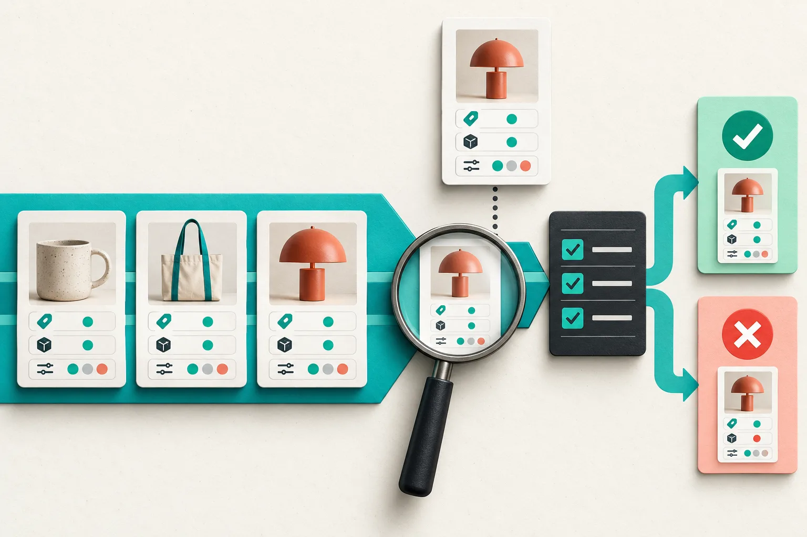
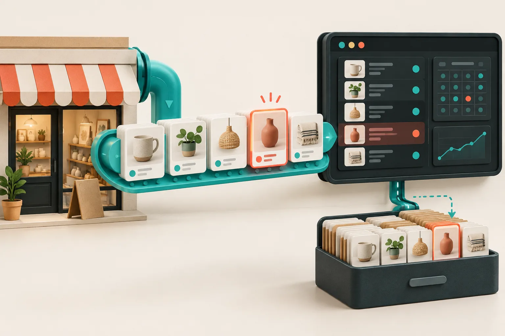

# Etsy Catalog Feed Smoke Test: 6 Checks Before You Connect Meta

An Etsy catalog feed is worth smoke-testing before you give it to Meta Commerce Manager. The short version: make a small, deliberate fixture set in Etsy, then confirm that the feed exposes the same title, price, availability, image, and variation logic you expect. Only then is it useful to schedule imports or build product tags around it.

I use this pass because a feed can be reachable and still be wrong in the ways that matter to shoppers: the sale item is stale, the color option is not a separate purchasable row, or the one made-to-order listing has silently changed the catalog’s behavior. [Catalog Generator for Etsy](https://catalog-generator.webyze.com/) reads listings and can expand priced options into their own catalog rows, so the setup is a good place to make those choices visible before the destination catalog is involved.



## Start with a six-listing fixture, not the whole shop

Pick listings that make assumptions obvious. I usually choose one ordinary in-stock item, one sale item, one listing with size or color pricing, one low-stock item, one personalized item, and one that is inactive or a draft if I need to know how that setting behaves. This is a test set, not a new collection strategy.

Write down the expected result next to each Etsy listing before opening the feed URL. That turns “looks fine” into a comparison you can repeat. Catalog Generator’s current documentation says that priced size, color, and option variations are represented as separate rows, and that draft/inactive and personalization behavior are feed settings. Those are exactly the settings that deserve an explicit expectation.

| Check | What I compare | A pass looks like |
| --- | --- | --- |
| Identity | title and product ID | the same fixture is easy to find |
| Commerce data | price and availability | current Etsy values, including the sale case |
| Option behavior | size/color rows | every purchasable option is represented deliberately |
| Media | primary image | recognizable and connected to the right item |
| Exceptions | personalization and inactive rules | included or excluded exactly as configured |
| Change detection | one controlled Etsy edit | the new value appears after the expected refresh |

This is different from merely [connecting Etsy listings to a Meta catalog with a feed URL](https://how-to.the-lean-ecommerce.com/2026/10/13/how-to-connect-etsy-listings-to-a-meta-catalog-with-a-feed-url/). The connection is the handoff; the smoke test proves what you are handing off. If you are still choosing the initial path, this earlier walkthrough of [syncing Etsy listings to an Instagram catalog with a feed](https://how-to.the-lean-ecommerce.com/2026/10/10/how-to-sync-etsy-listings-to-an-instagram-catalog-with-a-feed/) covers that setup boundary.

## Check one variation that could embarrass you

The fixture I care about most is a product whose options are materially different: a small and large item with different prices, or colors with different stock. If those choices are separate purchasable items in the destination, they should not inherit one generic price or availability value.

Open the generated feed and inspect the relevant rows before creating the data source. Do not assume that the cheapest or first option is representative. If the behavior is surprising, change the feed setting or the source listing, then repeat the exact same fixture comparison. A small loop here is much cheaper than cleaning a catalog after product tagging has started.



## Make one controlled change and watch it propagate

A feed is not only a snapshot; the useful question is whether it stays aligned when a listing changes. Change one unambiguous field in a safe fixture, such as a price by a small amount or a short title suffix, then record the time. Refresh or wait for the interval you intend to use and confirm that exact field in the feed. Revert the test afterward if it was only a fixture.

This gives you a baseline for later troubleshooting. My earlier [Etsy listing drift check](https://the-lean-ecommerce.gitlab.io/2026/10/10/i-run-a-drift-check-after-etsy-listings-change/) uses the same idea: compare a defined source value, the feed value, and the destination value instead of guessing which system is late. When you are ready to choose the operating rhythm, the [feed-refresh scheduling guide](https://how-to-blog.gitlab.io/2026/10/12/how-to-schedule-an-etsy-catalog-feed-refresh-in-meta-commerce-manager/) is a useful companion.

## Keep the feed URL treated like configuration

Catalog Generator puts its customization choices in the feed URL. That is convenient, but it also means the link is part of your production configuration. Save it in the same place you keep channel setup notes, alongside the choices you made for variation expansion, inactive listings, and personalization.

I also keep a compact change record:

```text
feed purpose: Meta catalog test
fixture set: 6 Etsy listings, recorded 2026-11-01
variation mode: priced options expanded
exceptions: personalization reviewed; inactive excluded
last controlled change: price fixture updated and confirmed
owner: person who can change the Etsy source
```

That note makes it possible to distinguish a source-listing change from a feed-setting change later. It also gives a teammate enough context to repeat the check without reverse-engineering a mysterious URL.

## Connect only after the result is boring

The best smoke-test result is unexciting: every fixture does what the written expectation says, a controlled change reaches the feed, and the URL’s settings are documented. Then connect the data source in Commerce Manager and use the same six fixtures for the first import review.


If a row is wrong, pause at the source/feed boundary. Catalog Generator is designed to read Etsy rather than edit it, so correct the Etsy record or the feed configuration and test again; do not paper over a systemic mismatch in the destination catalog.

My next action is simple: start the [Catalog Generator free trial](https://catalog-generator.webyze.com/), build a fixture list from real listings, and save the expected values before pasting the feed anywhere. The first import then becomes a verification step, not the first time you discover what your catalog actually says.
