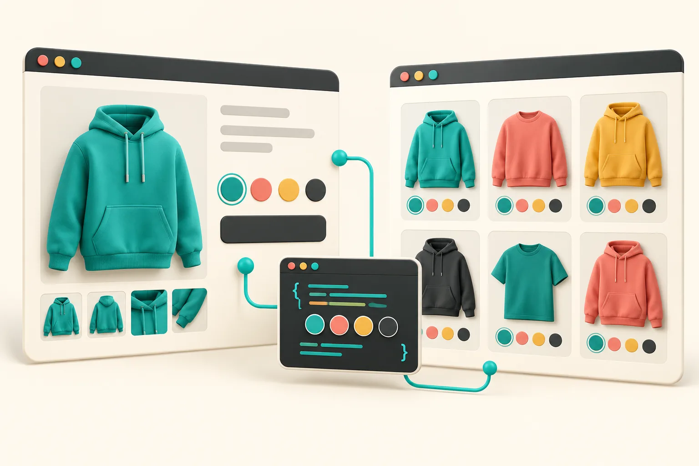

# Shopify Linked-Product Swatches: A Migration Checklist for Variant Catalogs

If a color needs its own inventory story, photography, URL, or merchandising copy, I would move it out of a mega-variant product and make it a linked product. The safe way to do that is to build a small source-of-truth matrix first, migrate one color family, then check the product and collection surfaces together. Shopify’s theme model still treats variants as purchasable choices within one product, so this is a catalog decision before it is a swatch-design decision.

[Supra Swatch Colors](https://apps.shopify.com/swatch-colors-ultimator) is useful here because it supports both variant-color swatches and links between separate product pages, including collection-page swatches. It does not make mismatched catalog data coherent, though. That part is still ours.

## Why I do not convert every color into a separate product

Variants are the lower-maintenance choice when each color shares a product story: the same description, sizing logic, media structure, and merchandising rules. Shopify documents variants as choices on a product, and theme code should handle the selected variant rather than assume a color label is the source of truth. [Start with Shopify’s variant guidance](https://shopify.dev/docs/storefronts/themes/product-merchandising/variants) if the theme has custom selectors or availability logic.

I reach for linked products only when a color behaves like a different mini-catalog item. Think seasonal photography, a different fabric story, a color-specific landing URL, or a different collection strategy. The trade-off is real: separate products mean more records to keep aligned. Swatches should help people navigate that choice, not hide a fragmented catalog.

This distinction matters because a shopper can jump from a swatch on a product page to a new URL, while a variant change normally stays on the same product. I had already used product images as swatches in a simpler single-product setup; [that approach is still useful when images, not separate pages, are the thing shoppers need to distinguish](https://the-lean-ecommerce.github.io/2026/10/10/i-used-product-images-as-shopify-swatches-before-designing-color-chips/).


## Build the migration matrix before configuring a swatch

My practical rule: every visible swatch needs one canonical color name, one destination, and one visual source. I make the table in a spreadsheet or a product-data repository before I touch the app. It catches the annoying problems: `Stone` on the card, `Oat` in the product title, and an image that is actually a different dye lot.

| Field | Example | Why it is needed |
| --- | --- | --- |
| Canonical color key | `cedar-red` | Stable internal key; do not use a translated display label as the identifier. |
| Shopper label | `Cedar Red` | What the swatch tooltip and product page communicate. |
| Destination handle | `field-jacket-cedar-red` | The one page a linked swatch must open. |
| Swatch source | image or controlled hex | Lets design choose a consistent visual treatment. |
| Availability rule | publish / hide / sold-out | Prevents a swatch from advertising an unavailable destination. |
| Collection check | jackets, new arrivals | Names the grids that must match the product page. |

I keep the mapping deliberately boring. Here is the shape I want my catalog team to be able to review:

```json
{
  "colorKey": "cedar-red",
  "label": "Cedar Red",
  "handle": "field-jacket-cedar-red",
  "swatchSource": "product-image",
  "collectionsToCheck": ["jackets", "new-arrivals"]
}
```

This is also where I decide what *not* to migrate. If the only difference is a common color option and the product page, stock, and story are otherwise shared, keeping it as a variant is usually the cleaner model. For that decision boundary, compare this matrix with the [variants-versus-linked-products test](https://productivity-tech-business.sktch.io/home/i-tested-a-rule-for-shopify-variants-vs-linked-products-QHm7+daKgZK_E+oFXEsDYg).

## Make one pilot group prove the linking rule

Do not begin with a hundred products. I use a three-color group where each destination is published, has a representative image, and has no special sale or preorder logic. Then I configure the group in [Supra Swatch Colors](https://apps.shopify.com/swatch-colors-ultimator), using the same canonical key and the same display order as the matrix. The app advertises linked-product and variant swatches, customizable color and image treatments, and collection-page support; confirm the exact available controls in the [current Shopify App Store listing](https://apps.shopify.com/swatch-colors-ultimator) before standardizing a workflow around them.

For the pilot, I check four transitions manually:

1. Select each swatch on the product page and confirm the destination URL and selected state match.
2. Load each target product directly, not only through the swatch, so the reverse links are present too.
3. Check an unavailable combination or unpublished target; decide whether it should be hidden, visibly unavailable, or excluded from the group.
4. Check the group in a collection grid at mobile width as well as on the product page.

That last check is easy to skip. It is why I treat product and collection cards as one interface contract, not two templates that happen to contain circles. I wrote a separate [collection-page swatch audit](https://the-lean-ecommerce.com/blog/i-audit-shopify-collection-swatches-before-i-touch-a-product-template-QDm7+daKgQ2pNeujfq9Ukg) for the things that commonly drift: order, imagery, availability, and destination.


## Use a rollout order that makes regressions obvious

The rollout order I trust is: one group, one collection, then one product type. After every expansion, compare the matrix to what a shopper sees. That gives me a small blast radius when an old theme script, translation, or product card snippet is still reading a variant label.

A compact acceptance checklist:

- The visible label is the intended shopper-facing name in every enabled language.
- Each swatch opens the mapped handle; it never falls back to a near-match.
- The selected swatch is visually clear without relying on color alone.
- The same color order appears on product and collection surfaces.
- A product removed from sales channels does not remain a live-looking destination.
- A keyboard-only pass can reach and identify the selector.

The third item is not decorative. A thin outline, selected-state label, or tooltip gives customers more than a red-versus-green guess. If you are rebuilding the selector itself, Shopify’s [variant-support documentation](https://shopify.dev/docs/storefronts/themes/product-merchandising/variants) is the place to validate how your theme updates selected options and availability.

## Keep the swatch system from becoming a second catalog

The maintenance trap is letting the app configuration become the only place that knows the relationships. My matrix stays authoritative, and I update it when a color launches, retires, or gets renamed. A swatch app should render a relationship that the catalog owns—not become a shadow product-information system.

This is why I would not promise that linked products are automatically better for conversion or support. They can improve browsing when color truly changes the product story, but they also add synchronization work. For a straightforward color option, variants are more honest. For distinct product pages, linked swatches make the navigation explicit.



## My next action before moving a real color family

Create the six-column matrix for one color family, choose three published products, and run the four-transition pilot before configuring the rest. If you need both linked-product and variant swatches without editing theme code, start with the [Supra Swatch Colors listing](https://apps.shopify.com/swatch-colors-ultimator), then make your catalog mapping the document the implementation has to satisfy.

The point is not to add prettier circles. It is to give shoppers a consistent, truthful path from a color choice to the product they can actually buy.
