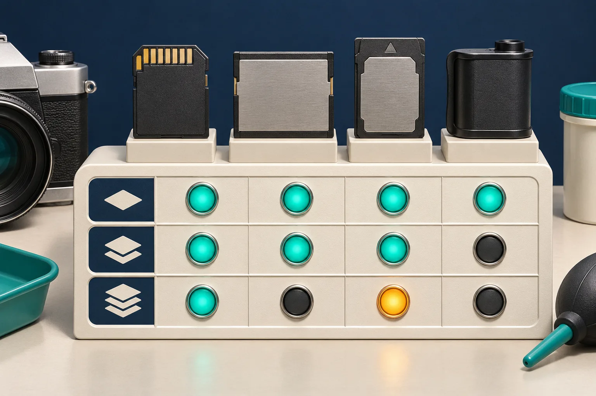
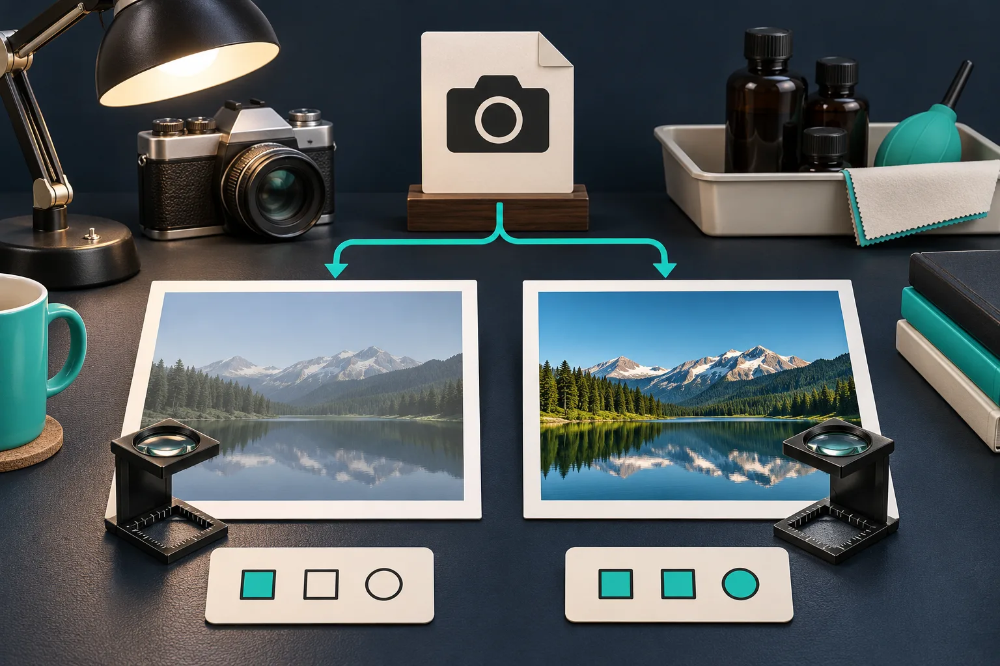

# How I Keep Browser RAW Previews Fast Without Trusting Them Too Much

A browser RAW preview should do one job well: let a shopper, photographer, or support teammate decide whether a file is worth keeping before the tab locks up. I keep the heavy decode in a worker, ask for the smallest useful result first, and treat that result as a preview—not proof that my final renderer is correct. [FlashRaw](https://flashraw.ybouane.com/) gives JavaScript and WebAssembly applications a local decoding path, but the architecture around it is what keeps the upload flow useful.

## Start with the decision, not the full image

It is tempting to accept a RAW upload, decode a full RGB image on the main thread, and call the first visible pixels a win. On a big camera file, that turns one curious click into a frozen product tool. It also confuses two different questions:

1. Can I show something quickly enough for the user to continue?
2. Can I produce the colour-managed output that this application is willing to ship?

Those are not the same test. An embedded preview can answer the first question quickly when one exists. A developed RGB frame is what I use for the second. FlashRaw documents both preview extraction and display-ready RGB output, while keeping the underlying sensor metadata available for a more deliberate pipeline.

For a browser uploader, my first response target is modest: identify the file, show its camera metadata when available, and return either an embedded preview or a clearly labelled low-cost developed result. The full-resolution export can wait until the user chooses it.

## Put decoding behind a worker boundary

The main thread owns the interaction: file picker, progress state, cancellation, and the preview element. A dedicated worker owns byte parsing and decoding. That split matters more than a clever loading spinner because a worker prevents CPU-heavy work from blocking the page event loop. The [MDN Web Workers guide](https://developer.mozilla.org/en-US/docs/Web/API/Web_Workers_API/Using_web_workers) is still the right baseline for the messaging and ownership model.

My minimum message contract looks like this:

| Message | Main-thread responsibility | Worker responsibility |
| --- | --- | --- |
| `inspect` | Send the chosen file and a request id | Read container and return metadata or a structured error |
| `preview` | Request the smallest acceptable preview | Extract embedded preview or make a bounded preview result |
| `develop` | Only after user intent | Decode and develop the requested output with explicit settings |

This is deliberately a contract, not a fake promise that every RAW file has the same fast path. In particular, make transfer and copy behaviour part of the test plan: large buffers can erase the responsiveness you thought the worker bought you. If you are already working through browser image variants, my notes on [browser-ready product image variants](https://the-lean-ecommerce.github.io/2026/10/16/i-build-browser-ready-product-image-variants-without-starting-over/) are a useful companion: a preview asset and a publishable asset should have separate acceptance rules.

## Treat support as a matrix

The extension is not enough. RAW support varies by camera, compression mode, bit depth, and sometimes crop or burst mode. FlashRaw’s [format matrix](https://github.com/ybouane/flashraw/blob/main/docs/formats.md) labels support at that level and documents unsupported cases, including Nikon High Efficiency NEF variants in its corpus. That is much more useful than telling users that “NEF works.”

Before I enable a camera family in production, I keep a tiny fixture register:

- exact camera model and firmware, if known;
- file extension, compression mode, and dimensions;
- whether inspection works;
- whether an embedded preview exists;
- whether the developed result passes visual review;
- the fallback message when any step fails.

FlashRaw reports coverage and limitations against the raw.pixls.us corpus, but that is evidence for the documented corpus—not a substitute for your camera fleet. For a deeper decoder-selection pass, keep the [RAW decoder reference guide](https://outils-et-tutoriels.gitlab.io/guides/2026/10/30/guide-de-reference-choisir-un-decodeur-raw-pour-une-application-photo/) nearby; before adding a previewer, the [browser upload-validation guide](https://how-to.the-lean-ecommerce.com/2026/10/27/how-to-validate-browser-camera-raw-uploads-before-building-a-previewer/) is the more operational starting point.

## Make the preview’s limits visible

An embedded JPEG preview is great for triage. It may not reflect your demosaicing, white balance, colour transform, crop handling, or orientation path. A decoded RGB image has different trade-offs: more work, more memory, and an actual rendering policy to defend.

I use this small acceptance gate before calling a browser preview feature done:

| Check | Preview path | Final-render path |
| --- | --- | --- |
| File opens without blocking UI | Required | Required |
| Camera and orientation look plausible | Required | Required |
| Product colour is approved | Not sufficient | Required on fixtures |
| Crop and active area are intentional | Helpful | Required |
| Unsupported file has a useful recovery path | Required | Required |

For colour-critical catalog imagery, I do not let a quick preview approve a listing. I preserve the RAW or original upload, use a reviewed export path, and compare representative fixtures against the application’s intended RGB output. The same caution applies to a migration from an older decoder: a successful decode does not establish visual parity. FlashRaw’s [benchmarks](https://github.com/ybouane/flashraw/blob/main/docs/benchmarks.md) are reproducible and scoped to specific machines, files, modes, and competitors; use that methodology as a model rather than turning a median into a universal speed claim.

## A practical rollout order

I would ship this in four small moves:

1. **Inspect first.** Return format status and metadata, with a safe unsupported-file message.
2. **Preview second.** Keep the work in a worker and bound the output size; log timing and memory on real target devices.
3. **Develop third.** Add RGB output only when you can name the colour space, orientation policy, and fixture checks.
4. **Export last.** Make full-resolution output an intentional action with cancellation and a clear wait state.

That order gives the user a useful answer early and gives the team room to learn which cameras actually arrive. If you need a current compatibility decision before rollout, start with FlashRaw’s [official format documentation](https://github.com/ybouane/flashraw/blob/main/docs/formats.md), test the exact files you expect, then decide whether the worker preview is enough for the job.

The next action is simple: collect five representative RAW files, run them through an inspect/preview/develop fixture sheet, and make the first unsupported result as helpful as the first successful one.
