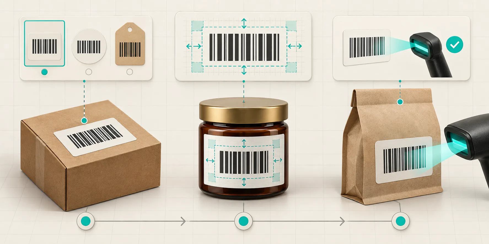
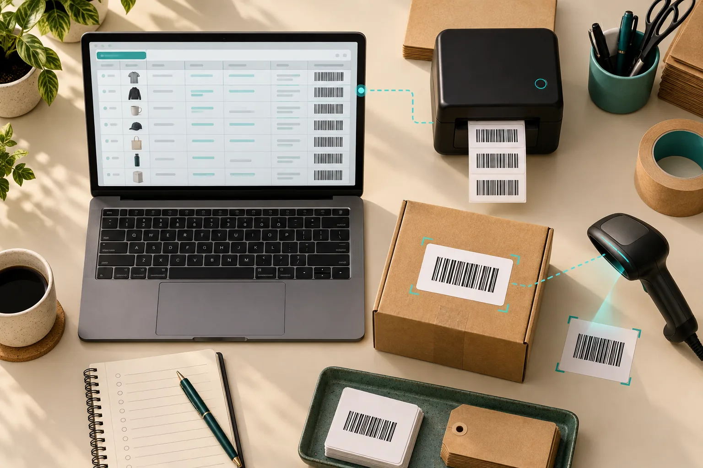
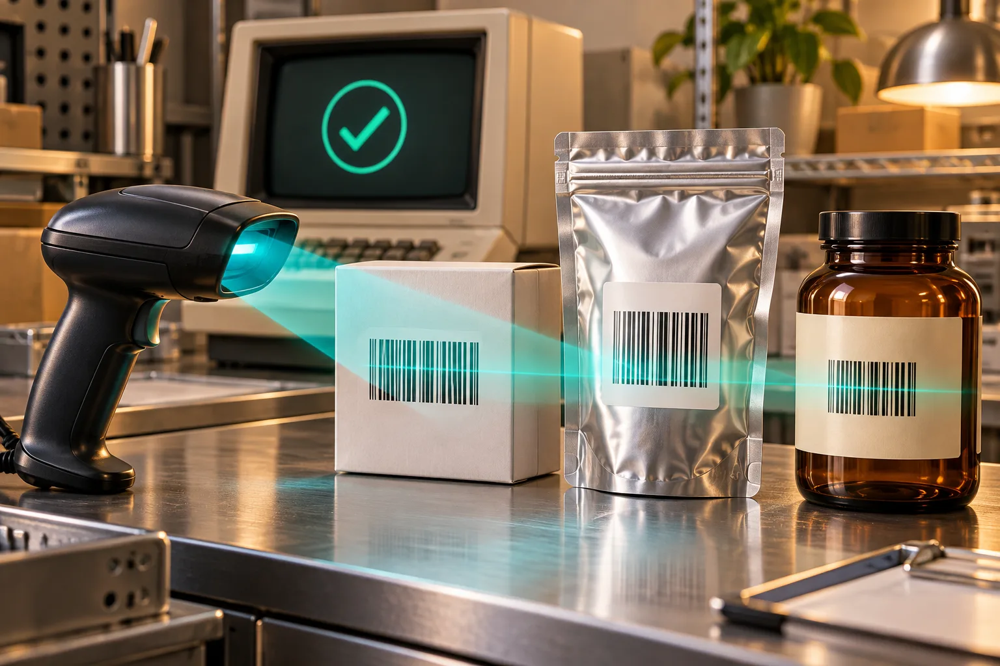

# How to Make a Barcode Proof Sheet Before Shopify Packaging Goes to Print

The safest way to prepare barcodes for Shopify packaging is to make a one-page proof sheet first: map each sellable variant to its approved identifier, generate a visual proof, then scan printed samples on the actual package material. A browser generator is useful for the proofing step, but it does not assign a GTIN or replace a formal verifier when a retailer requires one.

I use this gate before a label order becomes expensive inventory. It catches the unglamorous failures: a bottle variant that inherited the parent SKU, a code pushed too close to a die line, or a glossy pouch that scans on a laser printout but not after production. The practical tool in the middle is [Tiny Online Tools’ Barcode Generator](https://tiny-online.tools/utility-tools/barcode-generator), which can export a generic barcode proof as PNG or SVG. The work before and after that export matters more than clicking Generate.

## The barcode proof sheet I hand to a printer

My proof sheet has one row per sellable unit—not one row per product page. If a small and large jar are scanned, stocked, or sold as different trade items, they need separate identity decisions. GS1 explains that one GTIN represents one product identity, and that a GTIN is not a decorative number to reuse across changed items. Start with the source of truth, not with the artwork file.

| Proof field | What I record | Why it prevents rework |
| --- | --- | --- |
| Shopify variant | Handle, option values, SKU | Makes the row traceable back to the catalog |
| Identifier owner | Existing GTIN, internal code, or retailer requirement | Stops a random generated value becoming product identity |
| Symbology and data | The format and exact data to encode | Keeps packaging, scanner, and channel requirements aligned |
| Placement | Panel, orientation, label size, die-line reference | Exposes folds, seams, and curved surfaces early |
| Print test | Material, printer, scanner, pass/fail | Captures what a screen cannot prove |

That first column matters when a catalog is being reorganized. My [linked-product swatch migration checklist](https://the-lean-ecommerce.github.io/2026/11/01/shopify-linked-product-swatches-a-migration-checklist-for-variant-cata/) is the same principle in another form: customer-facing choices and internal records must agree before a theme change or packaging order amplifies a mismatch.

## 1. Decide whether this is a retail code or an internal workflow label

A barcode generator can encode many kinds of values. That flexibility is great for internal bins, sample kits, and pick-pack labels. It is not permission to invent a retail identifier. For a retail trade item, confirm who assigned the GTIN and which barcode is accepted at the place it will be scanned. GS1 notes that a GTIN can be represented in different barcode types depending on where the item is scanned.

For each row, I make this decision explicit:

- **Internal operations only:** encode the controlled value your warehouse workflow expects; test it with the scanner and software that will consume it.
- **Retail or marketplace fulfillment:** preserve the approved identifier and follow the channel’s barcode requirements. Ask the retailer or printer when the required symbol is unclear.
- **Changing a variant or pack:** pause rather than copying the old artwork. Reconfirm whether the product identity is still valid.

This is also why I keep a catalog feed smoke test separate from package design. In the [Etsy catalog feed smoke test](https://the-lean-ecommerce.github.io/2026/11/01/etsy-catalog-feed-smoke-test-6-checks-before-you-connect-meta/), an identifier problem should be caught in a small sample before it reaches a downstream channel.

## 2. Generate a proof, then protect its whitespace

Paste only the approved value into the [Barcode Generator](https://tiny-online.tools/utility-tools/barcode-generator). Pick the required format, leave enough label area around it, and export the proof alongside the catalog row. I label the exported file with the Shopify handle and variant option so it cannot drift into another SKU’s artwork.

The common layout failure is treating the blank area around a barcode as optional. Those clear margins are quiet zones. GS1’s barcode-quality guidance specifically calls out quiet-zone size, contrast, symbol size and height, package wrapping, damage, and placement on cylindrical packaging as things to check. In other words, a code that looks centered in Figma can still be a fragile production choice.

My practical layout rule is simple: never let a decorative border, fold, seam, foil edge, or background pattern creep into the code or its clear margin. For a curved container, proof the actual panel and placement—not a flat rectangle that only exists in the design file.

## 3. Run the proof through this four-part check

Before approving packaging, I mark every row with these four checks:

1. **Identity:** Does the encoded value match the approved catalog and channel record exactly?
2. **Geometry:** Are the bars unscaled and clear of folds, edges, and artwork? Are the quiet zones preserved?
3. **Material:** Does the chosen ink, finish, and substrate keep enough contrast? Gloss, wrinkles, and transparent film change the result.
4. **Readability:** Can the intended scanner read a physical sample repeatedly in the real orientation?

A handheld scan is an operational smoke test, not a standards-grade verification. If a retailer, distributor, or compliance program needs a documented grade, use a printer or barcode verifier that meets the applicable specification. GS1 distinguishes a verifier—which measures and grades print quality—from an ordinary data-capture scanner. That distinction has saved me from overclaiming a successful desk scan.

## 4. Keep the proof sheet with the launch record

I attach the approved proof sheet, exported barcode image, packaging PDF, and scan notes to the same launch card as the variant update. It makes the next replenishment much less mysterious. It also creates a sensible rollback trail when a supplier sends revised artwork.

This pattern matches the way I approach [Shopify product-page questions](https://the-lean-ecommerce.github.io/2026/10/25/i-rebuilt-my-shopify-product-page-around-shopper-questions/): make the underlying product decision explicit before polishing the presentation. And if the source catalog is a vendor CSV, clean duplicates and ownership ambiguity first; I previously covered that handoff risk in [cleaning duplicate Shopify CSV rows](https://the-lean-ecommerce.github.io/2026/10/19/i-cleaned-duplicate-shopify-csv-rows-before-a-contractor-handoff/).

## A small gate with a large payoff

A barcode proof sheet is not a replacement for GS1 licensing, channel requirements, or formal verification. It is the lightweight operational layer between your Shopify catalog and a costly packaging run. Use it to force four answers—what the code represents, where it will sit, how it will be printed, and how it will be read—before the first carton arrives.

Open the [Barcode Generator](https://tiny-online.tools/utility-tools/barcode-generator), build one proof row for a high-risk variant, print it at intended size, and scan the real material. If that row is not trustworthy, do not send the whole packaging set to print.
