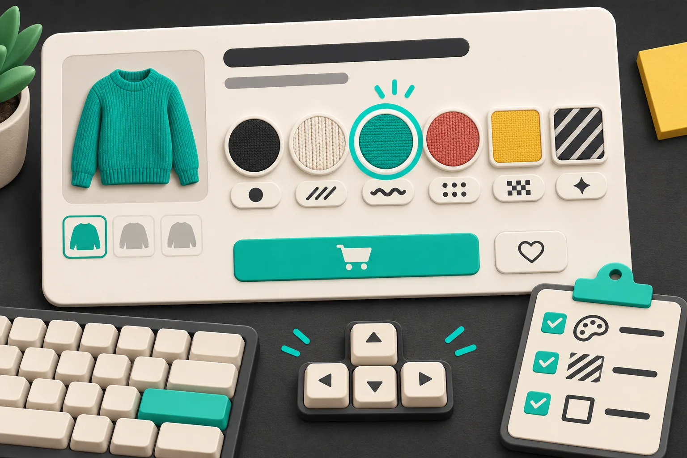
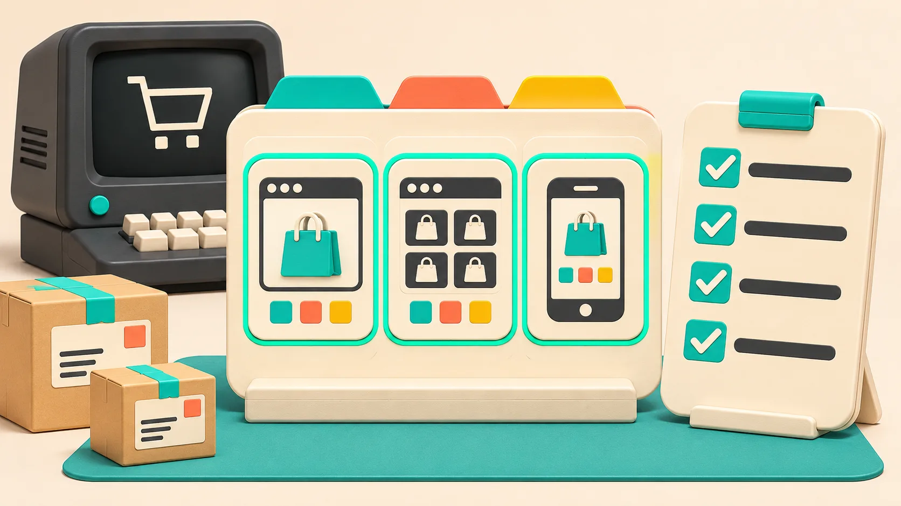

I used to treat a color-swatch rollout as a visual task: set the chips, check the product page, ship. That missed the people who reach the same option with a keyboard, a small screen, or a color-vision difference. My release rule now is simple: every swatch must have a visible keyboard focus state, a cue beyond color, and a short test on the product page, collection grid, and mobile. [Supra Swatch Colors](https://apps.shopify.com/swatch-colors-ultimator) is useful here because it can present color or image swatches for both variants and linked products without requiring a theme-code detour for the basic setup.



## The small failure I look for first

A row of red, green, and black circles can look finished while still hiding its state. If the selected option is only marked by a hue change, a shopper may not know what is selected. If focus disappears while tabbing, a keyboard user has no reliable way to continue. Shopify’s [theme accessibility guidance](https://help.shopify.com/en/manual/online-store/themes/customizing-themes/accessibility) specifically calls for a clear focus indicator on interactive elements and says color alone should not carry meaning.

That changes my question from “Do these swatches look on-brand?” to “Can I tell what each control does and where I am without relying on a mouse or color?” The answer should be yes before I spend time polishing a tooltip.

## My three-surface swatch test

I use one representative product with enough colors to expose wrapping, then run this little matrix. It works whether the color choice is a Shopify variant or a linked product.

| Surface | What I do | Pass condition |
| --- | --- | --- |
| Product page | Tab from the product title into the options | Every swatch receives a distinct, high-contrast focus treatment |
| Product page | Select two colors using keyboard only | The chosen state is apparent through an outline, label, check, or text—not only a fill color |
| Collection page | Open cards with several swatches | Swatches do not obscure the product link, price, or quick-add control |
| Mobile | Repeat at a narrow viewport | Targets remain easy to distinguish and the focus/selected state does not clip |

For native theme data, Shopify exposes a [`swatch` Liquid object](https://shopify.dev/docs/api/liquid/objects/swatch) with color and image properties for product option and filter values. That is useful context, but it does not turn into an accessible control by itself. The markup, labels, selected state, and focus styling still decide whether the experience is understandable.

## Wire the meaning in before styling the chip

When I can inspect the rendered control, I want a real button or labeled input rather than a clickable `div`. The implementation will vary by theme and app, but the contract is consistent:

```html
<button
  type="button"
  class="swatch"
  aria-pressed="true"
  aria-label="Color: Atlantic Teal, selected"
>
  <span aria-hidden="true" class="swatch__color"></span>
  <span class="visually-hidden">Atlantic Teal</span>
</button>
```

That does not mean every swatch needs visible text underneath. It means the color name must be available in the control’s accessible name, and selection should have a second, durable visual cue. I usually reserve a 2–3px outline plus a small check or selected label. Avoid removing `outline` without replacing it: Shopify’s own guidance calls out focus visibility, and a subtle box-shadow that vanishes against one color is not a replacement.

[Supra Swatch Colors](https://apps.shopify.com/swatch-colors-ultimator) supports both color and image swatches, linked products, and collection-page swatches. I configure its display settings first, then use the test above against the actual theme rather than assuming a settings preview proves the storefront behavior. If the catalog has patterned or texture-led choices, image swatches can help the decision—but they still need an accessible name and a visible selected treatment.

## Don’t let the collection grid be the forgotten surface

Product-page swatches get attention because the shopper is already committed. Collection cards are where a compact swatch row can accidentally compete with the card link, truncate labels, or move the grid around. That is especially likely when a product has more colors than the tidy demo product.


I test three products in one collection: one with two colors, one with five or six, and one with a long color name or an image swatch. Then I check desktop and mobile. This is also a good place to borrow a lesson from my [linked-product swatch migration checklist](https://the-lean-ecommerce.github.io/2026/11/01/shopify-linked-product-swatches-a-migration-checklist-for-variant-cata/): use a small, representative slice first. It catches card-layout problems before the whole catalog changes.

If I need the storefront color vocabulary cleaned up before QA, I use the normalization workflow from [this color-name guide](https://how-to-blog.gitlab.io/2026/11/04/how-to-standardize-shopify-color-names-before-you-add-swatches/). Consistent names make labels, tooltips, screen-reader announcements, and support replies less ambiguous.

## A five-minute pre-launch pass

Right before publishing, I do this in a private theme preview:

1. Use `Tab`, `Shift+Tab`, `Enter`, and `Space` from the product title through every color choice.
2. Confirm the focused swatch is obvious against the page background and against the swatch itself. Shopify recommends at least 3:1 contrast for non-text UI components; I treat that as the floor, not the finish line.
3. Select two neighboring colors and confirm a non-color selected cue persists after focus moves away.
4. Test one unavailable choice. It should look and behave unavailable rather than merely becoming a mysterious dull chip.
5. Repeat on a collection card and on a phone-width viewport.

This is deliberately lightweight. It is not a full accessibility audit, and it does not promise that any app or theme is automatically WCAG-conformant. It is the release gate that catches the most expensive easy mistake: shipping a visual option picker that only works when someone can see, point, and infer.



## Make the next swatch change safer

The right swatch implementation depends on whether a color is a variant or a separately merchandised product. If you are still deciding that architecture, my [variant-versus-linked-product decision rule](https://productivity-tech-business.blogspot.com/2026/11/when-should-shopify-color-be-separate.html) is the place to start. And if the question is whether a chip actually represents the product shoppers receive, the [product-matching swatch guide](https://tools-and-how-tos.github.io/2026/10/16/how-to-choose-shopify-swatches-that-match-the-product-not-just-the-var/) is a useful companion.

Once the catalog structure is settled, [install Supra Swatch Colors](https://apps.shopify.com/swatch-colors-ultimator), configure the product and collection experience, and run the three-surface test on one real product before expanding it. A visible focus ring and a durable selected cue are small details. They are also the difference between a swatch system that merely looks finished and one that customers can actually use.
