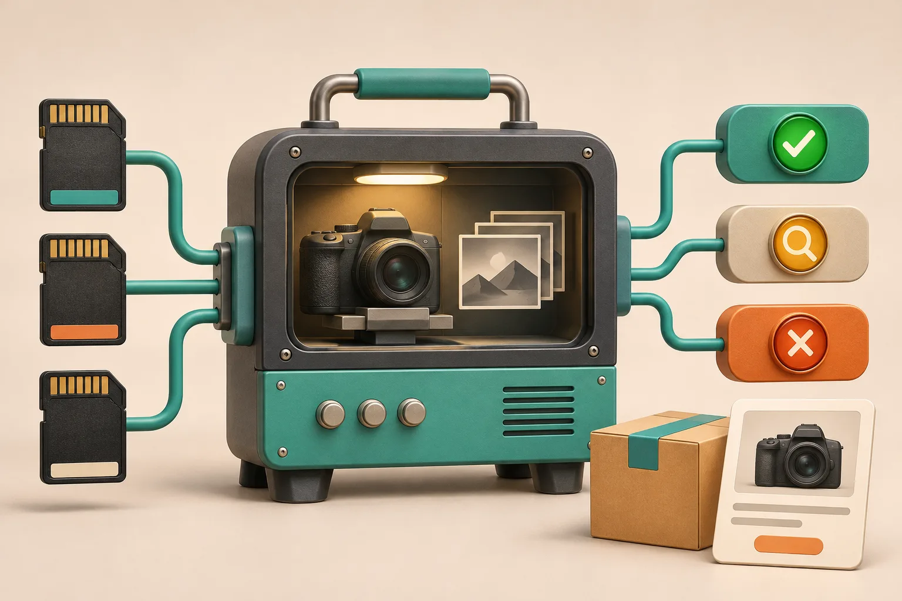
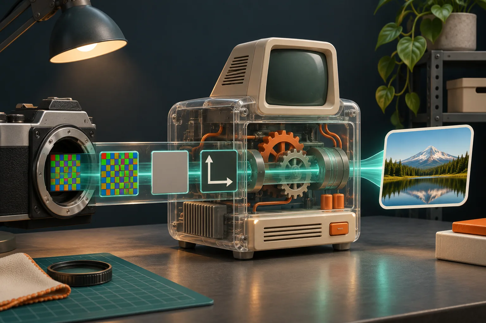

# A Camera RAW Fixture Gate for Shopify Upload Releases

When a store lets a team upload camera RAW files before turning them into product images, I do not call the feature ready because one `.CR3` opened on my laptop. I make a small fixture gate first: named camera files, an expected result for each file, and a clear decision when a decoder should reject it. That catches the expensive failure—an upload that looks supported until a customer-facing image job cannot make a trustworthy product asset.

[FlashRaw](https://flashraw.ybouane.com/) is useful here because it can decode RAW data, extract previews, and produce display-ready RGB through native and browser-oriented integrations. It is still a component, not a promise that every extension, camera, or rendering intent will work the same way. Its [format matrix](https://github.com/ybouane/flashraw/blob/main/docs/formats.md) tracks support by mode and compression variant, which is exactly how I would test an upload path.

## The release question is not “does this extension open?”

A RAW filename tells you almost nothing useful about production behavior. A `.NEF` might be a common lossless file, a compressed variant, or a mode your chosen decoder detects but declines. A successful sensor decode also does not prove that orientation, white balance, crop, preview extraction, or the final RGB product image matches what your storefront needs.

My gate has four assertions for every fixture:

| Check | Expected result | Why it matters to a Shopify workflow |
| --- | --- | --- |
| Identification | The pipeline identifies camera, format, and relevant mode | Routes can show a helpful supported/unsupported message instead of guessing from an extension. |
| Decode | The job either produces sensor data or a documented error | Prevents a stuck background job after an upload appears accepted. |
| Product derivative | A preview or display-ready image is made at the requested size | Confirms that the thing the merchandiser needs actually exists. |
| Metadata | Orientation and basic capture metadata are retained or intentionally ignored | Avoids sideways, strangely cropped, or incorrectly processed product media. |



The matrix matters. At the time of writing, FlashRaw documents corpus coverage by individual format/mode and marks unsupported inputs explicitly; for example, its documentation calls out Nikon High Efficiency NEF files as recognized but not decoded while metadata and previews can still work. That is a better product decision than silently treating every NEF as a universal success.

## Build a five-file fixture pack before wiring the uploader

I start small, then add files that represent the camera mix my merchants actually use. Do not put customer originals in a public repo. Use files you can lawfully retain for test purposes, record their origin, and keep their checksums with the fixture manifest.

Here is the initial pack I use for an ecommerce ingest proof:

1. **Known-good common capture.** One camera file from the format and compression mode you expect most often—for example, a documented CR3, NEF, ARW, RAF, or DNG variant.
2. **A second camera family.** This makes sure the upload route has not accidentally become tuned only for one vendor.
3. **A large but valid file.** Record its dimensions and bytes so memory and timeout behavior have a real boundary.
4. **A supported file with awkward metadata.** A rotated capture or a file where crop and white-balance data matter is more revealing than another straight-on frame.
5. **A deliberate negative fixture.** Use a documented unsupported or malformed sample and assert the user-facing error, cleanup, and retry behavior.

That last file is not pessimism. It lets the team decide whether the product should offer “preview available, full processing unavailable,” reject the upload, or send it to a slower fallback. The right branch depends on the workflow. A private studio import tool can afford an exception queue; a self-serve Shopify app needs a fast, legible answer.

For a wider browser-focused intake check, I would pair this gate with the earlier guide on [validating camera RAW uploads before building a previewer](https://how-to.the-lean-ecommerce.com/2026/10/27/how-to-validate-browser-camera-raw-uploads-before-building-a-previewer/).

## Decide what “pass” means before you compare decoders

I keep the expected result in a compact manifest rather than reviewing files by eye after every dependency update:

```json
{
  "id": "nikon-orientation-case",
  "input": "fixtures/nikon-orientation.nef",
  "expect": {
    "status": "decoded",
    "preview": true,
    "orientation": "preserved",
    "displayRgb": true
  }
}
```

The labels are deliberately modest. “Decoded” means the pipeline produced the layer you asked for; it does not mean the output is automatically a color-perfect replacement for another RAW engine. For a migration, compare the result that matters to your product: a fast embedded preview, a product-card JPEG, sensor samples for another tool, or a full color-managed RGB export.



FlashRaw publishes [reproducible benchmarks](https://github.com/ybouane/flashraw/blob/main/docs/benchmarks.md) that separate sensor decode from RAW-to-RGB and color-managed output. That distinction is worth preserving in your own acceptance tests. “Faster decode” does not answer “does my product image job finish sooner with acceptable color?”

For teams moving a legacy C/C++ pipeline, the related [LibRaw-compatible shim test plan](https://the-lean-ecommerce.gitlab.io/2026/11/05/i-test-a-libraw-compatible-shim-before-i-replace-the-decoder/) is a good reminder to rebuild and test the actual API subset. Source compatibility is not binary compatibility, and output behavior is still yours to sign off.

## Add the guardrails that make failures boring

A fixture gate should exercise the same path your application uses: upload validation, worker handoff, decoder, derivative storage, and status response. It should also make bad inputs uninteresting:

- put a byte-size ceiling in front of decoding;
- set a worker timeout and clean up partial derivative files;
- record the decoder version and fixture checksum with a failed job;
- preserve the original only under your product’s retention rules;
- return a specific unsupported-format state rather than a vague “processing failed.”

If your browser path uses threaded WebAssembly, test its deployment headers too. Cross-origin isolation is a deployment property, not a local-development assumption; MDN’s documentation on [COOP](https://developer.mozilla.org/en-US/docs/Web/HTTP/Reference/Headers/Cross-Origin-Opener-Policy) explains its role in browsing-context isolation. This is one reason I do not consider a local browser demo sufficient evidence for a production upload route. The [private browser RAW preview with Web Workers](https://how-to-blog.gitlab.io/2026/10/27/how-to-build-a-private-browser-raw-preview-with-web-workers/) walkthrough is useful when that worker boundary is part of the design.

## Run the gate on every meaningful change

Run it when you change the decoder version, WASM build flags, worker configuration, image-derivative settings, or the storage handoff. I also run it before a merchant enables a new camera family for a catalog shoot. A five-file gate is cheap; discovering that one selected camera mode cannot become a usable product image after a campaign is staged is not.


My release checklist is simple:

1. Each required fixture has the expected accept, reject, or limited-support result.
2. Successful fixtures produce the exact derivative the product promises.
3. Orientation and display intent are checked where they affect the result.
4. A negative fixture gives a clear status and leaves no orphaned work.
5. The record includes decoder version, runtime target, and fixture checksum.

## Start with the product decision, then test the bytes

FlashRaw is a strong option to evaluate when your team wants a Rust-based RAW decoding component with practical native or browser paths. Start with its [format documentation](https://github.com/ybouane/flashraw/blob/main/docs/formats.md), select fixtures that mirror your customer cameras, and decide whether you need decode, preview, or display-ready RGB before you optimize anything.

Once the five-file gate is green, make it part of the release path—not a one-time research spike. That turns RAW support from a vague upload claim into an observable ecommerce capability.
