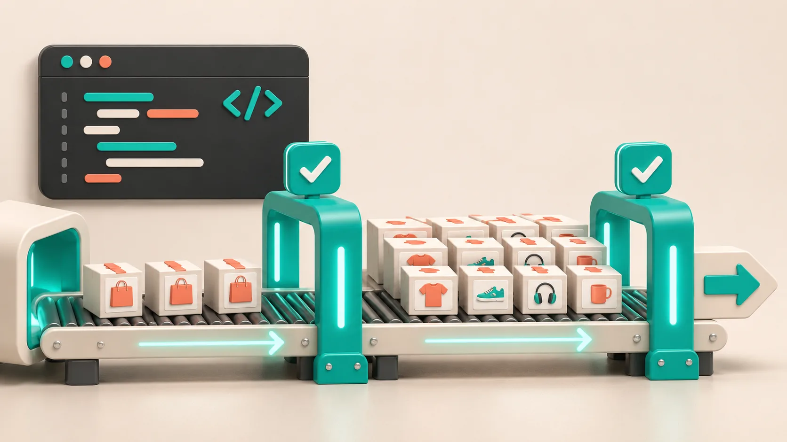

# I Reconcile Shopify Bulk Edits With a Five-Record Receipt

A Shopify bulk edit is not finished when the task says it ran. It is finished when I can point to a small, deliberate set of records and show that each one changed exactly as intended. My practical answer is a five-record receipt: one plain product, one multi-variant product, one edge-case product, one excluded record, and one storefront check. It takes minutes, but it catches the kind of catalog drift that turns a tidy cleanup into a long afternoon.

That receipt fits nicely after a careful preflight like [this bulk-update workflow](/2026/09/02/how-i-run-safe-shopify-bulk-updates-without-spreadsheet-roulette/). Preflight protects the input; reconciliation proves the result.


## Why I use a receipt instead of a giant spot check

Looking at twenty random products feels responsible, but it rarely tests the assumptions that mattered in the task. A catalog change normally has a rule: append a tag, replace a supplier phrase, alter a metafield, round prices, or move a group into a collection. The useful verification set deliberately covers the shapes that could react differently to that rule.

For a Shopify task, I write the intended change in one sentence before I run anything: "Add `winter-warehouse` to active outerwear products tagged `clearance-2026`; do not change variants, prices, or products outside that selection." That sentence becomes the receipt header. If I cannot write it cleanly, I am not ready to bulk edit.

[Ultimator Bulk Editor](https://apps.shopify.com/ultimate-bulk-editor) is built around selecting products or variants, defining the update, and running it immediately or on a schedule. Its current listing also identifies product and variant fields such as tags, prices, inventory, SKU/barcodes, metafields, collections, and SEO updates. That breadth is useful, but it is also why one field per task is a sensible operating constraint.

## The five records I keep

Here is the whole receipt. I save the handles or admin links before starting, then record the observed result after the task completes.

| Record | Why it belongs | What I confirm |
| --- | --- | --- |
| Plain product | The normal case | The intended field changed once |
| Multi-variant product | Product and variant data can be confused | The right level changed; untouched variant values remain intact |
| Edge-case product | It exercises the boundary | A special title, tag, metafield, or status behaved as expected |
| Excluded product | It tests the selection rule | It did not change |
| Storefront record | Admin data is not the buyer experience | The visible price, collection, or product detail is correct |

I choose the edge case on purpose. For a tag cleanup, it might be a product with the old tag embedded in a longer tag. For a price operation, it might be the smallest price in the selection. For a collection task, it might be a product that already belongs to several manual collections. This is more valuable than adding three more ordinary records.



## Separate product and variant evidence

This is where I slow down. Shopify product-level fields and variant-level fields are not interchangeable. A title or collection change may appear exactly once on the product. Price, SKU, barcode, weight, and option values can exist per variant. When a bulk task touches a variant field, my receipt includes a product with several variants and I inspect each relevant variant—not just the product header.

That small distinction is the reason I avoid combining a product cleanup with a variant price update in the same task. Separate tasks create separate receipts and make a rollback conversation much less fuzzy. If I am preparing price work, I use the same caution described in [a bulk-price preflight checklist](https://tools-and-how-tos.github.io/2026/09/08/shopify-bulk-price-changes-a-safer-preflight-checklist/): define the affected records and the arithmetic before clicking run.

## Compare the result against the original rule

My receipt is not a prose note. It is a quick before/after comparison:

```text
Task: append "winter-warehouse" to selected active outerwear
Plain product: expected tag present once — pass
Multi-variant product: product tag added; 4 variant SKUs unchanged — pass
Edge case: existing "winter" tag not duplicated or replaced — pass
Excluded product: draft item still unchanged — pass
Storefront: collection filter shows intended product — pass
```

If one line fails, I stop calling the batch complete. I do not quietly repair one product and move on, because that hides whether the selection, field, or operation was wrong. I first identify the failure mode: selection too broad, operation interpreted differently, old data inconsistent, or storefront behavior delayed. Then I make a new, narrowly scoped corrective task with its own receipt.

This habit also makes more involved work less scary. A change to product types, for example, can alter how a catalog is organized downstream, so it deserves the same explicit selection and exclusion proof. The recent guide on [reconciling a Shopify bulk edit](https://tools-and-how-tos.github.io/2026/11/02/how-to-reconcile-a-shopify-bulk-edit-before-you-call-it-done/) is a good companion when you need a wider post-run review.


## Put the storefront in the receipt

Admin accuracy is necessary, not sufficient. I open the one storefront record in a clean browser session and check the buyer-facing consequence. The test changes with the task:

- For tags and product types, confirm the expected collection or filter behavior.
- For price changes, check the displayed price and compare-at presentation on the right variant.
- For SEO fields, inspect the rendered page source or a search preview later rather than assuming the admin field guarantees a result.
- For image or collection work, verify the order and visibility a shopper will actually see.

This protects against a common blind spot: the API/admin object can be correct while a theme, app block, cache, or collection rule produces a different storefront result. The same buyer-facing check is why I treat a [three-product size-chart sample](/2026/11/04/a-three-product-sample-that-catches-shopify-size-chart-mistakes/) as more than data QA.

## When this is enough—and when it is not

A five-record receipt is right for a contained, reversible update with a clear selection rule. It is not a substitute for a staged rollout when changing thousands of prices, rewriting descriptions, deleting variants, or migrating critical metafields. In those cases, run a small pilot first, confirm the receipt, then expand. A scheduled task gives you time to review the setup, but it does not replace review after execution.

My next action is simple: before your next Shopify bulk edit, choose the five records while you are still defining the task. Then use [Ultimator Bulk Editor](https://apps.shopify.com/ultimate-bulk-editor) to create a narrowly scoped product or variant update, and do not mark it complete until your receipt has five passes. That turns a bulk action from a hopeful click into a change you can explain later.
