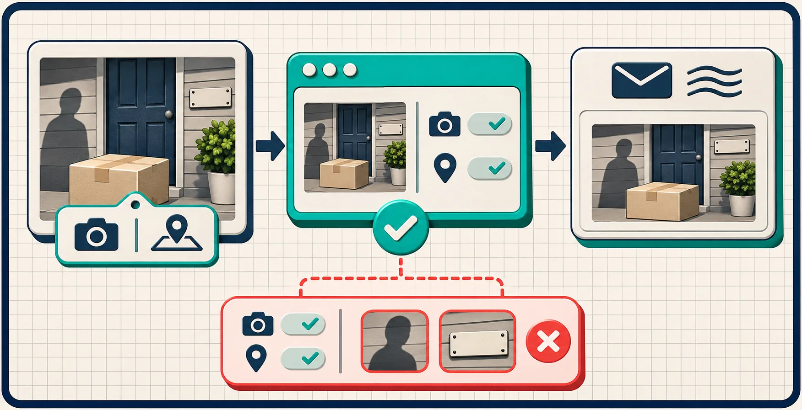

# A Shopify Product Photo Metadata Check Before You Share a Sample

I treat supplier samples and Shopify product photos as shareable only after one small check: inspect the file’s metadata, then remove it if the handoff does not need it. That will not hide a warehouse sign, a face, or an order number visible in the pixels—but it can stop camera, timestamp, GPS, and editing details from travelling with the original file. [Tiny Online Tools’ Image Metadata Viewer](https://tiny-online.tools/image-tools/image-metadata-viewer) reads metadata from JPEG, PNG, and WebP in the browser; its [Remove Image Metadata tool](https://tiny-online.tools/image-tools/remove-image-metadata) is the matching cleanup step.

This is not a big digital-asset-management project. It is a two-minute gate I use before dropping a sample into a supplier thread, a client approval folder, or a Shopify collaboration.

## Why a product image can carry more than product pixels

A polished product crop can still contain EXIF (Exchangeable Image File Format) data: camera and lens details, capture time, and sometimes location. Other metadata can record software, copyright fields, color profiles, or comments. The exact fields vary by format and export path, which is why guessing is a weak policy. Inspect the actual file you plan to send.

That distinction matters operationally. A photo shot at a studio, warehouse, customer event, or founder’s home may be perfectly acceptable visually while still carrying context the recipient does not need. I also do not assume that a destination will clean it up for me: direct downloads, attachments, and third-party tools can preserve a different version of the file.


## The three-part check I use before sharing

Here is the whole workflow. It is intentionally boring, which is why it gets used.

| Gate | What I check | What changes next |
| --- | --- | --- |
| 1. Inspect | Does this exact export contain location, time, device, or editing metadata? | Decide whether the recipient needs it. |
| 2. Separate risks | Is the sensitive detail in metadata or visible in the image itself? | Use metadata removal only for the first; crop, blur, retouch, or reshoot for the second. |
| 3. Re-check | Does the cleaned copy still look right and have the intended metadata state? | Send the derivative, keeping the original in the source folder. |

### 1. Inspect the outgoing file, not the original you remember

Open the [Image Metadata Viewer](https://tiny-online.tools/image-tools/image-metadata-viewer) and select the JPEG, PNG, or WebP you are about to share. The tool is useful because it gives you a file-specific answer before the email is already out. For this check, I look for GPS coordinates, capture timestamps, camera/device fields, software entries, copyright/contact fields, and comments.

If the file is intended for a store listing, some metadata may be harmless. If it is a sample handoff, a product shoot from a private location, or an asset gathered from a customer, I lean toward a cleaner derivative. The goal is not to purge data by reflex; it is to share only the context the recipient needs.

### 2. Do not confuse metadata removal with redaction

This is the failure mode worth writing down: metadata cleanup does not change visible pixels. A shipping label, a reflection in a mirror, a person in the background, a serial number, or a warehouse aisle still needs a visual edit. If the issue is visible, use the appropriate image-editing workflow before you share.

I use the check as a branch, not a blanket fix:

- Hidden field found, image is otherwise safe: create a clean derivative.
- Visible private detail found: edit or replace the image first, then inspect metadata again.
- No sensitive context found: document the decision and send the current export.



## Remove metadata without replacing your source asset

When the inspection says cleanup is warranted, I run the copy through [Remove Image Metadata](https://tiny-online.tools/image-tools/remove-image-metadata), then download the result as a separate file. The tool describes support for JPEG, PNG, and WebP and removal of EXIF, GPS, XMP, ICC profiles, and embedded comments; confirm the output in your own workflow, particularly when print color management is part of the handoff.

That last point is a trade-off, not a footnote. If a printer needs a particular profile or a photographer needs capture data for a retouching round, a stripped version may be the wrong deliverable. Keep the master untouched and name the derivative so it cannot silently replace the source. My lightweight naming pattern is:

```text
linen-shirt-sage-front__share-clean.jpg
linen-shirt-sage-front__master.jpg
```

For a broader storefront-image pass, pair this with the practical checks in [How to Review a Product Photo Before Publishing in Shopify](https://herramientas-y-tutoriales.github.io/2026/11/04/como-revisar-una-foto-de-producto-antes-de-publicarla-en-shopify/) and [How to Relight a Product Photo Without Misrepresenting It](https://tools-and-how-tos.github.io/2026/11/06/how-to-relight-a-product-photo-without-misrepresenting-it/). Those solve a different problem: whether the image accurately represents the product. Metadata cleanup is about the file context that rides alongside it.

## Add the check where work naturally pauses

The best place is immediately before an external handoff—not at upload time after a dozen versions have escaped. I add it to three moments:

1. A supplier or client asks for raw or high-resolution samples.
2. A freelancer sends a folder of original captures for selection.
3. A team is preparing screenshots or product media for a partner, press contact, or support case.

It also fits neatly beside a small pilot-review habit. If you are already testing a few SKUs before a bulk change, the same mindset in [A Shopify Bulk-Edit Pilot for Catching Variant Scope Mistakes](https://tools-and-how-tos.github.io/2026/11/08/a-shopify-bulk-edit-pilot-for-catching-variant-scope-mistakes/) applies here: validate a representative sample before you repeat a workflow at scale.


## A reusable handoff checklist

Before I attach product media, I now ask:

- Is this the correct, approved export?
- Did I inspect metadata on this exact file?
- Are any sensitive details visible in the pixels?
- If I stripped metadata, did I keep the master intact?
- Did I re-open the cleaned file and confirm it is still the right asset?

The [Tiny Online Tools catalog](https://tiny-online.tools/) is handy for the adjacent one-off jobs that show up around this check: resizing a clean derivative, converting an image format, or checking another file characteristic. But I would start with the inspection tool, because it tells you whether a cleanup step is necessary at all.

## The next action

Pick one product photo you are about to share externally. Inspect the outgoing copy first. If it contains context the recipient does not need, create a clearly named clean derivative and verify it before sending. It is a small operational gate, but it keeps an avoidable detail from becoming part of the handoff.
