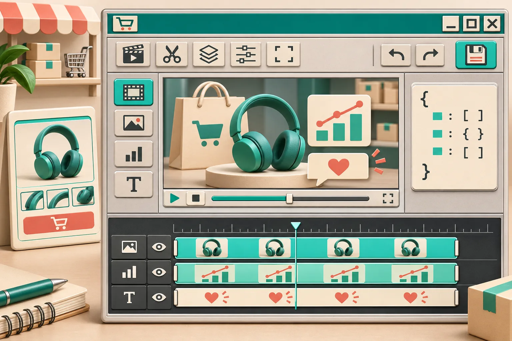
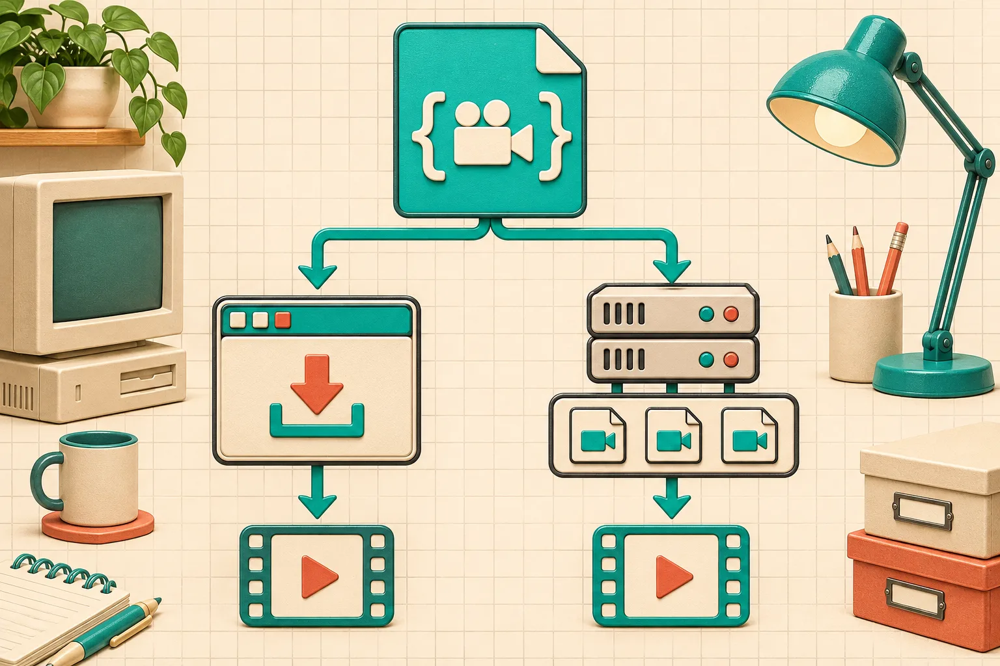

# How to Build Editable Customer Recap Videos in a React SaaS

A customer recap video should not become a dead MP4 the moment your app generates it. The practical pattern is to keep the generated **VideoJSON** as the source of truth, let a customer make a small, controlled set of changes in a React editor, and render only the saved revision. That gives an ecommerce or SaaS team a repeatable path from account data to a video that is still correctable.

I would use [VideoFlow's React Video Editor](https://videoflow.dev/react-video-editor) for the editing surface, then choose a browser or server renderer based on who needs the export and how many jobs are waiting. This is not a replacement for a fully open-ended desktop edit; it is a product feature for templated recaps, loyalty milestones, onboarding summaries, and post-purchase videos.



## The part that must remain editable

A recap has three kinds of information mixed together:

- **Account data:** order count, loyalty status, subscription usage, or a date range.
- **Approved presentation:** your brand type, colors, music choice, scene duration, and layout.
- **Customer-specific corrections:** a preferred product photo, a name pronunciation, a trimmed greeting, or a changed call to action.

Only the last category should be freely changed in the customer-facing flow. If the generated video is only an MP4, every correction becomes a support request or a rerun from an unclear input. If you persist the VideoJSON alongside the customer and template version, you retain a small, reviewable document that can drive a preview, an editor, and a later render. That is the useful boundary behind [VideoFlow Core](https://videoflow.dev/core): code or data can compile into portable VideoJSON rather than disappearing into an opaque export.

For Shopify-adjacent work, I use the same discipline as a [product-photo metadata check](https://the-lean-ecommerce.github.io/2026/11/08/a-shopify-product-photo-metadata-check-before-you-share-a-sample/): distinguish the factual asset and data from the presentation layer before letting anyone publish it.

## Make a recap document, not a final file

Start your worker with a narrow input contract. It can be as plain as a JSON object from your CRM or storefront:

```ts
const recapInput = {
  customerId: "cus_412",
  displayName: "Maya",
  period: "October 2026",
  featuredProductImage: product.imageUrl,
  milestone: "3 orders this season",
  templateVersion: "recap-v4"
};

const videoJSON = await buildRecap(recapInput);
await db.recapVideos.insert({
  customerId: recapInput.customerId,
  templateVersion: recapInput.templateVersion,
  document: videoJSON,
  revision: 1,
  status: "editing"
});
```

The important decision is the `document` column. Store the generated VideoJSON, not just a render URL. Also retain the template version and a revision number. A later template improvement should create a new candidate, not silently rewrite a customer-approved video.

That keeps the workflow different from a batch-only pipeline. If your immediate job is high-volume export, a [video rendering queue](https://the-lean-ecommerce.github.io/2026/10/29/i-built-a-video-rendering-queue-before-my-first-batch-export/) is still the right backbone. The editable document simply enters that queue after the customer has saved it.

## Embed the editor with product-level guardrails

VideoFlow's editor accepts a video document and gives edits back through callbacks. I would persist on explicit save, and use `onChange` only for a short-lived draft or debounced autosave.

```tsx
import { VideoEditor } from "@videoflow/react-video-editor";
import "@videoflow/react-video-editor/style.css";

export function RecapEditor({ recap }: { recap: Recap }) {
  return (
    <VideoEditor
      video={recap.document}
      theme="dark"
      onChange={(next) => saveLocalDraft(recap.id, next)}
      onSave={async (next) => {
        await fetch(`/api/recaps/${recap.id}`, {
          method: "PUT",
          headers: { "Content-Type": "application/json" },
          body: JSON.stringify({ document: next, expectedRevision: recap.revision })
        });
      }}
      onUpload={async (file) => uploadApprovedMedia(file)}
    />
  );
}
```

The component supplies a multi-track timeline, live preview, inspector, undo/redo, uploads, and export hooks; your app still owns authentication, persistence, and which media URLs are permitted. That separation matters. Do not treat an editor callback as authorization to replace an asset with any public URL. Validate file type and size in `uploadApprovedMedia`, attach ownership to the upload, and check that the saved document only refers to assets the customer can use.



## Choose the renderer after the editing decision

The same saved VideoJSON can power a DOM preview, a browser download, or a backend render. I use this rule of thumb:

| Need | Good delivery path | Why |
| --- | --- | --- |
| Customer wants a short file immediately | Browser renderer | The MP4 is created client-side, avoiding an upload/render round trip. |
| Customer wants to inspect changes | DOM preview | The live preview is scrubbable before any export job exists. |
| A campaign needs hundreds of finalized recaps | Server renderer + queue | Node can render headlessly and a worker can retry, meter, and deliver jobs. |
| A support agent must reproduce a request | Saved VideoJSON + revision | You can render the exact approved document again. |

[VideoFlow's renderer guide](https://videoflow.dev/renderers) documents those three backends. Its browser renderer supports progress and cancellation through `AbortController`; that browser API lets your UI signal that an async operation should stop, as documented by [MDN](https://developer.mozilla.org/en-US/docs/Web/API/AbortController). Give the cancel button a real job rather than leaving a customer staring at a spinner.

For the server path, queue the **saved revision ID**, not a mutable "latest recap" reference. The worker should load that revision, render it, and attach the output URL to the same revision. That prevents the classic race where a customer edits the caption while a stale document is already rendering.

## My release checklist for editable recaps

Before I expose this to customers, I check these six things:

1. The data worker records its input and template version with the VideoJSON.
2. The editor can save a new revision without overwriting an approved one.
3. Uploads are validated and scoped to the account before their URLs enter the document.
4. The preview and export use the same saved revision.
5. Browser exports show progress and can be canceled; queued exports have a retry policy.
6. The delivery email or dashboard links to the approved MP4, while support can still inspect the underlying document.


This is the detail that turns an AI-assisted video feature into an operable product. It echoes the reason I prefer a [12-URL receipt before a Webflow export](https://the-lean-ecommerce.github.io/2026/11/09/i-test-a-webflow-collection-export-with-a-12-url-receipt/): a visible record of what was produced beats an assumption that the latest thing is safe to ship.

## Start with one recap template

Pick one bounded job first: a post-purchase thank-you, a monthly usage recap, or a loyalty milestone. Build a template with two locked brand scenes and one editable customer scene. Persist its VideoJSON, wire in the React editor, and log the revision that actually renders.

That small setup gives your customers a correction path without handing them an unbounded production suite. [Try the VideoFlow React Video Editor](https://videoflow.dev/react-video-editor) with a single recap template, then add queued server exports only after the edit-and-save path is solid.
