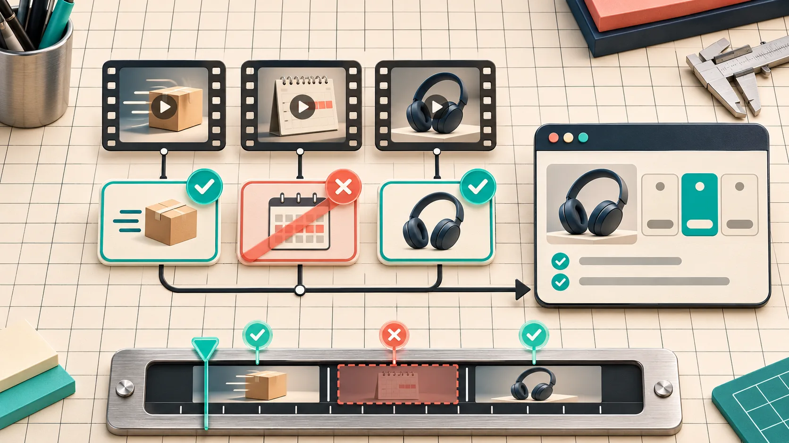

# How to Update a Startup Launch Video When Your Pricing Changes

A pricing change does not require a brand-new launch video. It does require a small evidence pass: find every price-adjacent claim, compare it with the live pricing source, revise only the affected scenes, then review the rendered film as a viewer would. I treat that as a release task, not a copy tweak.

This comes up constantly in startup work. The product message is still good, the UI footage still earns its place, and the video is still doing its job—until an old plan name, trial detail, or savings claim turns a useful asset into a support-ticket generator. The way out is to preserve the message spine while treating pricing as versioned product data.

[VideoFlow Studio](https://studio.videoflow.dev/) is useful here because its agent-driven workflow produces an editable project, not just a locked MP4. Studio can work from a URL in the terminal or browser, accept a change in plain language, and re-render the same film. That does not make a pricing claim correct by itself; it makes a targeted correction much less painful.

## Start with the live source, not the old script

Before opening the editor, write down the exact page that currently owns the claim: usually your public pricing page, sometimes a plan-specific landing page or checkout. Then make a compact claim inventory. I do not start by asking, “What should the new scene say?” I start by asking, “What does this video currently cause a viewer to believe?”

| Video element | Check against the live source | Decision |
| --- | --- | --- |
| Price or discount | Amount, currency, billing period, eligibility | Update or cut |
| Plan name | Current naming and included audience | Update |
| Trial or free allowance | Limit, expiry, restrictions, region | Update, qualify, or cut |
| Feature comparison | What is actually included today | Reframe or remove |
| Call to action | Destination page and offer context | Verify link and wording |

This is more reliable than editing every scene that *looks* commercial. A product demo may be fine while a passing end-card phrase is the risky part. For a useful pre-production version of the same idea, see [my four-card launch-video brief](https://the-lean-ecommerce.github.io/2026/11/10/startup-launch-video-brief-four-cards-to-write-before-the-first-cut/); its proof card is a good home for a source URL and date.



## Mark claims by risk, not by scene count

A 30-second film can have six scenes and only two meaningful pricing claims. Put each claim in one of three buckets:

- **Direct:** a number, plan label, “free,” “save,” or “starts at” statement. Match it character-for-character to the live source.
- **Implied:** language such as “for every team” or “unlimited.” Check the exclusions and plan boundaries before keeping it.
- **Contextual:** a product visual that may imply a feature belongs to the shown plan. Keep it only if the viewer will not reasonably infer the wrong entitlement.

The useful rule is: if a buyer could use the frame to make a payment or eligibility decision, it needs a source. If it is merely a product narrative beat, it still needs to be consistent, but it is not automatically a pricing scene. This keeps the review tight enough to finish.

## Change the smallest possible unit

Once the inventory is settled, change the scene that carries the outdated claim—not the whole video. Studio’s product page describes each film as an editable project, with layers, timing, colours, and text available in the editor; it also supports directed changes in natural language against the existing plan. That is the right shape of tooling for a maintenance edit: preserve approved pacing and visual language, replace the evidence that changed.

My change request is intentionally specific:

```text
Scene 4: replace the retired annual-plan claim with the current monthly-plan wording
from the approved pricing page. Keep the existing product shot, duration, and end-card CTA.
Remove the scene if the claim cannot fit without a footnote.
```

That last line matters. A crowded disclaimer is often worse than a clean scene that makes one defensible claim. When an offer needs qualifications that cannot be understood at viewing speed, point the CTA to the current pricing page and let that page do the detailed selling.


## Re-check the film, not only the editable timeline

After the edit, I review two things separately. First, compare the editable scene against the source: wording, plan names, order of ideas, CTA destination. Second, watch the encoded render at normal speed. A correct line can still be unreadable, clipped, or paired with an old visual.

VideoFlow Studio says its review pass watches encoded frames and checks visual issues before delivery; that is a helpful second set of eyes for alignment and contrast, not a substitute for product approval. The person who owns pricing should still sign off on the claim. I use a quick release receipt:

1. Source URL and the date checked.
2. Every direct claim copied from that source.
3. Scene IDs changed or removed.
4. Render filename/version reviewed at normal speed.
5. CTA page opened from the published placement.

If the product itself changed alongside the price, expand the receipt. [This note on keeping startup videos accurate as a product changes](https://the-lean-ecommerce.github.io/2026/10/29/how-i-keep-a-startup-video-accurate-when-the-product-changes/) is the broader dependency check; a [four-card first-cut review](https://the-lean-ecommerce.gitlab.io/2026/11/08/startup-launch-video-first-cut-four-card-review-workflow/) is useful when several reviewers need one shared decision.


## Keep the old claim out of the next release

The final small habit is to record the claim beside the video project. I save the source URL, checked date, owner, and the next likely review trigger: pricing-page publish, plan rename, promotion launch, or region rollout. That turns a fuzzy “remember to update the trailer” task into a normal release check.

Do not promise a price, trial, or saving your public page cannot support today. Do not solve a changed offer by rebuilding an otherwise useful film. Open the current source, isolate the claim, revise the smallest scene, and watch the final render. If you want a structured workflow that keeps that edit portable, start a project in [VideoFlow Studio](https://studio.videoflow.dev/) with the current product URL and a one-sentence change request.
