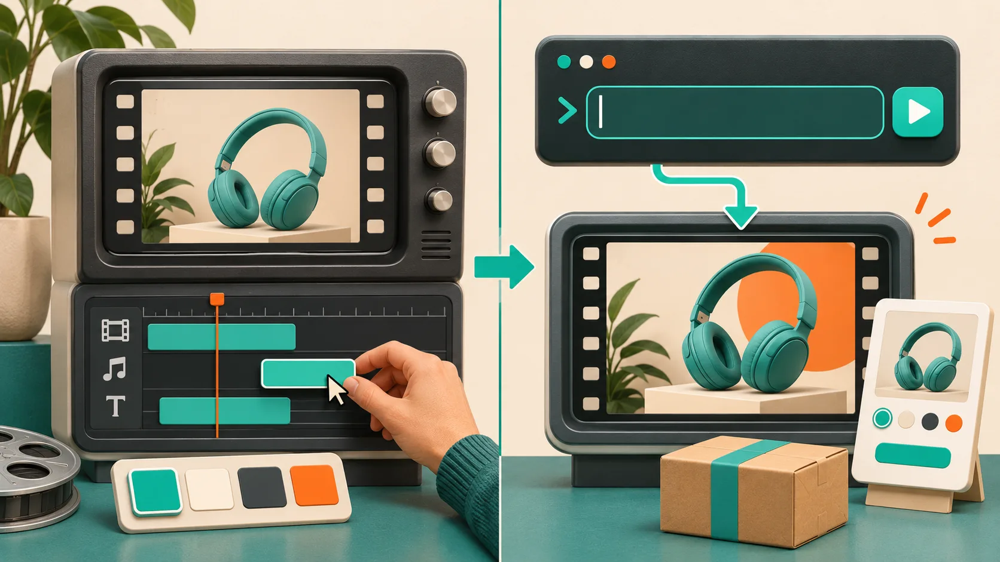

# Startup Launch Video Brief: Four Cards to Write Before the First Cut

A launch-video brief does not need a slide deck, but it does need a point of view. My practical answer: write four cards—**message, proof, constraints, and next action**—before you generate a first cut. That gives an agent enough direction to turn a website into a focused product story instead of a fast-moving feature list.

That is the gap I try to close before asking [VideoFlow Studio](https://studio.videoflow.dev/) for a startup trailer. Studio can inspect a URL, plan scenes, build the motion graphics, and revise an editable film from the terminal or browser. The better input is still a clear decision about what the viewer should understand, trust, and do.

## The four cards I put beside the URL

For a product launch, the homepage is source material, not the script. I use one card per decision and keep each card to a sentence or two. The point is not to predict every frame; it is to stop the first render from trying to say everything.

| Card | Write this | What it protects against |
| --- | --- | --- |
| Message | The one change the product makes for a specific customer | A generic “all-in-one” opening |
| Proof | One visible workflow, object, or before/after fact that makes the message credible | A trailer made of claims and UI fragments |
| Constraints | The words, screens, brand elements, and promises that must not drift | A polished film that says something inaccurate |
| Next action | The single action a qualified viewer should take after the end card | A vague ending with competing calls to action |

For a Shopify app, that might be: “A merchandiser can correct the right variants before a sale starts.” The proof could be a before/after price-selection screen. Constraints might include the exact sale language and the variants that are out of scope. The next action might be “Start a five-product pilot,” not “Transform your catalog.”

That message/proof split is the useful guardrail. If you cannot point to a scene that demonstrates the message, I would revise the brief before I render. It is the same reason I build a [website evidence pack before generating a startup video](https://the-lean-ecommerce.github.io/2026/10/29/i-built-a-website-evidence-pack-before-generating-my-startup-video/): a real page, product shot, and customer job are stronger inputs than a pile of adjectives.

## Turn each card into three scenes, not ten

A first-cut launch video can often carry its job in three scenes:

1. **Problem in context.** Show the moment that makes the viewer care. Keep it recognizable: a product page, a crowded catalog, a release note, or a checkout handoff.
2. **Proof in motion.** Follow one visible object through the workflow. A selected variant, a support ticket, or a product card is easier to remember than five disconnected feature screens.
3. **Decision and action.** Restate the outcome, then make one clean next-step offer.

This is not a universal runtime rule. A complex onboarding or demo needs more room; a paid social cut may need fewer beats. It is a first-cut constraint that reveals whether the product story has a spine. I have found it more useful than trying to make every important feature fit before anyone has reviewed the central idea.

## What I give VideoFlow Studio—and what I keep out

The current [Studio workflow](https://studio.videoflow.dev/) supports both a local CLI route (`npx @videoflow/studio@latest`) and a hosted route. It uses the same editable project and browser editor at the end, according to its product page. For CLI use, the site currently advertises eight free renders and edits a month on a free plan, with optional AI media billed separately; verify the current limits before you plan a campaign around them.

I give the agent the four cards, the URL, and concrete source material. I keep speculative positioning, unapproved screenshots, and every optional feature out of the first brief. Studio’s plan-then-render workflow is valuable here because it provides a place to challenge the sequence before treating the film as final. If your choice is between a hosted workflow and the terminal path, this [CLI-or-hosted decision note](https://the-lean-ecommerce.github.io/2026/10/31/i-choose-videoflow-studio-s-cli-or-hosted-path-before-a-launch-video/) is the decision I would make first.

The distinction matters: VideoFlow Studio is the operator-facing product that turns a URL and direction into a reviewable motion-graphics film. [VideoFlow](https://github.com/ybouane/VideoFlow) is the open-source underlying engine, with a portable JSON model and an Apache-2.0 license. If you need to author a video application in React, a code-first route may fit better. If you need a product story from a live site with an editable first cut, Studio is the more direct starting point.

## Put a review gate between “rendered” and “ready”

A first render can be attractive and still be the wrong launch asset. I use a small gate before requesting revisions:

- Can a first-time viewer repeat the message after the opening?
- Does every scene advance that message or prove it?
- Are logo, product UI, price, availability, and customer claims current?
- Is the text legible at the channel’s likely viewing size?
- Does the end card offer one next action?

Studio says it reviews encoded frames for issues such as alignment and contrast before it delivers a result. That is helpful production QA, but it cannot decide whether you chose the right promise. I still keep the human review at the message and proof layer—especially when the product is changing. This is the practical extension of how I [keep a startup video accurate when the product changes](https://the-lean-ecommerce.github.io/2026/10/29/how-i-keep-a-startup-video-accurate-when-the-product-changes/).

## Choose a revision path deliberately

After the review, separate a content correction from a craft correction. Ask for agent-led revision when the brief changes: a different proof, a narrower audience, a reordered message, or a new end-card action. Use the editor when the direction is stable and you need a timing, layer, color, or copy adjustment. Studio describes the resulting project as editable in its browser editor, and says later agent changes can work from that context.

I keep revisions as short receipts: “Scene two: replace the feature montage with the five-SKU bulk-edit proof; retain the opening and CTA.” That gives the next pass a bounded job. For a more formal handoff, the [message–proof–cut review card](https://the-lean-ecommerce.gitlab.io/2026/11/02/startup-launch-video-handoff-a-message-proof-cut-review-card/) is a good companion.

## Start with the card that makes exclusion easy

Before you open a video tool, write the message card and cross out everything that does not support it. Then choose one proof and one next action. Put those four cards beside your URL and create the first cut in [VideoFlow Studio](https://studio.videoflow.dev/). You will have a much better review conversation than “make it feel more premium,” and an editable project gives you room to improve the craft without losing the decision behind it.
