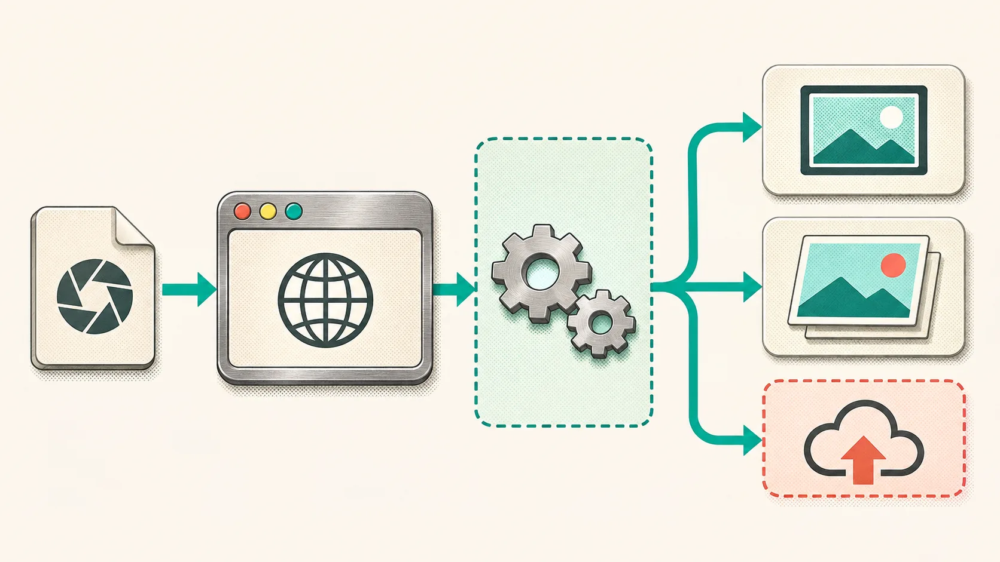
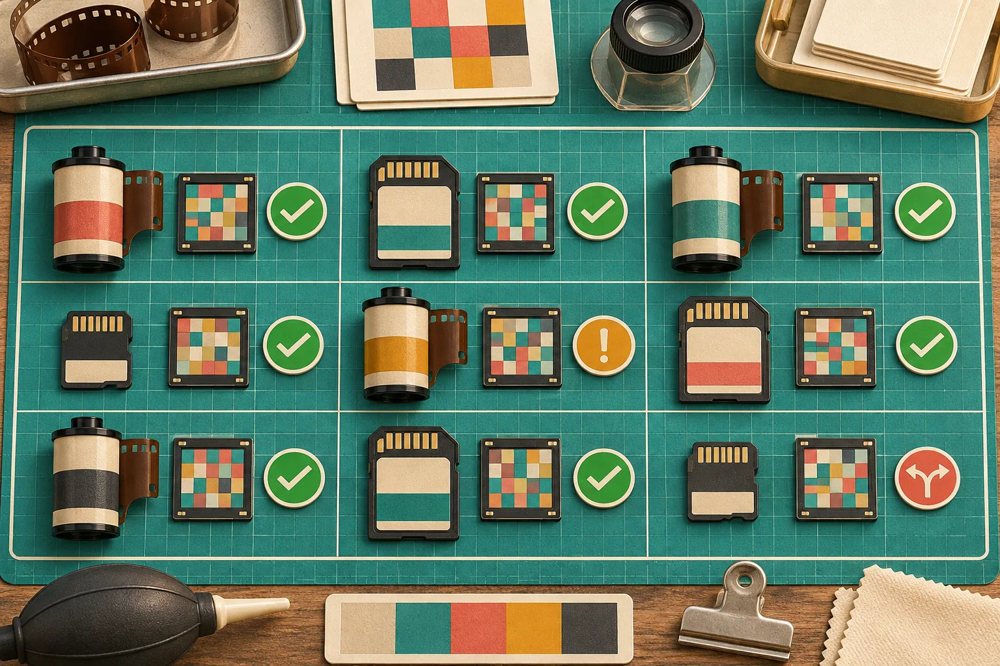

# A Browser RAW Preview Promise Matrix for Shopify Photo Uploads

If your supplier or merchant upload flow accepts camera RAW files, promise less than "we support RAW previews" and ship more reliably. The practical approach is a four-state contract: show an embedded preview when one is usable, develop a preview only for fixture-tested files, keep the original when processing is pending, and route unsupported variants to a clear fallback. I would put that contract in place before treating a browser preview as a storefront-ready product image.

[FlashRaw](https://flashraw.ybouane.com/) is one option for local browser decoding: its JavaScript package supports browsers and Web Workers, and the project documents both embedded-preview extraction and display-ready RGB output. That does not make every file from every camera a safe promise. RAW support is a matrix of camera, compression mode, and intended output—not a file-extension checkbox.



## The four states I would expose to uploaders

This is the decision matrix I would use in a Shopify app or custom product-photo intake. It gives support and merchandising teams a precise answer before they see a confusing blank thumbnail.

| Upload state | What the customer sees | What the app does | When it is safe |
| --- | --- | --- | --- |
| Embedded preview available | A fast preview marked as a preview | Extract the camera’s embedded image; preserve the RAW original | The preview is present and decodes successfully |
| Tested development path | A generated thumbnail | Decode and develop the RAW in a worker; keep original bytes | Exact camera and compression mode are in your acceptance fixtures |
| Processing or constrained | Original retained; status explains next step | Queue server-side processing or ask for JPEG/TIFF | Browser memory, device capability, or deployment policy says not to process locally |
| Unsupported variant | A clear alternate-upload route | Reject only the preview step, not the whole handoff | Format/mode is documented unsupported or your fixture fails |

The distinction matters because an embedded camera JPEG, a freshly developed sRGB image, and the final catalog asset have different colour and crop expectations. A browser thumbnail is useful for confirming that the supplier attached the intended shot; it is not evidence that your storefront pipeline has approved the image. For a broader product-image handoff, pair this with [a three-image gate before Shopify publish](https://the-lean-ecommerce.github.io/2026/11/11/a-three-image-product-photo-gate-before-shopify-publish/).

## Start with a format claim you can defend

I would never write "accepts NEF" or "supports CR3" in the UI without naming the boundary behind it. FlashRaw’s [format documentation](https://github.com/ybouane/flashraw/blob/main/docs/formats.md) tracks support by format and mode, including compression variants. Its current corpus report says 1,980 of 2,016 raw.pixls.us files decode, while Nikon High Efficiency NEF is explicitly detected but unsupported; a JPEG XL DNG needs the relevant feature enabled. Those details are why a single extension list is not enough for a production promise.

For each camera family that matters to your merchants, make a small acceptance row:

- one lawful fixture RAW and its camera/model/firmware note;
- the exact result you expect: embedded preview, sensor decode, or developed sRGB;
- a maximum file-size and device-memory test;
- the fallback copy a merchant will see if it fails;
- a saved output reference for the cases where colour or crop matters.

That is deliberately narrower than a decoder’s overall coverage number. If your merchants mostly upload Canon CR3 files but a specific compression mode is new to your fixture set, the honest state is "processing needs review," not a green supported badge.



## Put the decode boundary in a worker

A RAW file can be large enough to make a perfectly correct decode feel like a broken upload when it blocks the main thread. Keep browser interactions responsive by moving file inspection and preview generation into a Web Worker, then return only the thumbnail, status, and small metadata your form needs. FlashRaw documents a browser and worker integration path; test that path in the same browsers and device classes you plan to support.

The browser contract I would implement looks like this:

```js
// Main thread: preserve the original and give the UI a predictable state.
worker.postMessage({ file, requestedOutput: "preview" });

worker.onmessage = ({ data }) => {
  if (data.kind === "embedded-preview") showPreview(data.blob);
  if (data.kind === "developed-preview") showPreview(data.blob);
  if (data.kind === "needs-server-processing") showProcessingState();
  if (data.kind === "unsupported") showAlternateUpload();
};
```

The snippet is intentionally about states rather than a made-up decoder call. Your worker should first identify the file and decide whether to extract a preview or develop pixels. It should also set allocation and time budgets appropriate to your deployment. If you introduce threaded WebAssembly, validate the required cross-origin isolation headers—COOP and COEP—before treating that build as your baseline.

This approach also avoids a common scope mistake: GPU support can help a post-decode development path, but it is not a guarantee that every parser or every RAW format is GPU-accelerated. FlashRaw’s [benchmark notes](https://github.com/ybouane/flashraw/blob/main/docs/benchmarks.md) separate sensor decode from RAW-to-sRGB work and list cases where other decoders are faster. Use those figures as a reason to measure your own files, not as a blanket SLA.

## Test the promise, not just the decoder

I would run this release checklist before enabling a customer-facing RAW preview:

1. Test each priority camera/mode fixture in the actual production browser build.
2. Record whether the UX used an embedded preview or a developed image.
3. Compare the developed thumbnail against a trusted reference only where your workflow needs rendering parity.
4. Test a large valid file, a truncated file, and a known unsupported variant.
5. Confirm that cancellation, retry, and an alternate JPEG/TIFF handoff all leave the original upload intact.
6. Watch worker time and memory on the least-capable device you advertise.

For untrusted supplier files, a memory-safe parser is useful but not a security boundary by itself. Keep limits and failure handling in your application, and use the decoder’s documented malformed-file behavior as one input to that design. If your handoff includes unknown image formats beyond RAW, the inspection pattern from [checking a file header before opening it](https://tools-and-how-tos.github.io/2026/11/06/how-to-inspect-an-unknown-file-header-before-you-open-it/) is a helpful companion.


## The next action: publish the matrix with the feature

The reliable feature is not "RAW preview." It is a documented set of outcomes that preserves the original file and tells the uploader what happened. Start with one or two merchant camera families, add fixtures for the exact modes they send, and expose the four states in your upload UI before expanding support.

If you need a local browser decoder to evaluate, try [FlashRaw’s live browser demo](https://flashraw.ybouane.com/) with non-sensitive sample files, then build your own fixture receipt around the formats and output you actually ship. That will make your product-photo intake more trustworthy than a long, vague compatibility list.
