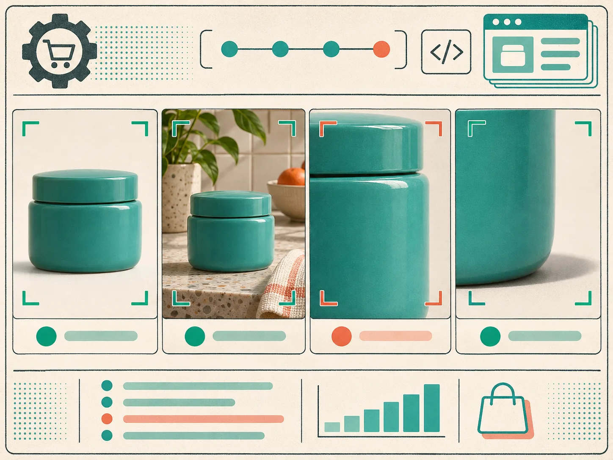
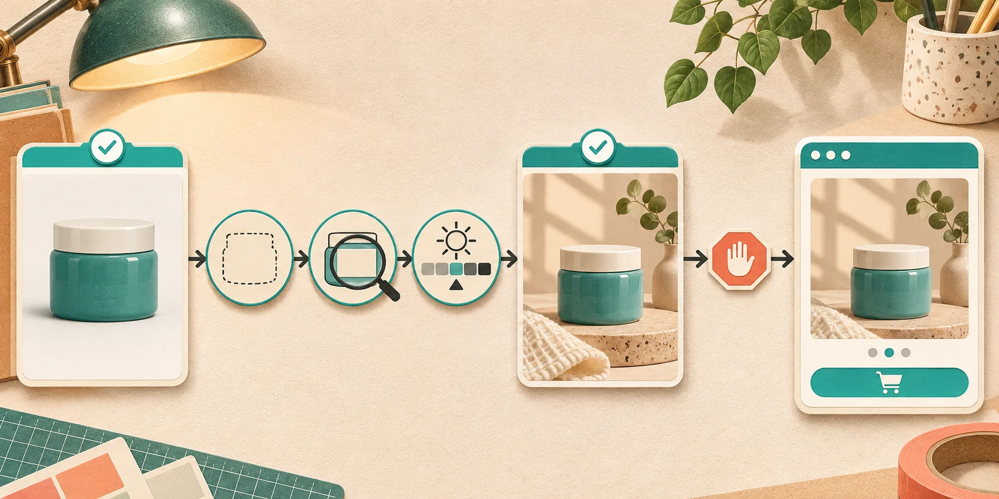
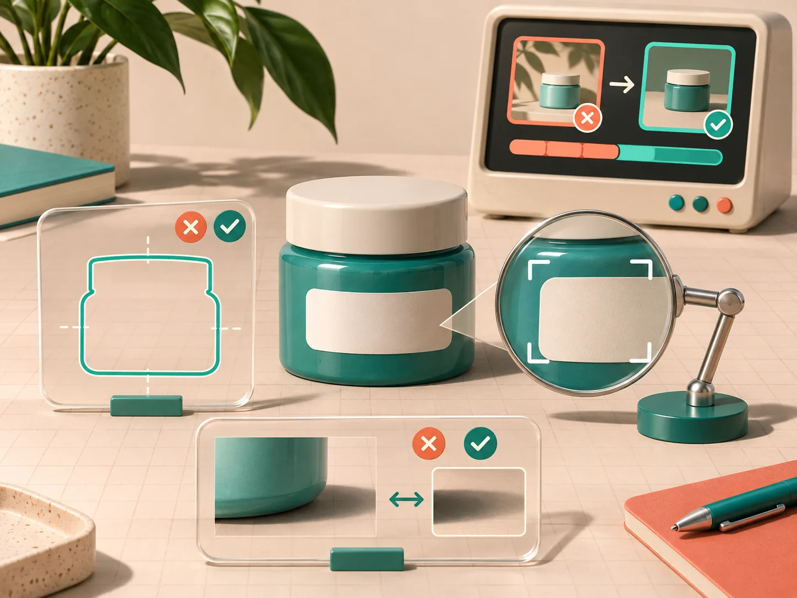

# A Three-Image Product-Photo Gate Before Shopify Publish

AI lifestyle images are useful only when they still describe the thing a customer will receive. My practical rule is simple: before a generated image reaches a Shopify product page, I compare it with the source in three views—whole product, critical detail, and context. If any view disagrees, the image stays in the draft pile.

That is the small gate I would put in front of [Supra AI Photo Studio](https://apps.shopify.com/supra-ai-photo-studio). The app can create lifestyle scenes, enhance images, remove backgrounds, and produce fashion try-ons from existing product photos. It is fast enough that the constraint is no longer making a variation; it is deciding which variation is truthful enough to publish.



## Why three views instead of one approval glance?

A pleasant lifestyle scene can hide a very expensive mistake. The wide view tells me whether the object is still the right shape and proportion. The detail view catches the failures shoppers zoom into: a changed clasp, a missing seam, a warped label, a different material, or a color shift. The context view makes sure the scene does not imply something the product cannot do or include.

Shopify supports images, video, and 3D models as product media, so a product-page gallery can carry a lot of persuasive weight. That is also why the [product-media documentation](https://help.shopify.com/en/manual/products/product-media) is a useful reminder: media is part of the product record, not just campaign decoration.

I use the following gate before publishing a generated still. It is intentionally boring; boring is what makes it repeatable across a catalog.

| View | Compare against the source | Reject the candidate when |
| --- | --- | --- |
| Whole product | silhouette, count of parts, proportions, orientation | a handle, trim, closure, or product edge changes |
| Critical detail | label area, fabric print, finish, color, hardware | a claim, marking, material, or color becomes ambiguous |
| Context | scale, included accessories, use setting, safety cues | the scene suggests an included item, result, or use case you cannot support |

## The three-image workflow I would wire into a content pass

### 1. Start from a clean source record

Pick a single source image that is already approved for the product page. Make the source filename or asset ID part of the review note; it prevents the easy mistake of checking a generation against another generation. For apparel, I would also retain the flat lay or mannequin source, even if the final candidate is a try-on.

This is close to the metadata hygiene I use in [a product-photo handoff](https://the-lean-ecommerce.github.io/2026/11/09/how-to-strip-supplier-photo-metadata-before-a-shopify-handoff/) and in [a sample-sharing check](https://the-lean-ecommerce.github.io/2026/11/08/a-shopify-product-photo-metadata-check-before-you-share-a-sample/): keep the original identifiable and keep sensitive source material out of public delivery paths. Shopify explicitly cautions that files in its public Files area should be intended for public access.

### 2. Generate a candidate with bounded instructions

In Supra AI Photo Studio, I would first isolate a product when the original background is busy, then create the lifestyle or try-on variation. The prompt should describe the scene, camera height, surface, and lighting—not rewrite the product. For example:

```text
Place the supplied teal ceramic jar on a warm stone bathroom shelf.
Keep the jar silhouette, lid proportion, blank label area, and teal glaze unchanged.
Soft morning side light; no extra accessories touching the product.
```

The important part is the second line. It gives the reviewer a contract to check, not a vague instruction to judge against. For a broader preflight, decide the non-negotiables before generating a large batch.



### 3. Review the wide view, then crop the risk

Put the source and candidate side by side at the same approximate size. First look at the silhouette for ten seconds. Then crop the highest-risk area: product label, jewelry setting, garment logo placement, connector, texture, or seam. Finally, look at the entire card as a shopper would see it.

This order matters. I have seen a detail crop look perfect while the full scene quietly changes the product scale. I have also seen a handsome scene create a false claim by putting an accessory beside the product as though it were included.



### 4. Publish only with a receipt

For a pass, I record four fields in the task or asset manager: source asset, generated asset, reviewer, and the specific views checked. A rejected output needs one short reason—`shape`, `detail`, or `context` is enough. That is a better feedback loop than endlessly rewriting prompts.

Before pushing the asset live, preview it in the actual theme and test both desktop and mobile crops. If you are creating multiple variants, my earlier guide on [browser-ready product image variants](https://the-lean-ecommerce.github.io/2026/10/16/i-build-browser-ready-product-image-variants-without-starting-over/) is a helpful companion: preserve an original and make variants explicit rather than silently replacing the only good asset.

## When this gate is not enough

This process is a publication check, not evidence that an image will increase conversion. It does not validate fit, performance, safety, or customer outcomes. For regulated products, claims-heavy packaging, or branded marks, route the candidate to the appropriate legal, brand, or product reviewer. And if the product has intricate geometry that repeatedly fails the detail crop, use the original photography instead of forcing a synthetic lifestyle scene.

## My next action

Try the gate on one product with a clear source packshot: make one lifestyle candidate in Supra AI Photo Studio, compare whole product, critical detail, and context, then publish only the version you can explain in those three views. The workflow is small enough to run today—and disciplined enough to keep a fast image tool from changing the product you meant to sell.
