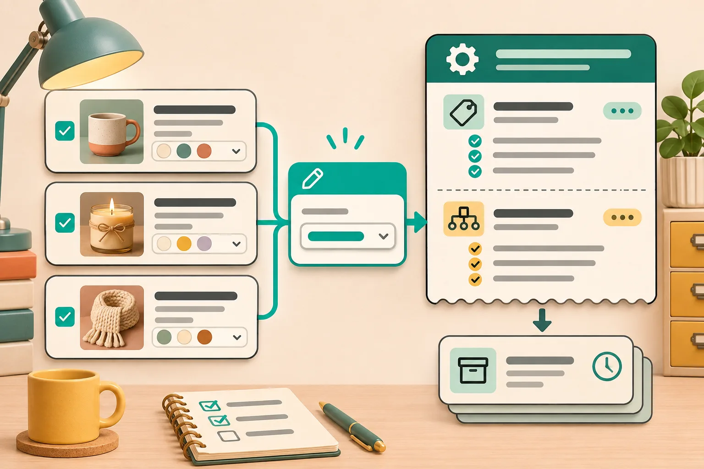

# How to Create a Change-Set Receipt Before Bulk Editing Etsy Listings

Bulk edits are safe when the scope is explicit, not when the button is big. Before I change a group of Etsy listings, I make a tiny change-set receipt: the selected listings, the one field I intend to change, an example of the new value, and the checks that prove the result. That turns [Bulk Listing Editor](https://bulk-listing-editor.webyze.com/) from a fast way to touch many records into a controlled catalogue operation.

This is most useful when you are changing tags, titles, SKUs, prices, or personalization settings across a collection. It is deliberately not a substitute for deciding whether something belongs at listing level or variation level; use this companion guide to [make that distinction first](https://the-lean-ecommerce.github.io/2026/09/16/how-to-decide-whether-an-etsy-change-belongs-in-listings-or-variations/).

## The receipt is four lines, not another spreadsheet

Here is the format I use before a batch. Keep it with the person who is going to press Bulk Edit.

| Receipt line | Example | Why it matters |
| --- | --- | --- |
| Selection rule | Active ceramic-mug listings tagged `housewarming`; exclude made-to-order sets | Makes the target group reviewable |
| One field | Add one tag | Stops unrelated fields drifting into the same run |
| Intended value | `mug gift` | Gives a reviewer something concrete to inspect |
| Proof sample | Check 3 selected listings and 1 excluded listing | Tests both the change and the boundary |

That “one field” rule is the useful constraint. If a seasonal refresh needs price, photos, and tags, make three receipts and run three edits. It feels slower for about ten minutes, but it makes it possible to explain a surprise later—and to correct only the affected field.

## Write the selection rule Etsy cannot misread

Bulk Listing Editor follows a straightforward sequence: search for listings or variations, select the items, specify modifications, then run the edit. The risky bit is not the sequence; it is the vague human instruction before it. “Update the spring mugs” is not a selection rule.

Instead, define inclusion, exclusion, and level:

- **Include:** a searchable property you can inspect, such as a collection of active listings with an old tag.
- **Exclude:** an exception class, such as personalized sets, clearance items, or listings with a particular variation structure.
- **Level:** listing or variation. A listing field changes the offer as a whole; a variation field changes a specific choice such as color or size.

Etsy treats variations as predefined buyer choices that can affect price, inventory, or SKU. Its [variation guide](https://help.etsy.com/hc/en-us/articles/115015664047-How-to-Add-Variations-to-Your-Listings?segment=selling) also notes that variations are unavailable for digital listings. That is why I do not bundle a variation edit with a listing-tag cleanup just because both are visible in the same editor.

For a deeper guardrail, use the [listing-versus-variation decision note](https://the-lean-ecommerce.github.io/2026/08/03/how-to-tell-whether-an-etsy-edit-belongs-in-listings-or-variations/) before setting the receipt.

## Make a small, reversible first run

I use a three-listing pilot. Pick examples that represent the edges of the selection: a plain listing, a listing with variations, and the most complex included item. Then save the receipt somewhere durable before applying the edit. A screenshot or a short note is enough; the goal is a baseline, not a backup system.

For a tag change, record the complete existing tag set for those three listings. Etsy currently allows up to 13 tags, and each should be accurate and relevant to the item rather than a catch-all keyword dump. Read Etsy’s [tag guidance](https://help.etsy.com/hc/en-us/articles/360000336307-How-to-Use-Tags-to-Get-Found-in-Search?segment=selling) before replacing tags rather than merely appending another phrase.

For a SKU update, sample an item with stock and an item with variations. Etsy describes SKUs as seller-defined identifiers for tracking inventory, so the receipt should show the old pattern, the new pattern, and the exact subset being updated—not claim that a new SKU system automatically reconciles another sales channel.

## Use the right receipt for the field

A generic “catalogue updated” note loses the information you need to inspect the result. I change the proof line based on the field.

| Field | Add to the receipt | Review after the pilot |
| --- | --- | --- |
| Tags | exact tags to add/remove; exclusions | tag count, relevance, retained useful phrases |
| Titles/descriptions | search/replace string and two real examples | beginning, middle, and end of the rendered copy |
| SKU/inventory | old-to-new pattern and variation scope | a base item and an option-level SKU |
| Price | currency, selected range, and one expected final price | selected price plus an excluded listing |
| Personalization | affected field and required/optional intent | buyer-facing instructions and an unaffected product |

Personalization deserves its own receipt even when the change looks cosmetic. Etsy differentiates it from variations: use personalization for buyer-provided details that do not change inventory, price, or SKU; use variations for fixed choices that do. Etsy’s [personalization documentation](https://help.etsy.com/hc/en-us/articles/360000344528-How-to-Offer-Personalized-Listings?segment=selling) also recommends clear field titles and one detail per field where possible.

## Run, inspect, then expand the same receipt

After the pilot, I inspect the three included listings plus the excluded control. The control is important: it catches a search or selection rule that was broader than the words on the receipt. If all four look right, I reuse the same receipt for the remaining selection. If not, I correct the selection rule or intended value first; I do not compensate with a second broad edit.

That pattern maps cleanly to the app’s search → select → modify flow. The app supports bulk changes across listing and variation fields, including prices, tags, materials, descriptions, images, inventory, and SKUs; its value is letting the operator apply a focused, already-reviewed change set without editing items one at a time.

If your broader job is an Etsy catalogue feed rather than the shop listing itself, the same habit applies: use a clear scope and a small control sample. I used that approach in this [Etsy Meta catalog preflight](https://how-to.the-lean-ecommerce.com/2026/11/10/how-to-preflight-an-etsy-meta-catalog-feed-before-a-seasonal-promotion/), where a small verification pass catches mismatched data before promotion traffic finds it.

## The practical next move

Before your next bulk edit, write one four-line receipt and run it on three listings. If the pilot and excluded control match the paper, expand it with [Bulk Listing Editor](https://bulk-listing-editor.webyze.com/). If they do not, you have a narrow problem to fix instead of a shop-wide mystery.
