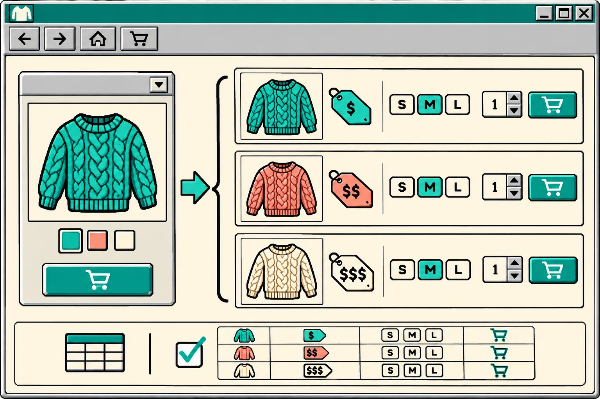

I treat an Etsy-to-Meta feed as a publishing interface, not an export button. Before I import it, I write down what a catalog row is allowed to say about one purchasable item. That small feed contract catches the expensive mismatch: a shopper sees one image, price, or availability state in a catalog and lands on a different Etsy listing.

The practical answer is to define a handful of non-negotiable fields, test one simple listing and one variation-heavy listing, then attach the feed URL in Meta Commerce Manager on a schedule. [Catalog Generator for Etsy](https://catalog-generator.webyze.com/) is useful here because it reads an Etsy shop and produces feed URLs for Meta and Google; it does not edit Etsy listings. The feed still needs an operator-owned definition of what “correct” means.

## My feed contract: one row, one honest buying promise

A feed contract is a short acceptance test I can run before a catalog import. It is deliberately boring: no conversion promises, no invented inventory rules. It answers whether the listing a person can click is the listing Meta is describing.

| Field | Contract question | Reject the row when |
| --- | --- | --- |
| Identity | Can I match this row to one Etsy listing and, where relevant, one purchasable variation? | The item ID or variant relationship is unclear |
| Title and image | Does the title and primary image describe the same item? | The photo shows a different material, colour, bundle, or scale |
| Price and availability | Do the values represent the selectable Etsy purchase? | A variation price, stock state, or currency is stale or ambiguous |
| Destination | Does the link open the exact listing a buyer expects? | It redirects to a shop, a different item, or a broken page |
| Personalization | Is the customisation boundary clear? | The row implies a ready-to-ship option that requires buyer input |

This is related to the smoke-test I use in [Etsy Catalog Feed Smoke Test: 6 Checks Before You Connect Meta](https://the-lean-ecommerce.github.io/2026/11/01/etsy-catalog-feed-smoke-test-6-checks-before-you-connect-meta/), but the contract comes first: a smoke test only helps once the expected behavior has been made explicit.

## Start with the Etsy listing, not the feed tool

Catalog tooling cannot make vague source data truthful. I first choose two listings: one plain item and one that has real variation or personalization complexity. Etsy supports options such as size and colour, and its seller guidance says a title should state what the item is and key details without repetition. It also treats listing photos as buyer-facing representation, not decoration. Review [Etsy’s listing guidance](https://help.etsy.com/hc/en-in/articles/115015628707-How-to-Create-a-Listing) and [image requirements](https://help.etsy.com/hc/en-us/articles/115015663347-Requirements-and-Best-Practices-for-Images?segment=selling) with the feed contract in hand.

For each sample, I open the Etsy page in a fresh browser session and record: the item name, displayed price, selected option, availability, hero image, and final URL. That is my source-of-truth receipt. If the product is personalized, I write the actual buyer choice needed before fulfillment; I do not let a catalog card suggest an off-the-shelf SKU.

## Make variations explicit before Meta sees them

Variation-heavy products are where a catalog can look fine at a glance and still be wrong. A sweater with teal, coral, and ivory options may have different stock or pricing. A contract should expect a distinct purchasable representation for each priced option, not “from” pricing pasted across every choice. Catalog Generator documents that it can expand priced variations and flag personalization, but I still prove that behavior with my two samples before relying on it.

My compact variation test is:

1. Choose the most expensive option and the least available option.
2. Confirm each one resolves to the correct Etsy listing and buyer-selectable option.
3. Compare price, image, availability, and option label in the feed destination against the Etsy source receipt.
4. Mark any option that needs custom input as a review case, not an automatic merchandising claim.

That is more specific than a generic feed audit, and it complements [Etsy Variation Prices in Meta Catalogs: A QA Workflow](https://the-lean-ecommerce.github.io/2026/11/07/etsy-variation-prices-in-meta-catalogs-a-qa-workflow/). If the store carries personalized products, I also keep the boundary described in [How to Handle Etsy Personalization Options in a Meta Catalog Feed](https://tools-and-how-tos.github.io/2026/11/06/how-to-handle-etsy-personalization-options-in-a-meta-catalog-feed/) close by.

## Connect the checked URL and schedule the smallest safe refresh

Once the samples pass, I copy the appropriate feed URL from Catalog Generator into Meta Commerce Manager as a URL-based data source. The product’s setup guide places that under Catalog → Data Sources → Add items → Data Feed, then asks the operator to choose a resync schedule. I choose a cadence that fits how often listings, stock, or prices actually change; “daily” is a reasonable starting point for an actively edited shop, not a universal rule.

The useful setup detail is that the feed URL represents configuration as well as data. Catalog Generator says variation expansion, inclusion of drafts or inactive listings, and personalization handling are URL parameters. I save the exact chosen URL and the reasoning beside my source receipt. That gives me a reproducible setup instead of a mystery link. For a step-by-step handoff, see [How to Connect Etsy Listings to a Meta Catalog With a Feed URL](https://how-to.the-lean-ecommerce.com/2026/10/13/how-to-connect-etsy-listings-to-a-meta-catalog-with-a-feed-url/).

## Run a tiny post-import receipt

After the first import, I inspect the same two listings in the destination catalog. I do not try to validate the entire shop in one sitting. My receipt has five cells: source listing URL, expected option, displayed price, availability, and catalog screenshot or timestamp. If any cell fails, I pause promotion for that item and fix the source or configuration before troubleshooting at scale.

This is especially helpful before a campaign: the [seasonal feed preflight](https://how-to.the-lean-ecommerce.com/2026/11/10/how-to-preflight-an-etsy-meta-catalog-feed-before-a-seasonal-promotion/) covers the broader launch check, while this contract makes the everyday import inspectable.

A catalog feed can reduce manual uploads, but it should not become an unowned translation layer. Build the contract for two real Etsy listings today, keep the receipt with the feed URL, and only then let the scheduled import represent your products elsewhere.

Ready to wire it up? Start a [Catalog Generator free trial](https://catalog-generator.webyze.com/) and use the two-listing contract above before you turn on your first scheduled sync.
