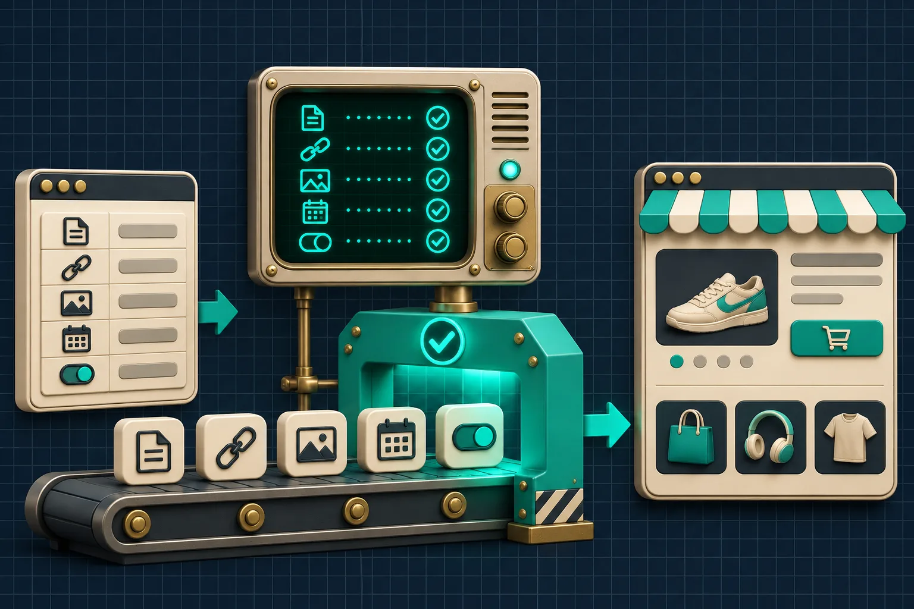
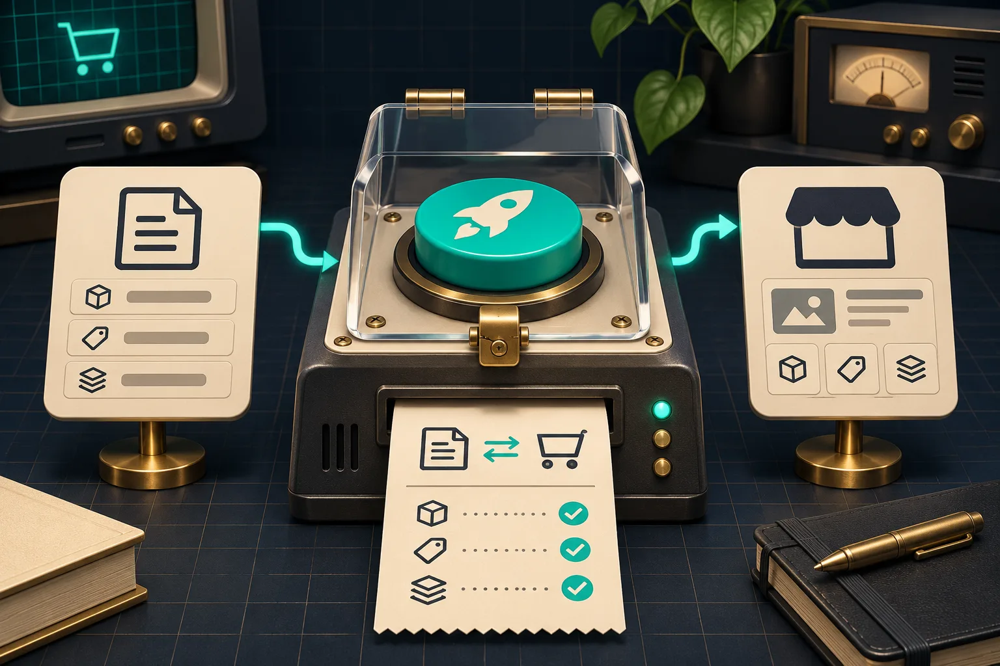

A Notion-to-Webflow sync should not treat every edit as equally safe. I let routine copy and asset updates flow automatically, but I pause for a tiny review when a change can alter field meaning, URLs, or publish state. That distinction keeps the speed benefit of [SyncFlow](https://syncflow.ybouane.com/) without turning a one-character edit into a storefront surprise.

The trick is to classify the *kind* of change before deciding whether auto-sync is allowed. SyncFlow maps a Notion database to a Webflow CMS collection, supports automatic or manual syncing, and can auto-publish. That is useful only when the mapping and release boundary are explicit.


## The three lanes I use

My policy has three lanes. It is deliberately simple enough to put beside the database, but specific enough that someone else can follow it.

| Lane | Typical Notion change | Action | Why it belongs there |
| --- | --- | --- | --- |
| 1. Content-safe | body copy, approved image replacement, typo, SEO description | Auto-sync | The destination field and customer meaning stay the same. |
| 2. Mapping-sensitive | property type, select value semantics, slug rule, relation, field mapping | Pause and test one record | The same source value may now mean something different in Webflow. |
| 3. Release-sensitive | publish toggle, price claim, campaign date, canonical URL, page visibility | Require a human release check | Correctly synced data can still be wrong to put in front of customers. |

This is not a claim that every content edit is harmless. A revised product description can still need legal or merchandising review. The point is to separate editorial approval from integration risk: the sync policy answers whether the transfer is mechanically safe, not whether the copy has been approved.

## Write the classification into the database

I add four small properties to the Notion database: `sync lane`, `webflow status`, `last checked`, and `release owner`. Notion distinguishes structured page properties from the free-form content blocks in a page, which makes properties the right place for this operational state.

A practical setup looks like this:

```text
sync lane: content-safe | mapping-sensitive | release-sensitive
webflow status: ready | hold | verified
last checked: date
release owner: person or role
```

Do not create a second source of truth by hand-editing both systems. The fields above describe the decision; the mapped source fields remain in Notion. SyncFlow’s job is to map the database properties into the Webflow collection. Webflow’s CMS API likewise treats item values as `fieldData` tied to the collection schema, including fields such as name and slug. When that schema moves, it is a lane-2 event even if the current item looks fine.

If you are still working out which property owns which destination field, start with this [Notion-to-Webflow field mapping contract](https://how-to.the-lean-ecommerce.com/2026/11/14/how-to-build-a-notion-to-webflow-field-mapping-contract/). It solves a different problem: ownership. The lane policy tells you what to do after that contract changes.



## Run one controlled record before enabling a lane

The fastest way I know to make auto-sync trustworthy is not to inspect fifty existing entries. I make one intentionally boring test record and change exactly one thing at a time.

1. Create a draft record with a unique slug, a short body, one image, and a visible status marker.
2. Sync it without publishing. Confirm the title, slug, rich content, asset, and links arrive in the intended Webflow fields.
3. Change one lane-1 value, such as the description. Confirm only that value changes.
4. Change one lane-2 value, such as a select option or mapping rule. Put the record on hold, inspect the result, then document the new expected behavior.
5. Toggle the lane-3 release field only after the public URL, canonical path, and page state have a named owner.

That test is particularly useful for page links and rich content. SyncFlow documents that Notion-page links can be converted into Webflow-post links, while Notion represents page content as typed blocks and rich text. Treat that conversion as something to verify on your own template, not as a reason to assume every block or URL will behave identically.

For a fuller failure drill, I still use my earlier [broken-link test before trusting auto-sync](https://the-lean-ecommerce.github.io/2026/10/18/i-run-a-broken-link-drill-before-i-trust-notion-to-webflow-auto-sync/). It catches a different class of problem: a transfer that technically succeeds but leaves a visitor at a dead destination.

## Give publish state its own gate

The dangerous shortcut is treating “synced” as “ready to publish.” They are separate states. Webflow supports draft and archived flags on CMS items, and its documentation describes publishing status separately from field data. Keep a record staged while you check the result; then release it through the workflow your team owns.

My release receipt is only five lines:

- URL and slug match the source decision.
- Required mapped fields are populated and formatted correctly.
- Internal and external links resolve.
- The intended image and alt text appear on the template.
- A named person has approved the public state.

That last line is why I do not bury a publish toggle in a general-purpose checkbox. A reviewable release decision needs a clear owner. If draft control is the immediate problem, pair this workflow with [keeping Notion drafts from publishing too soon](https://the-lean-ecommerce.blogspot.com/2026/11/how-to-keep-notion-drafts-from.html).



## A small rule for changes that do not fit

When I cannot quickly place a change, I default it to mapping-sensitive. That is intentionally conservative: it costs one test record, rather than a repair on live collection pages. For example, a renamed property sounds cosmetic, but it can break a field mapping; a new campaign date sounds editorial, but it can expose a collection early.

This policy is not a replacement for schema versioning, content approval, or backups. It is the operating rule between them. For more rigorous schema work, this [schema-change test](https://productivity-tech-business.sktch.io/home/how-i-test-a-notion-to-webflow-schema-change-before-auto-sync-QRm7+daKgRiGbP3safopYA) is a useful companion.

Set up the three lanes on one low-risk collection this week. Map the fields in SyncFlow, run the one-record test, and write down who owns the release toggle. Once the boundary is visible, auto-sync becomes a boring part of publishing—which is exactly what I want from it.
