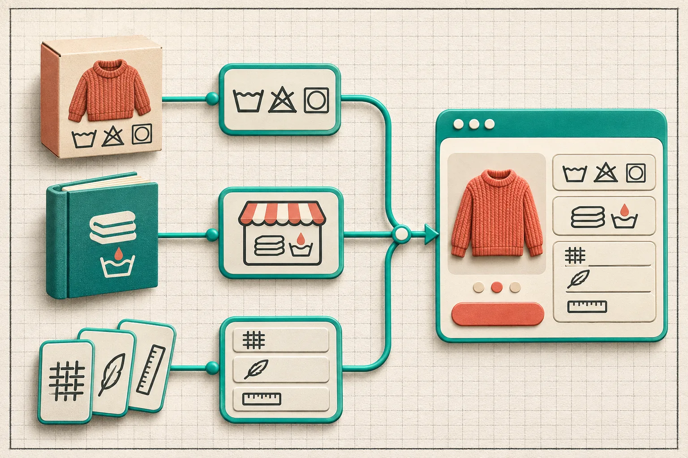
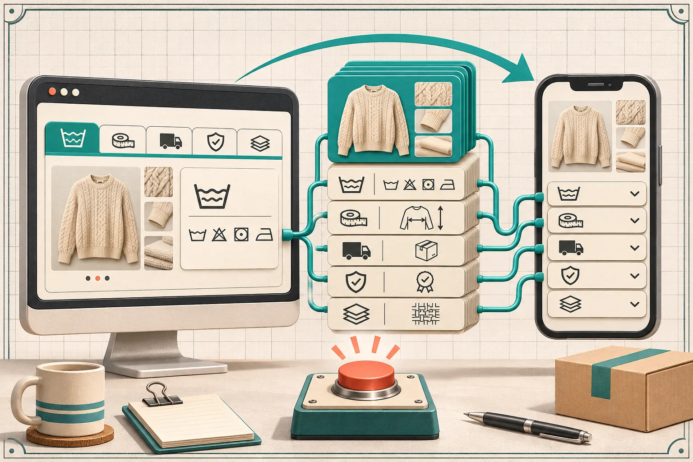

Most Shopify product-detail drift starts as an innocent copy-and-paste: a care paragraph on six sweaters, a warranty note on twelve tools, and a shipping promise embedded in every description. The durable fix is to give each fact one home, then present those homes consistently. I use product metafields for facts that genuinely vary, shared content for store-wide policy, and metaobjects when a detail is a structured record. [Supra Tabs & Accordions](https://apps.shopify.com/supra-tabs-accordions) can then turn those sources into desktop tabs and mobile accordions without turning the product description into the database.

## Start by separating facts, policies, and records

The temptation is to organize the page first: Care, Shipping, Warranty, Materials. I start one level earlier and ask where each answer should be maintained. That decision is what prevents a correction from becoming a catalog-wide scavenger hunt.

| If the content is… | Give it this home | Example |
| --- | --- | --- |
| Unique to one product or variant | A product metafield | a garment's wash instructions or a tool's voltage |
| The same across a group of products | A reusable store page or shared app content | a standard 30-day returns explanation |
| A repeatable item with several fields | A metaobject entry | a size-guide, material specification, or compatibility card |
| The narrative that sells the product | The product description | why this specific jacket has a lined hood |

This is not just housekeeping. Shopify describes metafields as custom data for existing resources, and specifically uses care instructions, measurements, and age guidance as product examples. [Its metafields documentation](https://help.shopify.com/en/manual/custom-data/metafields) also notes that definitions can enforce validation, which is a useful guardrail when several people maintain a catalog.

A metaobject is the better fit when one thing needs multiple fields. Shopify's [metaobjects documentation](https://help.shopify.com/en/manual/custom-data/metaobjects) describes them as reusable objects with a defined structure; an FAQ with a question and answer is one official example. In practice, I reach for that model when a detail needs a label, body copy, an optional file, and perhaps an image—not a single loose text box.

## Make a small source map before adding tabs

Here is the worksheet I would put next to a catalog before configuring the layout:

- **Care:** product metafield, because fabric and treatment can change item to item.
- **Measurements:** product metafield or a referenced size-guide record, depending on whether it is a single value or a maintained chart.
- **Warranty:** shared source when every eligible item has the same terms; product data only where the term or coverage differs.
- **Shipping:** shared source if the promise is store-wide; do not paste it into product descriptions.
- **Compatibility:** structured record when there are several required checks, such as model, dimensions, and exclusions.

That makes the label on the page a presentation choice, not a storage location. It is the same idea behind my earlier [product question map](https://the-lean-ecommerce.gitlab.io/2026/11/11/a-shopify-product-question-map-that-keeps-tabs-useful/): customers scan for questions, but the team needs an ownership model behind each answer.

## Build one reusable set, then target it deliberately

Once the sources are clear, I would create a single tab set with labels such as Care, Fit, Shipping, Warranty, and Product details. In Supra, a tab can use product content, a per-product field, store-page content, a metaobject field, an image/file, or content entered in the app. The [Shopify App Store listing](https://apps.shopify.com/supra-tabs-accordions) confirms that the app can target a collection, tag, vendor, or product type rather than requiring a one-by-one configuration.

That targeting is powerful only if the assignment rule is understandable. I prefer this order:

1. Start with one collection whose products share the same information shape.
2. Add only the tabs whose sources are meaningful for that collection.
3. Use a tag or product-type rule when it expresses a real catalog distinction, not a temporary workaround.
4. Review the matching products before widening the rule.
5. Keep an exception list for items that need different warranty or compatibility information.

Do not create a universal tab set just because you can. A furniture collection may need dimensions, assembly, and delivery; skincare may need ingredients, usage, and patch-test advice. The labels should reflect the decision a shopper is making on that product, not the fields your admin happens to expose.

There is a useful failure mode to watch for here: an empty source can produce an empty promise. Supra can hide tabs that lack matching content, but I still check the underlying assignment. An invisible Care tab might mean the product is intentionally exempt—or that the care metafield was never populated. For a related cleanup pass, use this guide on [hiding empty Shopify product tabs without editing theme code](https://how-to-blog.gitlab.io/2026/11/14/how-to-hide-empty-shopify-product-tabs-without-editing-theme-code/), then return to the source owner instead of treating the hidden tab as the end of the investigation.

## Run a four-product consistency check

Before rolling a set across a collection, open four deliberately different products: one normal item, one with the fullest specification, one with an allowed exception, and one that should omit a section. On each product, verify:

- the tab label names the shopper's question;
- the content comes from the intended source, not a stale description paragraph;
- the exception is visible where it needs to be;
- an absent detail does not leave a dead heading or empty panel;
- the same content remains understandable in the mobile accordion view.

This is where presentation should stay honest. Tabs do not make a missing care instruction exist; they only make a maintained instruction easier to find. Likewise, a warranty tab should explain the actual terms, not imply that every product qualifies. If sizing is a repeat support question, pair this work with a [scan-friendly size and fit setup](https://the-lean-ecommerce.blogspot.com/2026/11/how-to-make-shopify-size-and-fit.html) rather than burying measurements in a general Details panel.

## Keep the template thin and the catalog editable

The practical benefit of an app block is that the page can stay presentational. Build the tab set once, choose the sources, target the matching catalog, preview a few real products, and add the block to the product template. The app listing says the same set renders as tabs on desktop and accordions on mobile, so the source system does not have to fork by device.

For a larger catalog, I would add one maintenance rule to the operating notes: whenever a new collection launches, decide its source map before copy lands in the product description. That prevents a beautiful tab system from becoming another layer over duplicated content. It also pairs cleanly with a [organizing Shopify product details with reusable tabs](https://how-to.the-lean-ecommerce.com/2026/10/24/how-to-organize-shopify-product-details-with-reusable-tabs/), especially when more than one operator owns catalog updates.

If your current product pages are long because the details are real, do not delete them or hide them behind clever UI. Give each fact a maintainable home, make the labels easy to scan, and let the layout adapt around that structure. Install [Supra Tabs & Accordions](https://apps.shopify.com/supra-tabs-accordions) when you are ready to turn that source map into a reusable product-page layer.

The next action is simple: pick one collection and classify every recurring detail as product-specific, shared, or structured. Only then build the tabs.
