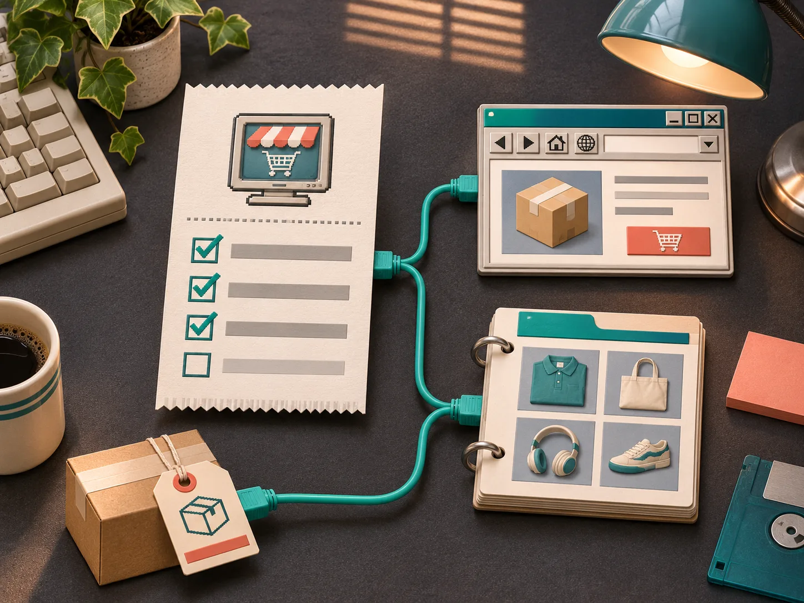

A Notion-to-Webflow sync needs a release receipt, not blind trust. Before I let a changed database row reach a live Webflow Collection, I verify the source values, the mapped output, the publish state, and one real URL. It takes a few minutes and catches the kind of tiny mismatch that turns a good content workflow into a quiet storefront problem.

[SyncFlow](https://syncflow.ybouane.com/) is useful here because it connects a Notion database to a Webflow CMS Collection and can sync changes automatically or manually. But the tool is not the contract. The contract is the short record that says what one item must look like on both sides.


## The mapping is a release boundary

I used to treat the field mapper as setup work: connect Title to Name, Summary to Summary, then move on. That is fine until a writer renames a property, an image is missing, or a status that was meant to stay internal becomes publishable. Notion’s current API documentation is a useful reminder that a property has both a stable ID and a human-readable name; the ID survives a rename while the name does not. [Notion documents that distinction](https://developers.notion.com/reference/property-object), which is exactly why I write down both the content meaning and the destination behavior.

My release receipt starts with this compact mapping card:

| Reader-facing job | Notion source | Webflow destination | Check before release |
| --- | --- | --- | --- |
| Page title | `Name` title | `name` | readable and unique |
| URL | `Slug` text | `slug` | lowercase, stable, no accidental date |
| Teaser | `Summary` rich text | summary field | short enough for the card |
| Publish control | `Ready` checkbox/status | draft/publish decision | explicitly approved |
| Hero | files/media | image field | public image and correct crop |

The literal property names are examples, not SyncFlow requirements. The point is to make the expected transformation reviewable. For a fuller schema-first pass, I keep [a field-mapping contract](https://how-to.the-lean-ecommerce.com/2026/11/14/how-to-build-a-notion-to-webflow-field-mapping-contract/) beside the collection rather than burying the decision in a setup screen.

## Start with one canary item

Do not let the first test be a week of editorial work. I make one disposable, complete item that includes a title, plain text, a rich-text section, an image, a link, and the exact publishing state I expect. This is the content equivalent of a canary release.


Here is my canary checklist:

1. Create or duplicate one intentionally obvious test record in Notion.
2. Run SyncFlow manually first; only enable auto-sync after that output is acceptable.
3. Open the Webflow Collection item, then the rendered page—not just the CMS row.
4. Click the outgoing link and inspect the image on a narrow viewport.
5. Record the result, then change one low-risk field and repeat.

That fifth step matters. A first sync proves a mapping exists; a second proves that an update behaves like you think it does. The Webflow CMS API itself separates content fields in `fieldData` from state flags such as `isDraft` and `isArchived`, so treating content review and publishing review as separate checks is sensible even when an integration handles the calls for you. [Webflow’s CMS reference shows those separate fields](https://developers.webflow.com/data/reference/cms/collection-items/staged-items/create-item).

If the canary fails, I do not keep retrying on production-looking content. I use the recovery approach from [this bad-sync guide](https://how-to-blog.gitlab.io/2026/10/20/how-to-recover-a-notion-to-webflow-cms-entry-after-a-bad-sync/) and fix the mapping or source data first.

## Keep publishing state outside the prose

A common failure is treating a finished paragraph as permission to publish. It is not. A piece can have complete body copy while its product image, legal review, CTA, or internal link is still unfinished. I keep a dedicated readiness property in Notion, then make it part of the receipt.

For a store content team, mine reads like this:

```text
Record: 2026-11-canary-product-care
Source state: Ready = true
Expected Webflow state: draft for review
Required fields: title, slug, summary, body, hero
Rendered checks: one H1, hero crop, two internal links, one CTA
Decision: publish only after page review
```

That is deliberately boring. It gives the editor an unambiguous handoff and prevents a new sync rule from becoming a new publishing policy by accident. If you need the classification layer first, [separating changes by risk before they auto-sync](https://the-lean-ecommerce.github.io/2026/11/15/how-to-classify-notion-changes-before-they-auto-sync-to-webflow/) is a solid companion process.

## Verify the rendered page, not only the database row

The destination item can look perfect in Webflow and still render badly in the template. Rich text classes can be missing. An image can crop poorly. A relative URL can go somewhere unexpected. I do a five-point page check:

- H1 matches the intended title.
- Intro answers the reader’s question before the first scroll.
- Hero image is recognizably the right product or article.
- Internal and external links resolve.
- The item is draft or live exactly as the receipt says.



This is also where SyncFlow’s styling choice becomes a real design decision: its product page says imported Notion elements can use inline styling or Webflow classes. I prefer classes when the site has an established component system; I use a contained test page before I let inline styling spread through a production template.

For teams migrating an existing editorial workflow, pair this receipt with [a reviewable publishing pipeline](https://the-lean-ecommerce.github.io/2026/07/26/how-i-build-a-reviewable-notion-to-webflow-publishing-pipeline/) rather than switching every collection at once.

## Turn the receipt into a repeatable habit

The best automation is the one you can explain when it misbehaves. Copy the five-row mapping card into the Notion database description or your project notes, add one canary record, and keep the final rendered URL with the release decision. Then use [SyncFlow](https://syncflow.ybouane.com/) to connect the database and Collection, map the fields, and test the smallest safe change.

Your next action: make one canary item today and write down what its title, slug, image, and publishing state must be after sync. Once that receipt passes twice, auto-sync has a real boundary to operate inside.
