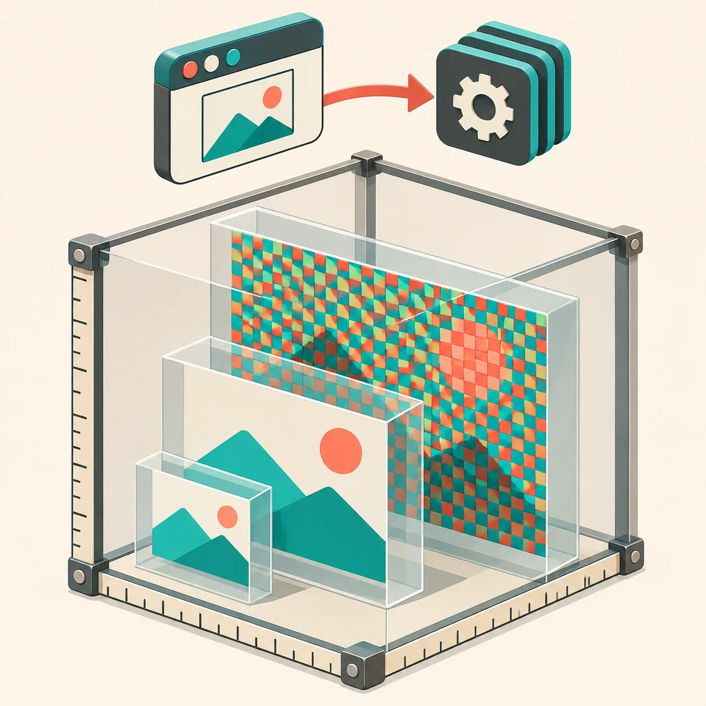

# How I Set a Memory Budget for Browser RAW Previews

A browser RAW preview can feel broken long before decoding is technically slow: the tab becomes unresponsive, a mobile browser reloads, or a supplier upload freezes at exactly the wrong moment. My rule is to set a memory budget before I pick a decoder or polish the preview UI. For most storefront-adjacent tools, the first preview should be a deliberately bounded image—not an accidental full-resolution editing pipeline. [FlashRaw](https://flashraw.ybouane.com/) is useful here because it can expose an embedded preview, decode sensor data, or develop display-ready RGB; those are different jobs with very different memory costs.

## Start by naming the preview promise

The word “preview” hides three products. Pick one before estimating anything:

| Preview job | What the browser needs | Good default boundary |
| --- | --- | --- |
| File accepted | Filename, size, camera/format decision | No pixel decode yet |
| Fast visual confirmation | Embedded JPEG or a constrained display image | One image sized for the panel |
| Crop, inspection, or colour-sensitive work | Sensor data plus a development path | Explicit, higher-budget mode |

For a supplier portal or product-ingest screen, I start with visual confirmation. It answers “is this the right shoe, angle, and orientation?” without promising an editing-grade rendering. That distinction matters: a successful RAW decode does not by itself guarantee the same colour intent or output behavior as an existing desktop workflow.

FlashRaw documents embedded-preview extraction and display-ready RGB output, alongside the sensor metadata needed to interpret a RAW file. Its [format documentation](https://github.com/ybouane/flashraw/blob/main/docs/formats.md) also treats support as a format-and-mode matrix, which is the right model for a production promise: verify the exact camera and compression variant, not merely the extension.

## Turn pixels into a budget worksheet

I use this deliberately simple planning equation for every buffer that can coexist:

`width × height × bytes per pixel × simultaneous buffers`

It is not a profiler. It is an early alarm that makes hidden copies visible. A 6000 × 4000 image has 24 million pixels. One 8-bit RGBA canvas is roughly 96 MB before you count the original file, decoded sensor buffer, worker transfer behavior, intermediate surfaces, or the rest of the page. A 1600 × 1067 RGBA preview is about 6.8 MB instead.

The useful question is not “how much memory does a RAW file use?” It is “which representations overlap during this user action?” Write them down:

1. Compressed camera file retained by the picker or your app.
2. Sensor or decode buffer, if the selected path needs one.
3. Working RGB buffer.
4. Canvas/ImageBitmap/output blob for the preview.
5. A second copy caused by transfer, cloning, caching, or retry logic.

Then choose an explicit maximum preview edge and release the larger representation as soon as the smaller one is ready. If the browser only needs a card-sized confirmation image, do not keep a full-resolution canvas alive “just in case.” A later inspect action can request a new, named higher-budget path.

## Put the expensive boundary inside a worker

A memory budget does not prevent a long decode from blocking input. I keep parsing, decoding, and downscaling off the main thread, then send back only the preview-sized result and a small metadata object. FlashRaw’s JavaScript package supports browsers and Web Workers, making that architecture a natural place to begin.

The implementation detail to inspect is ownership. Transferable `ArrayBuffer` objects can move between the page and worker without the same copying behavior as structured cloning, but your code still needs a clear lifecycle: after transfer, which side owns the bytes, and when are they released? Test this in the actual browsers you support rather than assuming a demo’s behavior matches a large supplier file.

This is also where I separate an embedded-preview route from a full develop route. Prefer the embedded preview when it is acceptable for the confirmation screen; otherwise decode and develop only to the dimensions the panel needs. FlashRaw also documents region/tile decoding and zero-copy embedded previews, which can help avoid full-resolution work when the product requirement truly is a preview.

I would not turn this into a universal “use all cores” rule. The project’s [benchmark notes](https://github.com/ybouane/flashraw/blob/main/docs/benchmarks.md) distinguish sensor decode from RAW-to-sRGB and document counterexamples and memory trade-offs. In particular, parallel plain decoding can retain per-thread buffers. Measure the exact route you ship.

## My small release gate

Before I call the preview feature ready, I run four checks on a lawful, representative fixture set:

- **Support:** each intended camera body and compression mode has a documented expected result—preview, constrained decode, or clear rejection.
- **Responsiveness:** opening the largest intended file leaves cancellation, navigation, and progress feedback usable.
- **Peak behavior:** profile a cold load and a second load; verify that old previews and object URLs are released.
- **Truthfulness:** compare orientation, crop, and a few obvious colour or exposure cases against the acceptance reference. This is a preview check, not an invented claim of rendering parity.

This gate complements the fixture approach in [my RAW upload release checklist](https://the-lean-ecommerce.github.io/2026/11/05/a-camera-raw-fixture-gate-for-shopify-upload-releases/) and the support-language table in [the browser preview promise matrix](https://the-lean-ecommerce.github.io/2026/11/11/a-browser-raw-preview-promise-matrix-for-shopify-photo-uploads/). If your bottleneck is input lag rather than memory, the worker-specific guide on [keeping a RAW preview responsive](https://how-to.the-lean-ecommerce.com/2026/11/17/how-to-keep-a-browser-raw-preview-responsive-with-a-web-worker/) is the next useful branch. For early rejection rules, pair this with [validating browser camera RAW uploads](https://how-to.the-lean-ecommerce.com/2026/10/27/how-to-validate-browser-camera-raw-uploads-before-building-a-previewer/).

## Pick the boundary first, then the decoder

A well-behaved RAW preview is a product decision backed by a memory decision. Define whether users need acceptance, confirmation, or inspection; budget the representations that overlap; keep work in a worker; and make the high-resolution path an explicit escalation.

If you are evaluating an implementation, start with FlashRaw’s [browser demo](https://flashraw.ybouane.com/) and its documented format matrix, then run the worksheet against your own largest permitted files. Your next action: choose one preview maximum edge, instrument a representative upload, and record the peak memory and time-to-first-preview before expanding scope.
