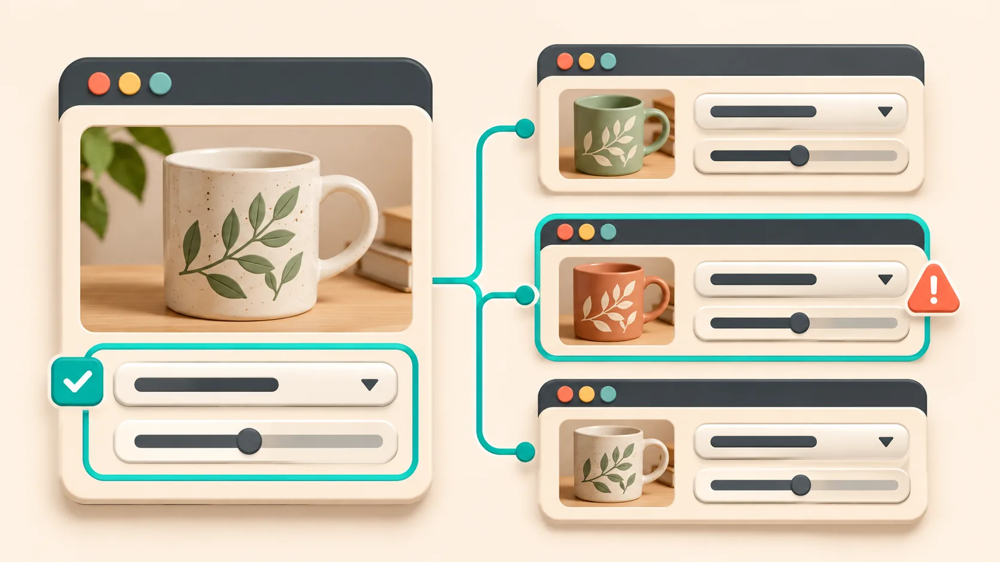

# Etsy Listing vs Variation Edits: A Scope Matrix Before You Bulk Update

A bulk edit goes wrong on Etsy most often because I chose the wrong *level* of the catalog, not because I clicked the wrong button. My practical rule is simple: use a listing edit when the fact belongs to the product as a whole; use a variation edit when the fact can differ by size, color, or another option. Before I run either, I make a one-line scope matrix that names the field, the target set, and the exclusions.

That rule sounds fussy, but it is much cheaper than discovering that a price change hit every option—or that a shipping-related cleanup skipped half the listings that needed it. [Bulk Listing Editor for Etsy](https://bulk-listing-editor.webyze.com/) makes the split explicit: Listings mode works on whole products, while Variations mode works on the individual options inside them. It also lets me filter, select exact records, review a pre-flight, and then apply the change.



## Start with the field, not the filter

I do not begin with “all summer items” or “everything on sale.” I begin by asking where the value actually lives. That keeps selection logic from deciding scope by accident.

| If I am changing… | My default scope | Question I ask before running it |
| --- | --- | --- |
| A title, description, tag, material, image position, or personalization prompt | Listing | Should every shopper see the same new value? |
| A price, quantity, SKU, or one option value | Variation | Could two options of this same item legitimately differ? |
| Weight, dimensions, or a processing-related setting | Listing, unless the shop’s data model says otherwise | Is this an item-level shipping promise or an option-specific fact? |

The important part is not pretending the table answers every edge case. Etsy listings can have unusual option setups, and a product may carry business rules that the interface cannot infer. The table is a forcing function: if I cannot describe the field’s owner, I do not bulk-edit it yet.

This is related to the [canary-listing workflow](https://the-lean-ecommerce.github.io/2026/11/15/how-to-use-a-canary-listing-before-a-bulk-etsy-update/), but it answers an earlier question. A canary proves a change can survive contact with a real listing. The scope matrix decides whether I should be operating on the parent listing or on its variants in the first place.

## Write a small scope matrix

My note is intentionally boring. I put it in the task ticket or a plain text file before I open the bulk editor:

```text
Change: add the material “recycled cotton”
Scope: listing
Include: active tote-bag listings tagged spring-2026
Exclude: personalized listings; listings with supplier-managed copy
Expected count: 34 listings
Verification: inspect 3 included listings and 2 excluded listings
```

For a variation-level price correction, the same note changes shape:

```text
Change: add $2.00 to XL variation prices
Scope: variation
Include: active hoodie variations where Size = XL
Exclude: clearance listings and bundles
Expected count: 19 variations across 12 listings
Verification: inspect one single-variant listing, one multi-variant listing, and one exclusion
```

The expected count matters because it gives me a stop condition. If the selected count is 190 when the note says 19, I do not rationalize it as a broad catalog change. I go back to the filter. The product’s documented flow—search, select, then apply with a pre-flight check—fits this sequence well.


## Keep a separate exclusion rule

“Included” is not enough. A good bulk task says what must remain untouched. I nearly always list at least one exclusion: made-to-order items, clearance inventory, bundles, a collection with a different margin rule, or listings managed by another person.

That is especially useful for search-and-replace work in titles or descriptions. The editor supports inserting text and search/replace, which can be helpful for a consistent correction. It can also amplify a too-broad phrase match. I test the exact phrase on one known listing first, then select only the catalog slice named in the matrix. For seasonal tag work, the same discipline complements this [Etsy tag refresh guide](https://herramientas-y-tutoriales.github.io/2026/11/17/renueva-etiquetas-de-etsy-por-temporada-sin-borrar-tus-palabras-clave/): add or remove a targeted keyword without treating the whole tag set as disposable.

## Run one field per task

Bulk Listing Editor can change prices, titles, descriptions, tags, materials, images, inventory, SKUs, weights, dimensions, personalization settings, and variation options. That range is the reason I keep a task narrow. A price correction and an image reorder may touch the same listings, but they deserve different runs and different verification questions.

A narrow run is easier to explain, reverse, and delegate. It also reduces the chance that a listing-level change masks a variation-level mistake. This is the same practical reason I like a [five-record reconciliation receipt for bulk edits](https://the-lean-ecommerce.github.io/2026/11/05/i-reconcile-shopify-bulk-edits-with-a-five-record-receipt/): a completed job should leave behind a small, inspectable proof rather than a vague memory that the button was clicked.

## Verify parent and child records after the edit

After a listing-level change, I open two or three changed listings and one deliberate exclusion. After a variation-level change, I also open a listing with multiple variations and inspect the specific option that should have moved. Looking only at the parent listing is not enough when price, quantity, or SKU differs below it.

My compact post-run check is:

1. Does an included listing show the new value?
2. Does a multi-variation listing show the change only on the intended option?
3. Does an excluded listing remain unchanged?
4. Does the observed count make sense next to the matrix?
5. Can I state what I would reverse if the answer to any of the first four is no?


If the task changes tags or listing data that feeds another system, I add one downstream check rather than assuming the edit ends in Etsy. For example, a shop sending Etsy data to Meta can use this [catalog-feed reconciliation workflow](https://tools-and-how-tos.github.io/2026/11/18/how-to-reconcile-an-etsy-catalog-feed-after-a-listing-change/) after the source listing update. The two checks serve different jobs: the matrix verifies the source edit; the reconciliation verifies what a connected channel received.

## Make the next bulk edit explainable

The goal is not to make a bulk editor feel risky. It is to make the scope visible before a fast tool makes the change permanent. Choose the field, assign it to listing or variation scope, name the exclusions, and compare the selected count with a written expectation.

For your next Etsy cleanup, start with one field and one small scope matrix. Then use [Bulk Listing Editor for Etsy](https://bulk-listing-editor.webyze.com/) to filter the records, select only the intended listings or variations, review the pre-flight, and make the smallest change you can verify.
