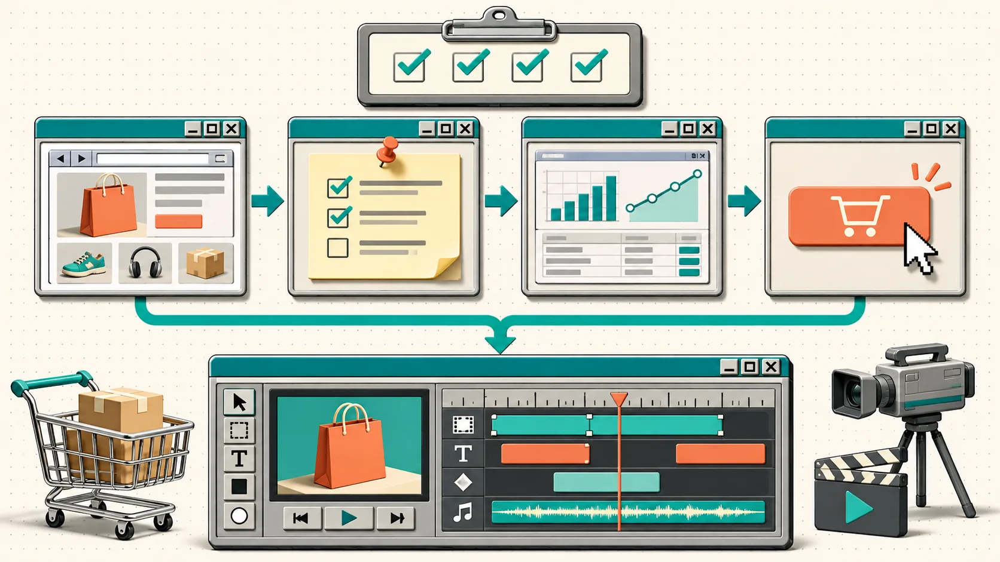
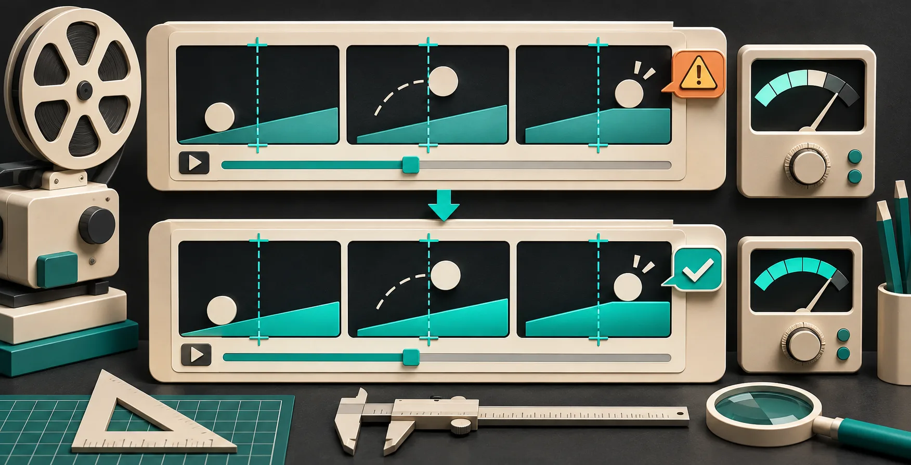

# Startup Launch Video Input Pack: 4 Things to Verify Before You Render

A launch trailer is only as accurate as the material you hand it. Before I ask an agent to turn a startup site into motion graphics, I check four inputs: the page evidence, the audience problem, one believable proof point, and a single next action. That small pack prevents a polished film from becoming an expensive-looking homepage recap.

[VideoFlow Studio](https://studio.videoflow.dev/) is useful here because it starts from a public website, develops a plan, renders the film, and keeps the result editable. But it cannot decide which feature deserves the opening scene or whether your CTA matches the campaign. That is still an operator job.



## Why a URL is not a complete video brief

A website has navigation, repeated claims, old screenshots, and more than one audience. A 30-second trailer needs a spine. If I supply only a URL, I expect the first cut to make a reasonable interpretation—not to recover every unstated launch decision.

The practical fix is a one-page input pack. It is intentionally small enough to check before every render:

| Input | What I verify | What breaks when it is missing |
| --- | --- | --- |
| Page evidence | Current headline, product screens, and visible brand rules | The video presents an old promise or invents a visual priority |
| Audience problem | One person and the job they are trying to finish | The scenes become a feature inventory |
| Proof | One concrete mechanism, workflow, or outcome the site supports | The trailer makes claims the product page cannot defend |
| CTA | One action for this campaign | The ending asks viewers to do three things—or nothing |

This overlaps with my [four-card launch brief](https://the-lean-ecommerce.github.io/2026/11/10/startup-launch-video-brief-four-cards-to-write-before-the-first-cut/), but the key difference is timing: this pack is a pre-render verification pass. I use the current site as evidence rather than assuming the last launch doc is still true.

## 1. Capture page evidence, not a summary

Open the landing page like a skeptical customer. Save the URL, the exact headline, the feature section you want the viewer to remember, and the current primary button. Then mark any content that is only for a different audience—enterprise navigation, careers copy, or outdated integrations are common traps.

My handoff note can be blunt:

```text
Audience: Shopify merchants preparing a seasonal launch
Problem: product updates are scattered across a long page
Proof to show: one configurable product workflow
Do not show: legacy pricing, partner logo strip
CTA: join the launch list
```

That is enough direction for Studio without pretending it is a full production treatment. Studio’s published workflow explicitly moves from crawling and screenshotting the site to understanding the product, directing a concept, designing scenes, and then rendering. The point of this note is to constrain the choices that should not be inferred.

If the page itself is changing this week, add a date and owner to the note. I use the same discipline as my [startup-video accuracy check](https://the-lean-ecommerce.github.io/2026/10/29/how-i-keep-a-startup-video-accurate-when-the-product-changes/): a great-looking render is still wrong if the source promise changed yesterday.

## 2. Choose one narrative job for the trailer

A trailer can introduce a category, demonstrate a workflow, announce a release, or move visitors to a waitlist. It rarely does all four in one short cut. I write the job as a testable sentence: “After watching, a store owner should understand why this workflow replaces their manual handoff and know where to try it.”

That sentence drives the scene order. A reliable five-beat structure is:

1. Name the customer friction.
2. Show the product object or screen that changes it.
3. Show one mechanism or proof.
4. Restate the payoff in the customer’s words.
5. Hold one CTA long enough to act on.

This is why a page-to-video workflow is more useful when the video remains structured. VideoFlow Studio says its output is an editable project rather than a locked render; its underlying open-source [VideoFlow engine](https://videoflow.dev/) describes the format as portable JSON that can be rendered across its supported surfaces. For a founder, that means the narrative can change without starting the visual system from zero.

## 3. Make proof visible before you make it cinematic

The most tempting mistake is opening with an abstract mood reel and adding proof as a tiny mid-film card. For a product launch, reverse that: decide what a viewer can actually see that supports the promise. It might be a real dashboard state, a clear before/after workflow, a product configuration, or a specific on-site claim.



Before rendering, I label every planned scene as one of three types:

- **Claim:** a headline or positioning statement.
- **Proof:** something a viewer can see or trace to the site.
- **Bridge:** a transition that makes the sequence easier to follow.

If the cut has three claims in a row, it needs proof. If it has four product screens in a row, it needs a bridge. This quick classification keeps a launch trailer from becoming either a slogan montage or an unedited screen recording.

It also makes review less subjective. VideoFlow Studio says it reviews the encoded frames and can measure issues such as alignment and contrast before re-rendering. That is valuable visual QA, but it does not validate product truth. My input pack separates those jobs: the source owner checks proof; the render review checks what viewers will actually see.

## 4. Define the change boundary before the first cut

The first render should be a decision point, not a delivery date. I specify what is safe to change after it arrives:

| Change request | Usually safe to revise | Recheck before approving |
| --- | --- | --- |
| Hold the end card longer | Timing and scene duration | CTA remains current |
| Swap a product screenshot | One scene asset | Screen still supports the stated proof |
| Change the key message | Narrative and scene order | Every later scene still follows the new promise |
| Update pricing or availability | Usually requires a broader pass | All claims, overlays, and CTA destination |

The product’s terminal path begins with `npx @videoflow/studio@latest`, while its hosted path lets a user paste a URL and steer the work in the browser. Both paths end in an editable project and editor according to the product site. Pick the terminal route when local files and a shell-first process are part of your launch workflow; pick hosted when the team mainly needs browser access. Neither removes the need to state the change boundary.


For a practical example of staying specific when a scene changes, see [how to revise one startup video scene without rebuilding the whole cut](https://productivity-tech-business.blogspot.com/2026/11/how-to-revise-one-startup-video-scene.html). The useful request is not “make it punchier.” It is “hold the proof screen one beat longer, keep the product name, and move the CTA after the demo.”

## A five-minute pre-render receipt

Before clicking render, I leave this receipt in the launch ticket:

```text
[ ] Source URL and page capture are current
[ ] One audience and one video job are named
[ ] One visible proof is assigned to a scene
[ ] One CTA and destination are confirmed
[ ] Out-of-scope claims and old assets are listed
[ ] First-cut changes that are safe vs. re-brief-worthy are clear
```

It is deliberately less elaborate than a production brief. The goal is not to slow down a launch; it is to give the first render enough truth to be worth reviewing. Once the cut exists, use a focused review pass like the one in [my launch-video review workflow](https://tools-and-how-tos.github.io/2026/11/15/how-to-review-a-startup-launch-video-before-you-share-it/) and then make the next request concrete.

Start your next trailer by copying that receipt beside the URL. Then open [VideoFlow Studio](https://studio.videoflow.dev/), give it the site and the four verified inputs, and treat the first render as an editable working cut—not the moment you stop checking the source.
