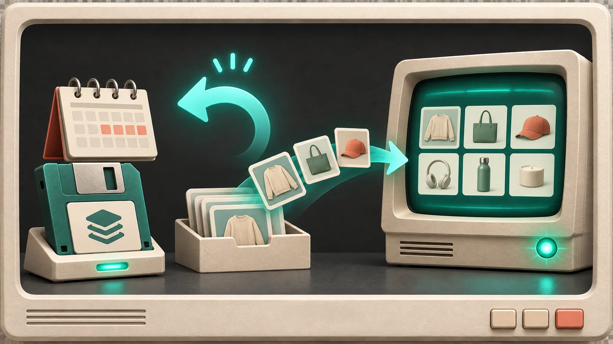

When a seasonal collection is over, I do not start by bulk-archiving everything with a winter tag. The safe move is to classify each listing as **keep active**, **remove from the storefront but preserve the URL**, or **archive**, then run a small representative check before changing the whole set. That prevents a tidy-looking catalog cleanup from quietly breaking a collection, an in-stock variant, or a paid link.

[Ultimator Bulk Editor](https://apps.shopify.com/ultimate-bulk-editor) is useful here because its task flow separates selection, the change itself, and scheduling. I use that separation as a release boundary: define what leaves the seasonal surface, decide what remains sellable, and preserve a reversal path before the task runs.

## Start with a product fate, not a bulk action

A seasonal label is not a product state. A scarf can be out of a winter collection yet still be a year-round item; a gift bundle may need to disappear from navigation while its product page remains useful for search or customer-service links. Put every selected product into one of these outcomes before changing a field.

| Outcome | Use it when | First check |
| --- | --- | --- |
| Keep active | The product is still sellable outside the campaign | Product status, inventory, and collections stay intentional |
| Remove from campaign surface | The listing should not appear in the seasonal collection or promo path | Collection rules, navigation links, and redirects |
| Archive | The item is genuinely unavailable and should be hidden from the online store | Existing collection membership and future reactivation data |

That middle row is the one teams often skip. Shopify notes that archived products can remain listed in collections even though customers cannot see them, and collection rules can be based on tags, status, inventory, price, and more. A status change is therefore not a substitute for reviewing the collection logic. [Shopify’s collection-condition guide](https://help.shopify.com/en/manual/products/collections/conditions) is worth opening next to the task.


## Build a selection you can explain tomorrow

For a retirement task, the selection should answer a question a teammate could reproduce: “products carrying the `winter-2026` campaign tag, excluding carryover items.” Avoid vague filters such as “everything that looks seasonal.”

Before creating the task, record these four things in a short change card:

1. **Selector:** the tag, vendor, product type, collection, or other criterion that finds the intended set.
2. **Exceptions:** carryover SKUs, preorders, bundles, and products still referenced by an active campaign.
3. **Fields to change:** for example, remove a campaign tag, change product status, or update a collection assignment—do not treat product and variant changes as interchangeable.
4. **Success rule:** the storefront result you expect, plus the admin evidence that proves it.

This is deliberately narrower than a generic cleanup. I used the same “one change set, one visible purpose” idea in [a bulk-edit change card for promotions](https://tools-and-how-tos.github.io/2026/11/21/how-to-build-a-shopify-bulk-edit-change-card-before-a-promotion/). It gives the task an owner and makes a rollback much less theatrical.

## Know the collection behavior before touching status or tags

Two Shopify details change the shape of this job. First, a Products-source collection can include a product when **any** of its variants matches an inventory condition. Second, a status condition used with “match any” can bring in every product with that status even when other conditions do not match. Those are good reasons to inspect the collection definition instead of assuming an archived or out-of-stock item simply vanishes.

Use this preflight:

- Open each affected automated collection and write down whether it uses **match all** or **match any** conditions.
- Identify conditions driven by the campaign tag, inventory, compare-at price, or product status.
- Check any manual collection separately; automation rules do not remove products that were added manually.
- For listings that should remain reachable, decide whether you are removing a tag, removing a collection relationship, or changing storefront availability. Those are different outcomes.

If the job also changes inventory, keep it in its own task. Shopify’s inventory bulk editor sets an absolute quantity, not a movement history, and concurrent changes can produce a conflict dialog. That is a different kind of operational risk from retiring a campaign label.

## Run a three-listing proof before the full task

Pick three intentionally different records: one single-variant product, one multi-variant product, and one exception that must remain active. In Ultimator, define the selection and update, but use that trio as the first proof of your rule. The app’s product brief describes scheduling or running a task immediately; either choice should follow this small check, not replace it.

For each record, compare the before and after state:

| Check | What I expect to see |
| --- | --- |
| Product page | Correct availability and no stale campaign message |
| Variants | The intended sellable variant remains sellable; no unrelated SKU changed |
| Collection | Inclusion or removal matches the actual condition, not an assumption |
| Navigation / link | Campaign links have a deliberate destination |
| Admin record | Tag, status, and collection assignment match the written change card |


This small proof catches the most expensive mistake: applying a product-level idea to a variant-level field, or the reverse. If your task includes SKU work, the same discipline applies—[this guide to separating product and variant changes](https://how-to-blog.gitlab.io/2026/11/13/how-to-separate-product-and-variant-changes-before-a-shopify-bulk-edit/) is a useful companion.

## Schedule only when the launch surface is ready

Scheduling is helpful when a campaign ends at a known time, but it should not be a hiding place for unresolved dependencies. Before scheduling, confirm the merchandiser has replaced the homepage slot, the email team has stopped using campaign links, and customer support has a plain answer for incoming questions about discontinued items.

Then save a rollback record containing:

```text
Task name: retire winter-2026 campaign
Selection: tag = winter-2026, excluding tag = carryover
Changes: remove winter-2026 tag; archive only the approved discontinued list
Proof set: SKU-A / SKU-B-Blue / SKU-C exception
Rollback: restore tag; restore prior status; refresh affected collection rules
Owner and window: name + scheduled time
```

The point is not to promise an instant undo that every data change can provide. It is to know the prior intent well enough to reverse the specific fields you changed. That is more reliable than hunting through a catalog after the campaign is already gone.



## Verify the storefront after the task finishes

After the change, check the proof set in an incognito browser and in Shopify admin. Then search the site for the old campaign phrase, open the seasonal collection URL, and test one known inbound product link. The [Shopify bulk-editing documentation](https://help.shopify.com/en/manual/shopify-admin/productivity-tools/bulk-editing) also notes that invalid values can block saves, including missing required SKUs and metafield validation errors—so a completed-looking task deserves a real spot check.

For larger rollouts, keep the scope deliberately small. A [dry-run workflow for scheduled bulk changes](https://productivity-tech-business.blogspot.com/2026/11/how-to-run-shopify-bulk-edit-dry-run.html) and a [five-record reconciliation receipt](https://the-lean-ecommerce.github.io/2026/11/05/i-reconcile-shopify-bulk-edits-with-a-five-record-receipt/) are both practical ways to make the final review repeatable.

## Make the seasonal exit reversible

A clean seasonal exit is not “archive everything with one tag.” It is a documented decision about visibility, sellability, collection behavior, and recovery. Start with a three-outcome fate table, prove the selector on representative records, and save the exact rollback fields before scheduling.

If your current Shopify cleanup is growing beyond a handful of manual edits, [install Ultimator Bulk Editor](https://apps.shopify.com/ultimate-bulk-editor) and build the task around that written change card. Your next campaign launch will be easier because this one left the catalog explainable.
