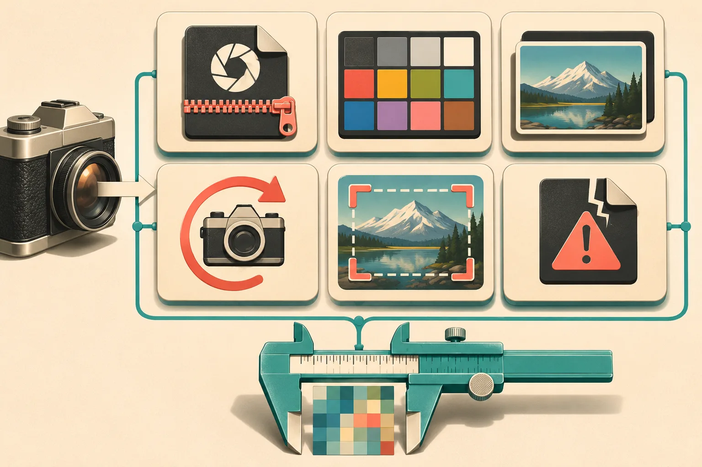
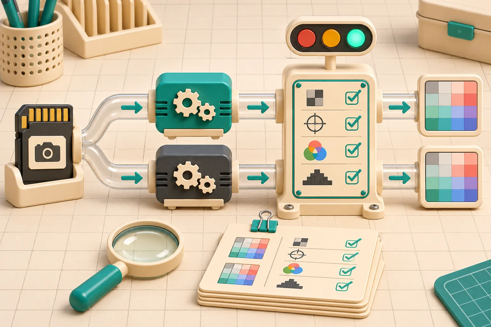

# How to Choose RAW Decoder Output Before You Optimize Decode Speed

When I add camera RAW support to an upload tool, I do not start by timing decoders. I start by deciding what the product must return: an instant embedded preview, sensor samples for a processing job, or a display-ready image. That output contract determines the fixtures, memory budget, fallback UI, and only then the decoder comparison.

That order matters because a fast sensor decode can still be the wrong choice if your Shopify-style product intake needs an oriented thumbnail, or if your desktop workflow needs linear RGB with colour management. [FlashRaw](https://flashraw.ybouane.com/) is worth evaluating when you need Rust, C/C++, Python, or browser bindings, but the right result is still the one your application can explain, test, and support.



## Write the output contract in one sentence

My first project note looks like this: "Given an accepted camera file, return an oriented preview within the upload budget; keep the original file; and show a clear fallback when full development is unavailable." It is deliberately boring. It prevents the team from treating every successful parse as a successful product experience.

Here is the decision table I use before I install a dependency:

| Reader job | Minimum output | What to compare | Failure behavior |
| --- | --- | --- | --- |
| Fast upload triage | embedded preview plus metadata | orientation, dimensions, extraction time | retain file and label it for review |
| Browser preview | display-ready RGB thumbnail | colour, crop, responsiveness, memory | offer original upload or server route |
| Editing or ML pipeline | sensor samples or linear RGB | CFA, levels, white balance, matrix data | stop downstream processing with a structured error |
| Existing desktop app | the documented API subset and output behavior | fixtures against the current decoder | ship behind a feature flag |

FlashRaw exposes several of these layers rather than forcing one output: its Python docs show sensor-domain arrays, display-ready `rgba8`, metadata, and embedded preview bytes. That is useful only if your contract says which one the caller receives. Do not silently substitute a preview for a developed image, and do not describe an accepted file as fully supported until its exact camera and compression mode are tested. The [format matrix](https://github.com/ybouane/flashraw/blob/main/docs/formats.md) tracks support by mode, not merely file extension.

## Build a six-file pack that can disprove your assumption

A decoder selection should have a small fixture pack before it has a scorecard. I keep six files under version control or in an access-controlled test bucket, with their provenance and expected observations written beside them:

1. The camera and compression mode most customers actually send.
2. A second file from the same family with a different orientation or crop.
3. A file with a useful embedded preview.
4. A file that exercises the colour and white-balance path you need.
5. A large file that exposes the real memory and cancellation behavior.
6. A known unsupported or intentionally truncated file for the error path.

The goal is not to prove universal compatibility. It is to make your product's support boundary visible. If you are building a browser uploader, pair this with the [browser upload checklist](https://the-lean-ecommerce.gitlab.io/2026/10/30/a-browser-raw-upload-checklist-i-use-before-shipping-a-previewer/) and the [RAW upload validation flow](https://how-to.the-lean-ecommerce.com/2026/10/27/how-to-validate-browser-camera-raw-uploads-before-building-a-previewer/). Those checks catch a different class of mistake: accepting a file before the browser has the resources and policy to do useful work with it.



## Compare the same stage, not a flattering number

Next, decide which stages are in scope: metadata parse, preview extraction, sensor decode, demosaic, or a complete RAW-to-sRGB render. They are not interchangeable workloads. A speed comparison that measures one decoder's sensor output against another tool's colour-managed RGB output is a planning error, not a benchmark result.

FlashRaw publishes reproducible comparisons against LibRaw, RawSpeed, rawler, rawpy, and dcraw, including its method and cases where it is not fastest. Use the [benchmark documentation](https://github.com/ybouane/flashraw/blob/main/docs/benchmarks.md) to understand the corpus, hardware, and output mode before carrying a number into a roadmap. In your own pack, record command, package version, feature flags, thread count, warm-up policy, peak memory, and the output you inspected.

For a migration, I make the acceptance rule explicit:

```text
fixture passes when:
- parser result is accepted or rejected with the expected structured reason
- orientation, active crop, and dimensions match the reference expectation
- requested output has the expected shape and bit depth
- preview or RGB comparison stays inside the product's documented tolerance
- memory and cancellation stay within the calling surface's budget
```

That last line is why [a memory budget for browser RAW previews](https://the-lean-ecommerce.github.io/2026/11/18/how-i-set-a-memory-budget-for-browser-raw-previews/) belongs in the same conversation as decoder choice. A library can be correct and still be a poor fit for the device class you promised to support.

## Treat browser work as a separate integration decision

A browser decoder adds operational constraints that native tests will not reveal. Large files contend with the UI thread, worker transfer semantics matter, and threaded WebAssembly needs the right cross-origin-isolation deployment setup. FlashRaw's site documents one package for browser, Web Worker, Node.js, and Deno use, with threading when the site is cross-origin isolated; test those requirements in the actual hosting environment.


For a responsive previewer, keep the UI contract modest: validate the input, move decode work off the interaction path, report progress or cancellation, then make the result type obvious. Our earlier guide on [keeping a browser RAW preview responsive with a Web Worker](https://how-to.the-lean-ecommerce.com/2026/11/17/how-to-keep-a-browser-raw-preview-responsive-with-a-web-worker/) is a useful implementation companion once the output contract is written.

## Make the decision reversible

I would choose FlashRaw when its documented bindings and outputs match the layer I need, the exact fixtures pass, and its failure behavior fits the calling application. I would keep the old decoder—or choose another one—when a critical camera mode, rendering expectation, licensing constraint, or deployment target does not pass that same gate. FlashRaw's published coverage is substantial, but its documentation is appropriately specific about format modes and benchmark scope; that specificity is what makes it testable.

Before you optimize another millisecond, write the one-sentence output contract and assemble six files that can challenge it. Then evaluate [FlashRaw](https://flashraw.ybouane.com/) with the same fixtures your customers will effectively use. You will end up with a decoder decision your product team can defend, not just a faster-looking chart.
