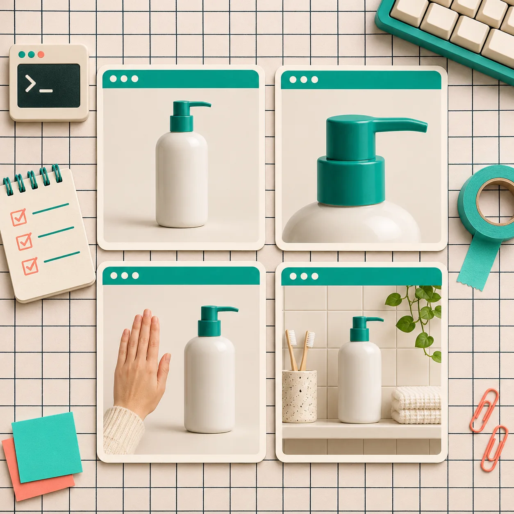
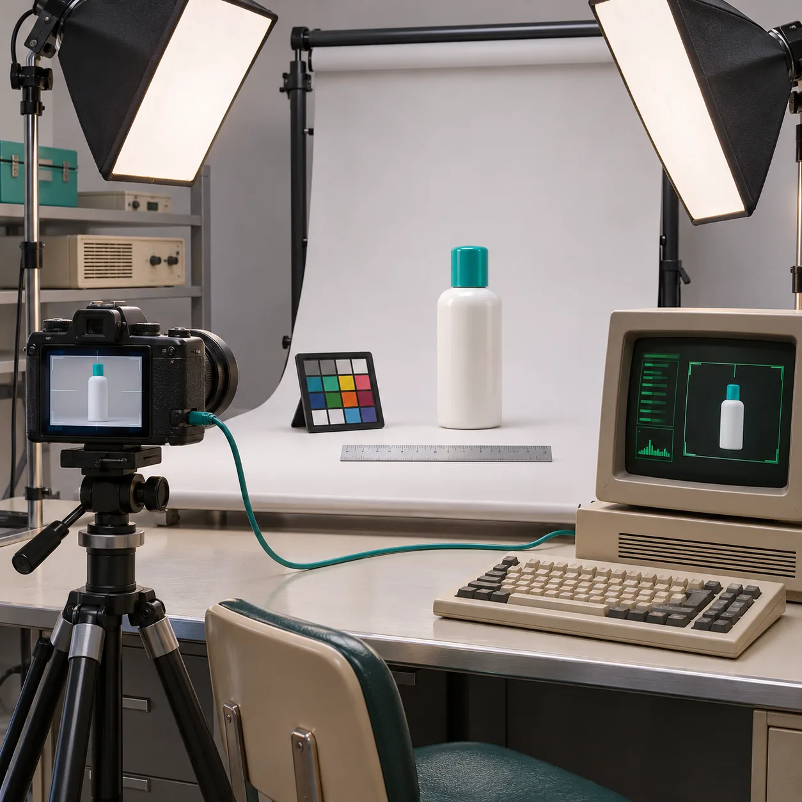
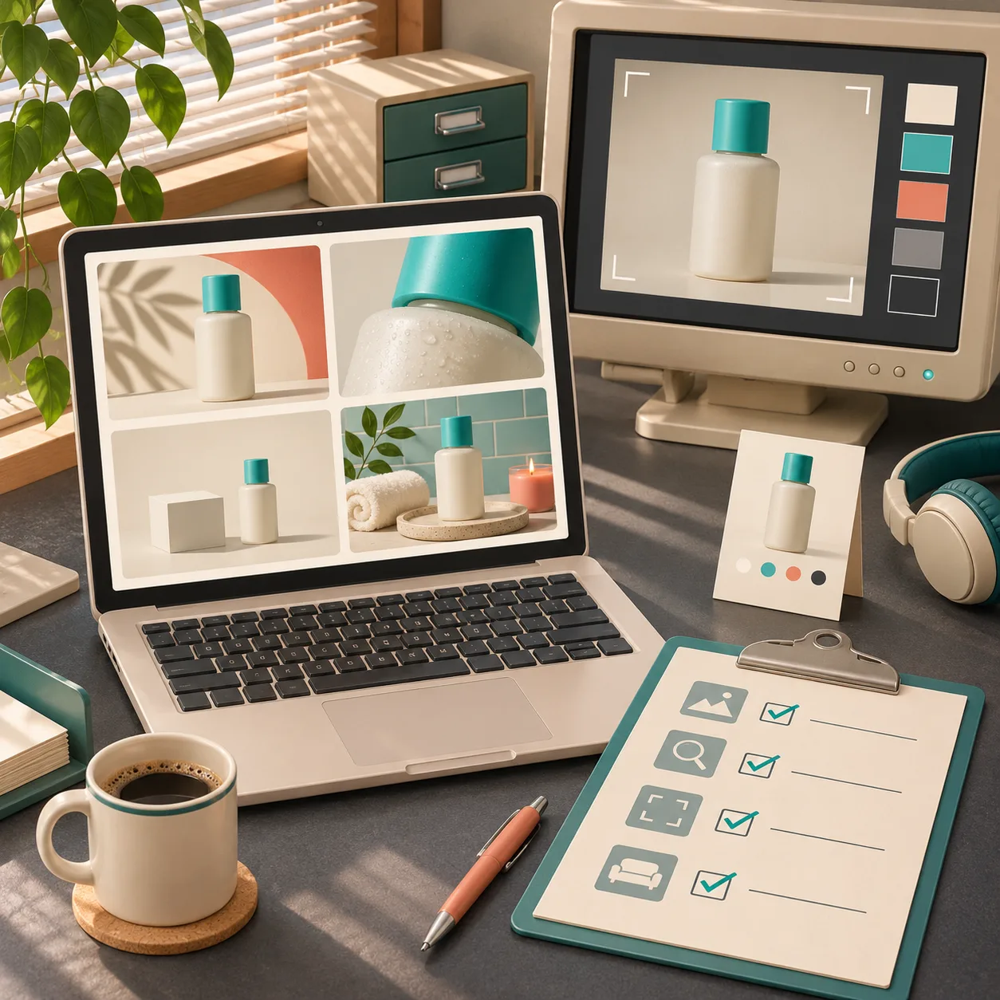

# Shopify Product Image Role Matrix: Plan AI Variants Before You Generate

AI image tools make it very easy to create five versions of the same product photo and still end up with a product page that answers almost nothing. The fix is to assign each image a job before you generate it. For a typical Shopify product page, I use four roles: a hero that identifies the item, a detail that proves a material or feature, a scale shot that answers ‘how big is it?’, and a context shot that shows where it belongs.

[Supra AI Photo Studio](https://apps.shopify.com/supra-ai-photo-studio) is useful here because its Shopify listing covers background work, image enhancement, lifestyle scenes, and fashion try-on. Those are different production moves, not a reason to make interchangeable gallery images. Start from a reliable product reference, then make each generated variation earn one specific place in the gallery.

## Why a role comes before an AI prompt

A prompt such as ‘make this product look premium’ leaves too many decisions unresolved. It can create a nice-looking image while changing the product’s silhouette, hiding the closure, or duplicating the information already supplied by the primary packshot. That is a content problem before it is an AI problem.

The role matrix gives the generation a constraint. It also gives the reviewer a question: does this image add a shopper-relevant answer that the other images do not? I use the following version when planning one product page.

| Image role | Shopper question | What must remain true | A useful AI task |
| --- | --- | --- | --- |
| Hero | What am I buying? | Overall shape, color, included parts | Clean background, lighting, crop |
| Detail | What is it made of or how does it work? | Texture, seams, controls, label facts | Tighter crop or clarity correction |
| Scale | How large is it in use? | Proportions and real-world relationship | Place beside a truthful reference or in a measured scene |
| Context | Where or how would I use it? | Product geometry, finish, functional orientation | Object placement in a relevant setting |

This is deliberately not a requirement to put four images on every listing. If a product has no meaningful detail shot, do not invent one. If scale matters more than context, spend the generation budget there. The matrix is a way to make omissions explicit.

## Build a trustworthy source image first

The reference image is the source of truth for every variant. Photograph or select the clearest available view, then record the attributes that must survive editing: product outline, finish, colorway, included accessories, text that needs to stay legible, and the product’s working orientation.

Supra’s help material recommends starting with a clear, high-quality image and isolating the product before using tools such as object placement or try-on. That sequencing makes sense operationally: a clean source gives the editor less irrelevant background to reinterpret. It does not replace a product check.

For a practical master, I keep three things with the original: the untouched file, a simple product facts note, and a target crop. The facts note can be tiny: ‘teal cap; white ceramic body; pump faces right; 250 ml; cap is included.’ The goal is not to feed the tool a novel. It is to give the reviewer a short list of visual invariants.

If you are already maintaining a master file for other visual work, [this guide to making a product-photo edit without changing the master](https://how-to.the-lean-ecommerce.com/2026/11/25/how-to-make-a-product-photo-edit-without-changing-the-master/) is a useful companion. The same separation prevents a gallery experiment from quietly becoming your only recoverable source.

## Write prompts as production tickets

Once the role is chosen, write the prompt like a production ticket, not a mood board. Name the role, scene, camera relationship, lighting direction, and non-negotiable product details. Then explicitly state what must not change.

For example, a context-shot ticket for a ceramic bottle might read: ‘Place the provided white ceramic pump bottle, teal cap facing right, upright on a bathroom shelf. Soft morning side light. Preserve bottle height, pump shape, color, and unlabeled surface. Do not add a logo, change the cap, or obscure the pump.’

That is more actionable than asking for a luxury bathroom. It gives you a concrete failure condition: if the pump has moved, the context image failed even if the room looks polished. For image preparation before any AI work, keep a separate intake pass; [this Shopify photo-prep workflow](https://how-to.the-lean-ecommerce.com/2026/11/19/how-to-prepare-shopify-product-images-before-you-upload-them/) covers the useful basics around source quality and file readiness.

## Generate one role at a time

I would not ask for hero, detail, scale, and context in a single batch prompt. Generate the hero first and compare it against the master. Then make the detail, scale, and context versions as separate tasks. A failure is easier to diagnose when one image has one job.

For apparel, a try-on can be the context or scale image, but only when it actually helps a shopper assess fit or styling. The [Shopify App Store listing for Supra AI Photo Studio](https://apps.shopify.com/supra-ai-photo-studio) describes fashion try-on, background removal, image enhancement, lifestyle scenes, and short video generation; pick the capability that matches the role rather than treating every capability as a required gallery format.

## Run a four-question release check

Before publishing variants, lay them beside the source and answer four questions for each one:

1. **Role:** Can I name the shopper question this image answers?
2. **Truth:** Did the product shape, color, included parts, or working orientation drift?
3. **Redundancy:** Does this image contribute something the hero already communicates?
4. **Placement:** Is this the right asset for the product page, social creative, or a campaign page?

The third question is the one that saves a surprising amount of catalog clutter. Four perfect-looking lifestyle shots can still be one useful image and three duplicates. A gallery should reduce uncertainty as a shopper moves through it.

For a baseline gallery check, compare your set with [a three-image product-photo gate](https://the-lean-ecommerce.github.io/2026/11/11/a-three-image-product-photo-gate-before-shopify-publish/). If your catalog has color variants, add a final route check so the image and selectable option agree; this [Shopify swatch source-of-truth guide](https://the-lean-ecommerce.blogspot.com/2026/11/how-to-choose-shopify-swatch-source-of.html) is a good reminder that visual choice and catalog data need to point to the same product.

## Keep the variant set small enough to review

A role matrix is not a license to inflate a media gallery. Publish the smallest set that identifies the product, proves the important detail, gives necessary scale, and supplies honest context. Save the rest as candidates for ads, emails, or a later test.

If you want to try this workflow in Shopify, open [Supra AI Photo Studio](https://apps.shopify.com/supra-ai-photo-studio), pick one existing product with a strong source photo, and make just one context variant. Review it against the four questions before creating another. That first disciplined comparison tells you far more than a folder full of pretty but interchangeable images.
