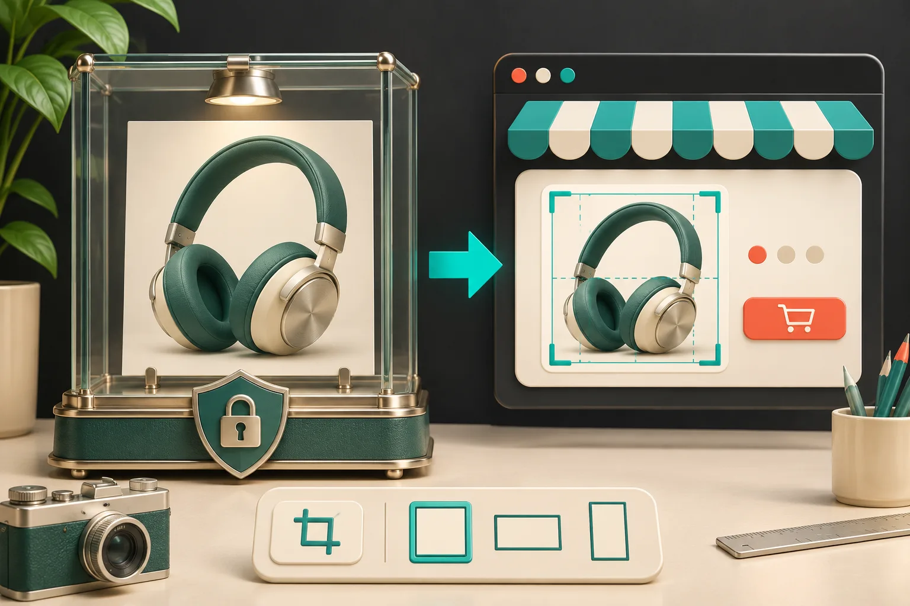

# A Shopify Product Image Handoff That Keeps the Master Intact

I usually see product-image trouble start before anyone opens Shopify: a campaign image gets cropped, exported, recompressed, and passed around until the only copy left is a tiny derivative. The safer workflow is to keep one protected master, make a purpose-built storefront copy, and run a short visual-and-file check before upload. For the conversion and proof steps, I use the browser-based [Tiny Online Tools image toolbox](https://tiny-online.tools/image-tools), which lists its image utilities as privacy-friendly browser tools.

That sounds fussy for one product card. It is much less fussy than trying to recreate a good crop after a launch, especially when the image has to work in a product page, a collection grid, and a channel feed.


## Start by naming the job of the derivative

Before choosing a format, I write one line beside the source file: **where will this image appear, and what must stay visible?** A product-page hero, a square collection tile, and a transparent detail overlay are three different jobs. The fact that Shopify can present product media does not make every rendition interchangeable; the visible crop still needs to make sense in its own placement.

Here is the decision card I use:

| Asset job | Keep as source | Make as storefront derivative | Check before upload |
| --- | --- | --- | --- |
| Product-page hero | Original dimensions and color | A web-ready image with the subject centered | Detail holds at the largest expected view |
| Collection tile | Full uncropped master | A square or grid-shaped crop | Product remains recognizable when small |
| Transparent detail | Original alpha-capable file | A transparent PNG/WebP only when the theme needs it | Edges look clean on the live background |
| Campaign export | Original campaign file | A separate crop, never an overwrite | Copy is clearly labelled as a derivative |

That table is intentionally not a format decree. A transparent asset may be the right choice for an overlay; a photographic product hero may need a non-transparent, web-ready derivative. The important decision is preserving the master and knowing the intended placement before export.

## Make the copy in a browser, not on top of the source

My small handoff sequence is: duplicate first, then transform the duplicate. [Resize Image](https://tiny-online.tools/image-tools/resize-image) gives me a purpose-built derivative when dimensions are the issue. If I need a different file type, I use [Image Converter](https://tiny-online.tools/image-tools/image-converter) rather than pretending a renamed extension changed the image. And if the derivative needs to travel quickly in a brief or support ticket, [Compress Image](https://tiny-online.tools/image-tools/compress-image) is the last step—not the first.

The order matters. Compression can hide a crop or color mistake because it feels like the final operation. I want to see the intended framing at the intended dimensions first, then decide whether a smaller file is actually necessary.



For a technical handoff, I leave a tiny receipt beside the file:

```text
master: studio-headphones-v4.tif
derivative: studio-headphones-product-square.webp
placement: collection grid
source preserved: yes
crop reviewed at grid size: yes
```

This is deliberately boring. It turns an image edit into something another person can verify instead of reverse-engineer. The same separation of original and derivative helps when you are [making a product-photo edit without changing the master](https://how-to.the-lean-ecommerce.com/2026/11/25/how-to-make-a-product-photo-edit-without-changing-the-master/) or building a [product-image role matrix before generating variants](https://the-lean-ecommerce.github.io/2026/11/25/shopify-product-image-role-matrix-plan-ai-variants-before-you-generate/).

## Check the crop at the smallest useful size

A product photo can look perfect at 2400 pixels and unreadable at a small collection-card width. I do not treat dimensions as a universal prescription because theme layouts and product subjects differ. Instead, I check the derivative in the smallest context it must survive:

1. Is the main object still obvious?
2. Is any label, texture, or variant cue now too small to matter?
3. Did the crop remove a cue that distinguishes this product from a similar one?
4. Does the background compete with the product at card size?

If the answer to any of those is no, I revise the crop—not the master. This is also the place to ask whether the image belongs in a primary product slot at all. For a broader planning pass, my [product photo background check](https://tools-and-how-tos.github.io/2026/11/22/how-to-make-product-photo-backgrounds-consistent-without-faking-the-pr/) is useful because it separates consistency from fabrication.

## Ship with a three-part proof

Before uploading, I want three things in the handoff: the derivative file, the original filename or location, and the intended placement. Then I use this release check:

- **Visual:** the product is recognizable at its smallest placement and no important edge is cut off.
- **File:** the derivative opens, has the expected format, and is not an accidentally overwritten master.
- **Placement:** the named Shopify slot is known, so a collection crop is not accidentally used as the gallery hero.


This proof is small enough to use during a busy launch. It is also more actionable than a vague request to “optimize images.” If a teammate says the card looks soft or awkward, you can locate the derivative, reproduce the transformation, and correct just that version. For a complementary preflight, use this [product photo metadata check before sharing a sample](https://the-lean-ecommerce.github.io/2026/11/08/a-shopify-product-photo-metadata-check-before-you-share-a-sample/).

## The boundary that prevents rework

Tiny Online Tools is useful here because it keeps narrow transformations close to the task: resize, convert, and compress a selected copy in the browser instead of installing a full editor for one change. It is not a substitute for art direction, a good source image, or a theme preview. Its value is that the mechanical step stays repeatable.

My next action is simple: pick one product image that is about to be reused, duplicate it, name its placement, make one derivative, and record the three-part proof. That gives your Shopify catalog a handoff another operator can actually trust.
