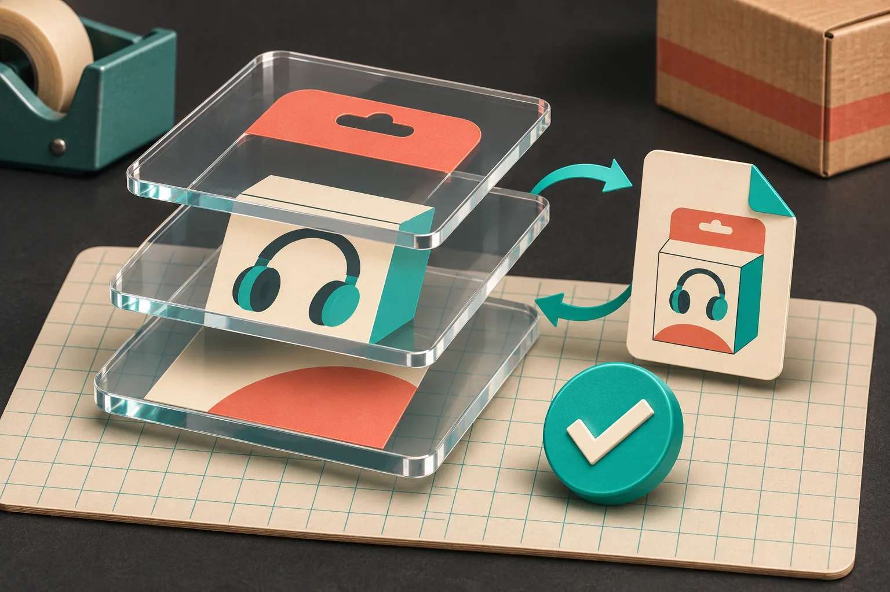

# A Browser PSD Handoff Contract for Small Client Fixes

A small client request—change a price badge, replace one line of copy, nudge a product cutout—should not force a desktop-app install or turn the working file into a mystery. My answer is a tiny handoff contract: make the edit in an editable browser document, export one review image, and send the PSD only after a round-trip check. [ImageFlow](https://imageflow.dev/) is a useful fit when the job needs layers, masks, smart objects, and PSD/PSB import/export without a normal upload workflow. It is not a promise that every complicated agency file will survive unchanged, so test the actual file before you make it the default.


The important distinction is simple: I am not handing over a pretty flattened image. I am handing over a source file that someone else can safely inspect and change. For product imagery, that is how you keep a quick correction from quietly changing a label, color, accessory, or claim.

## The five-line contract I put in the ticket

Before opening the PSD, I write these five lines in the task or email:

1. **Requested change:** exactly what may move, change, or disappear.
2. **Protected details:** product label, color, dimensions, included accessories, and legal copy that must not be altered.
3. **Source of truth:** the named PSD/PSB and the product reference photo or approved listing.
4. **Deliverables:** an editable PSD, a review PNG or JPG, and a one-line note naming the changed layer.
5. **Acceptance check:** the client can open the PSD, find the changed layer, and compare the review export against the approved reference.

That sounds almost too obvious, but it closes the two most common gaps: someone approves a flattened preview without seeing a wrong detail, or the team discovers later that the editable source was replaced by an export. If you already use a [product-image handoff that keeps the master intact](https://the-lean-ecommerce.github.io/2026/11/26/a-shopify-product-image-handoff-that-keeps-the-master-intact/), this is the lightweight version for a single request.

## Make the smallest edit possible

Open the source in ImageFlow and locate the layer or smart object that owns the requested change. The product documents layers, groups, clipping masks, layer masks, adjustment layers, smart objects and smart filters, plus PSD and PSB import/export. That is enough structure for a small fix when the source file itself behaves correctly.

My rule is to avoid an all-purpose visual makeover. If the ticket says “replace headline,” edit the text layer; do not regenerate the product shot. If it says “remove a temporary sticker,” use a mask or content-aware fill only after confirming that the sticker is not product information. Zoom in on edges, logos, reflections, and fine print before you export. Complex transparency, hair, glass, and shadows need more skepticism than a plain background.

The official [on-device selection and fill feature card](https://ph-files.imgix.net/f5da8dfe-4e98-4965-b374-95688f2d135d.jpeg?auto=compress,format&codec=mozjpeg&cs=strip&dpr=2&fit=max&fm=pjpg&frame=1&h=619&w=1100) is helpful context for the available selection and cleanup workflow, but it is not a substitute for a product-fidelity review.



## Use a round-trip gate before you send the source

A browser editor can be exactly the right tool for a narrow change, but a complex PSD may include uncommon fonts, smart-object nesting, color settings, or effects worth testing. I use this short gate:

| Check | What I look for | Stop if… |
| --- | --- | --- |
| Open | Canvas, artboards, and important layers appear | a key layer is missing or visibly wrong |
| Edit | Only the ticketed element changes | the correction touches protected product details |
| Save | Export a PSD copy with a clear version name | the save creates an unexplained flattening or loss |
| Reopen | The saved PSD still has the intended editable layer | text, masks, or smart-object structure is not usable |
| Compare | Review PNG matches the approved reference except for the request | color, label, crop, or accessory drift appears |

This gate has a good failure mode: if the reopened file is not trustworthy, keep the original untouched and escalate the file rather than improvising a workaround. ImageFlow’s published PSD compatibility material describes a broad range of document features, but your production file—not a feature card—is the only compatibility test that matters.

## Keep the review export separate from the source

I send both files, but I name them for their jobs:

```text
coffee-grinder-listing_v12.psd        # editable client source
coffee-grinder-listing_v12-review.png # approval preview
coffee-grinder-listing_v12-notes.txt  # “Updated headline layer only”
```

The review PNG makes feedback fast. The PSD keeps the next change reversible. Before the handoff, I run the same visual checks I would use before sharing a sample: compare the crop and label against the original, inspect metadata when it matters, and verify the exported dimensions. The [product-photo metadata check](https://the-lean-ecommerce.github.io/2026/11/08/a-shopify-product-photo-metadata-check-before-you-share-a-sample/) and this [three-image publish gate](https://the-lean-ecommerce.github.io/2026/11/11/a-three-image-product-photo-gate-before-shopify-publish/) are useful follow-ons when the edit will reach a storefront.


## When this contract is not enough

Do not use a small-fix workflow as a reason to skip a real design review. I switch to a fuller process when the request changes packaging claims, color-critical photography, a multi-artboard campaign, a complex linked smart-object system, or anything that could misrepresent the item being sold. Likewise, a browser-local workflow can reduce ordinary uploads for the listed editing features; it does not decide your company’s privacy policy for you.

If the next request is actually a new set of storefront variants rather than a one-layer correction, start with a [product image role matrix](https://the-lean-ecommerce.github.io/2026/11/25/shopify-product-image-role-matrix-plan-ai-variants-before-you-generate/) instead. It is cheaper to decide which image is the master before anyone starts exporting.

## A simple next step

Open [ImageFlow](https://imageflow.dev/) with one noncritical PSD and make the smallest useful edit: change one text layer or mask one obvious distraction. Save a copy, reopen it, and compare the review PNG at full size. If that round trip is clean, you have a practical browser option for the next small client fix—without treating a flattened export as the source of truth.
