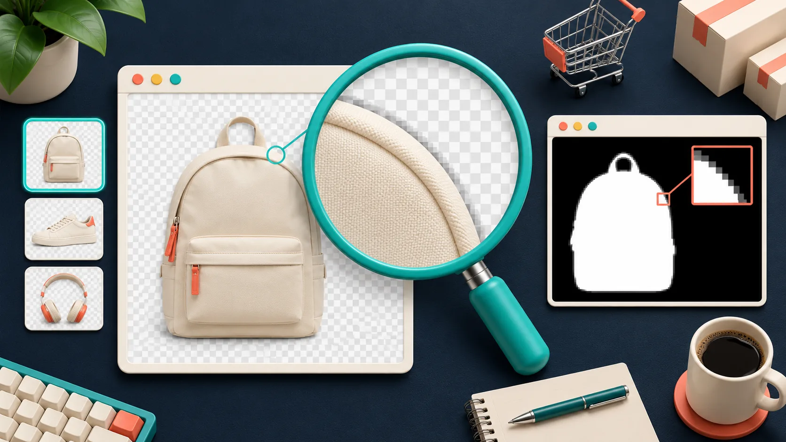

# A Transparent-Pixel QA Gate Before I Reuse Product Cutouts in Shopify

A product cutout can look finished on the designer’s checkerboard and still fail on a real Shopify product page. My practical answer is to inspect the alpha channel first, then view the same asset on both light and dark cards before it joins the catalog. [Tiny Online Tools’ Image Alpha Viewer](https://tiny-online.tools/image-tools/image-alpha-viewer) makes the first check quick: it renders the transparency as a grayscale mask in the browser, so opaque pixels, transparent background, and soft edge pixels are visible separately.

This is not a replacement for a good source file or a real storefront preview. It is a small release gate for the PNG or WebP cutout you already intend to reuse. It has saved me from treating “transparent” as a binary property when the actual question is whether the edge behaves on the backgrounds shoppers will see.



## The decision I am making

I use this gate when a product image has been removed from its background, retouched, exported from a design tool, or supplied by a vendor. The input is one candidate image; the output is either an approved derivative for Shopify or a note back to the person who owns the master. Keep that separation explicit: as in [my product-image handoff approach](https://the-lean-ecommerce.github.io/2026/11/26/a-shopify-product-image-handoff-that-keeps-the-master-intact/), the master remains the source of truth and the storefront file is a controlled derivative.

| What I see in the alpha mask | Meaning | Decision |
| --- | --- | --- |
| Solid white product, solid black background | Expected opaque product and empty background | Continue to storefront contrast check |
| Gray pixels only along naturally soft edges | Anti-aliasing or intentional soft material edge | Compare on light and dark cards |
| Gray haze well outside the object | Likely halo, leftover background, or feathering | Hold and request a cleaner cutout |
| Black holes inside a product that should be solid | Missing pixels or an unintended mask | Hold and fix before upload |

The viewer reports transparent-pixel count and percentage as well as a downloadable mask. Those numbers are not a universal pass/fail threshold—the percentage changes with product shape and canvas padding—but they are useful when a new export is unexpectedly different from its previous approved version.

## My three-step alpha check

### 1. Inspect the export, not the working file

Open the exact JPG, PNG, or WebP that will go into the product-media workflow in [Image Alpha Viewer](https://tiny-online.tools/image-tools/image-alpha-viewer). The tool runs locally in the browser and displays white as fully opaque, black as fully transparent, and intermediate gray as semi-transparent. That matters because a pristine layer inside a design file says very little about the exported artifact.

I check the silhouette at 100% zoom around handles, hair-like fibers, glass, seams, and any shadow that was meant to remain. I also look through open areas—a tote handle, sandal straps, a chair back—where accidental transparent holes are easy to miss in the original color image.

### 2. Test contrast before you call it reusable

An alpha mask tells me where the edge is; it does not tell me whether that edge looks intentional against a merchandising surface. I place the candidate on one pale and one dark product-card background. A pale fringe usually appears on the dark card; a dark fringe shows up on the light card. If either version makes the product look sticker-like, I do not try to hide it with Shopify theme CSS. I return the derivative for a corrected selection or a deliberate, consistent shadow treatment.


This contrast pass is especially helpful when the same item will serve as a collection tile, product-page media, and a promotional card. If you are planning a wider asset set, use the [product image role matrix](https://the-lean-ecommerce.github.io/2026/11/25/shopify-product-image-role-matrix-plan-ai-variants-before-you-generate/) before generating extra variants; it makes the background and crop requirements explicit per role.

### 3. Record the decision with the derivative

For a batch, I keep a tiny receipt beside the export folder:

```text
SKU: LUNA-TOTE-TEAL
source: luna-tote-v4.psd
derivative: luna-tote-shopify-v2.webp
alpha: clean silhouette; soft edge retained at handle
contrast: approved on #f7f3ed and #132532
next: upload + assign alt text
```

This is deliberately small. The point is to keep a future image refresh from silently replacing an approved cutout with a near-match. Before import, I run that file through the same URL and alt-text checks described in [this Shopify image import guide](https://how-to.the-lean-ecommerce.com/2026/11/27/how-to-check-shopify-image-urls-and-alt-text-before-import/).


## Where this gate stops

Alpha inspection will not tell you whether a product photo is honest, the crop is commercially useful, or the image matches the selected variant. It also cannot repair a rough extraction. Use it to find a transparency problem, then correct the master or regenerate a proper derivative. For 3D product media, the equivalent question is whether shoppers have a dependable fallback; I use a separate [3D media fallback check](https://how-to.the-lean-ecommerce.com/2026/11/26/how-to-set-a-3d-product-media-fallback-before-publishing/) for that release path.

## Make the gate part of the handoff

Tiny Online Tools is useful here because it keeps a narrow, privacy-friendly inspection task out of a heavyweight editor: open the exported asset, read the mask, make the decision, and move on. Start with one existing cutout that has bothered you on a dark collection card. Inspect its alpha channel, compare it on two backgrounds, and attach a four-line receipt to the approved derivative. That is enough process to prevent a surprising number of storefront-edge bugs.
